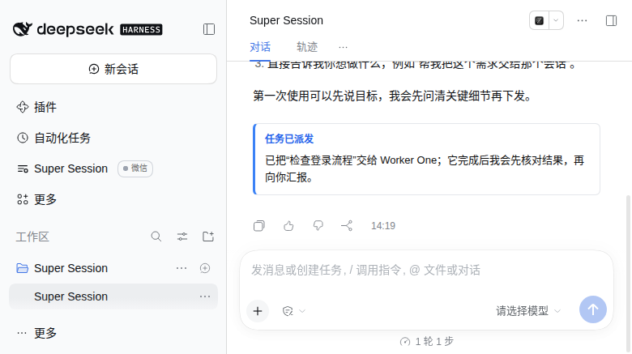
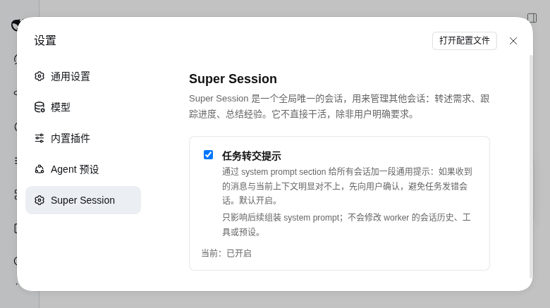

# dsh-super-session

一个 DSH Web 插件：全局只有一个 Super Session。它不直接承担实现工作，而是管理用户已有的顶层 Session：转述需求、跟踪进度、总结经验并分发。

Super 自己是一个普通的顶层 DSH Session，运行 PTC preset，带管理者 prompt 和 7 个 super_session_* 工具。worker 侧不需要安装任何东西，收到的就是普通用户消息；防误发提示由 agent 作用域的 system prompt section 提供，不修改消息内容。

## 当前状态

- Phase 0–16 已实现：单例、PTC 创建、任务、转述、读取、memory、重启恢复（含恢复上限可见性）、侧边栏入口、进程内微信和入口右侧的微信 chip、worker 审批可见性、新会话欢迎消息、系统 prompt 防误发提示与设置页开关、临时 worker 权限调整、微信长回复/复杂 Markdown 自动转 .md 文件，worker 结束 turn 后自动唤醒 Super，微信推送的暂停/恢复，以及暂停状态和手动开关的 UI，带 taskId 派发的 note 硬约束与可见的 turn-tail 派发卡片。
- 已验证环境：DSH 0.2.2-rc.1，Node 26，真实 Web profile 的隔离副本。
- 微信入站只接受文本；扫码登录需要在弹层里完成一次，之后 DSH 重启会自动复用凭据。

## 安装

在项目目录执行：

~~~bash
dsh plugin --profile web add file:/home/gkl/Desktop/vibe_proj/dsh-super-session
~~~

然后重启 dsh web，让 Host 和 client bundle 重新加载。

如果 pnpm 的全局 store 不在可写范围，可以进入 profile 目录手动安装：

~~~bash
cd ~/.dsh/profiles/web
pnpm add --ignore-scripts file:/home/gkl/Desktop/vibe_proj/dsh-super-session
~~~

开发时也可以不改 profile，直接用 patch 叠加：

~~~bash
DSH_HOME=$PWD/.verify-home dsh --profile supertest --patch ./cordis.patch.yml --port 3099 --host 127.0.0.1 --no-open
~~~

## 使用

左侧边栏出现 Super Session 入口。第一次点击会 ensure：创建唯一 Super，并把界面切到它；之后点击只是重新打开同一个 Session。

Super 的 cwd 固定在：

~~~text
DSH_HOME/state/super-session
~~~

DSH 的正常会话界面要求 Session 属于一个 Workspace。插件会为该目录创建一个标题为 Super Session 的专用 Workspace，并把 Super 挂进去。因此工作区列表里会多一个 Super Session，这是输入框可用的必要条件，不是可选的 UI 装饰。

Super 运行 PTC 模式：模型直接看到 run_code 和生成的 SDK，7 个 super_session_* 工具通过 SDK 调用。创建时固定 agentPreset=ptc；如果 ptc preset/runtime 不可用，会明确报错，不会退回 standard。

## 欢迎消息

新建 Super 后第一次打开，会看到一条 assistant 侧的欢迎消息：提示先选模型、设置权限（建议 danger-full-access + 审批策略），然后直接说想做什么。

- 只在 `created=true` 的新建路径追加一次；已存在或重启后的 Super 不会重复。
- 通过 Session.append 写入一个合成的完整 turn（turn 1/step 1：turn/start、step/start、assistant/message、step/end、turn/end），因此显示为正常的 assistant 消息，不占用户消息位，也不调用模型。DSH session-format 的 nextTurn 从 1 开始；早期 turn 0 能 append，但重启 resume 会报 corrupt。
- 欢迎消息失败只记 warn，不影响 Super 创建。
- 模型会看到这条消息；manager prompt 要求把它当作已经说过的话，不要重复。

## 微信

Super Session 入口标题右侧有一个“微信”chip。点开后可以扫码登录微信「文件传输助手」网页版、查看连接状态和退出登录。

- 微信客户端运行在 DSH 进程内，不启动 bridge 进程，不占端口。
- 凭据和去重/待发状态在 `DSH_HOME/state/super-session/wechat/`，文件权限 0600。
- 微信发来的文本原样作为普通用户消息进入 Super，不加前缀，也不直接进 worker。
- Super 的每条 assistant 文本回复都会同步回微信；暂停推送时除外。
- 入站只处理文本；图片和文件仍建议直接在 Super Session 界面发送。
- 出站长回复或复杂 Markdown 时，默认改发完整的 .md 文件；短消息和简单文本保持原样。
- DSH 重启后如有 creds 会自动重连；待发文本超过 10 条时只补发最后 10 条，并先提示跳过了多少条。
- chip 只在宽侧边栏显示；折叠侧边栏不插入。

### 暂停推送

暂停只关闭“Super -> 微信”的出站推送：连接、登录态、长轮询和心跳保持，微信入站照常投递给 Super。状态存在 `wechat/state.json`，DSH 重启后保持。

- 面板：已登录时 chip 弹层里有一张推送状态卡。正常显示“推送中”；暂停显示“已暂停推送”、来源（“手动”或“自动（非微信通道消息）”）和暂停时间，旁边是“暂停推送 / 恢复推送”按钮。点击后立即用 POST 的返回值刷新，不等下一次轮询。
- 自动暂停提示：弹层轮询或侧边栏轮询发现 paused 从 false 变为 true 且 pausedBy=channel 时，显示一条 8 秒自动消失的轻提示“已自动暂停推送：检测到非微信通道消息”，不弹窗、不打断输入。chip 圆点同时变橙色。
- 手动：`POST /plugins/dsh-super-session/api/wechat/pause`，body 为 `{"paused":true}` 或 `{"paused":false}`，可选 `reason`；`paused` 不是布尔值返回 400。
- 查询：`GET /wechat/status` 返回 `paused`、`pausedBy`、`pauseReason`、`pausedAt`、`resumedAt`、`resumedBy`。
- 自动：Web/手机等非微信用户消息进入 Super 时自动暂停（`pausedBy=channel`）；微信入站自动恢复，包括恢复手动暂停。
- 合成消息（`host_` 开头的启动恢复、启动失败、worker idle 唤醒）和官方 schedule 提醒不触发切换。
- 手动暂停优先：非微信消息的自动暂停不会覆盖 `pausedBy=manual`；手动恢复后，下一条非微信消息会再次暂停，这是预期行为。
- 正在发送的那一条会发完；还没开始发送的排队文本/文件丢弃。暂停期间不写 outbox，恢复后按重连积压策略补发。
- 丢弃会记 warn 日志：`dropped outbound while paused: {"at":...,"superSessionId":...,"to":"filehelper","kind":"assistant|system|text|file","pausedBy":...,"reason":...}`，文本带 chars/preview，文件带 name/bytes。暂停和恢复各有一条 `pause:` / `resume:` info/warn 日志。

### 长回复转 .md 文件

每条 assistant 文本回复都会先过规则；命中任意一项就发 .md 文件，否则直接发文本：

| 命中条件 | 默认值 |
|---|---|
| 字符数 | 超过 800 |
| 代码块 | 有围栏代码块（三个反引号或三个波浪线） |
| 表格 | 有 Markdown 表格 |
| 标题 | 4 个及以上 Markdown 标题 |
| 链接 | 6 个及以上 Markdown 链接 |

文件名形如 `super-<会话短 id>-YYYYMMDD-HHmmss.md`，内容是完整回复，不截断。命中后先发一条短提示“（内容较长，已转为 Markdown 文件发送）”，再发文件，不重复正文；上传或发送文件失败时，回退为文本，并在正文前加“（原回复已转为 Markdown 文件，但文件发送失败，以下改为文本）”。

配置写在 profile 的 `cordis.yml` 里，覆盖插件行：

~~~yaml
- id: super-session
  config:
    markdownFile:
      enabled: true
      charThreshold: 800
      codeBlock: true
      table: true
      headingCount: 4
      linkCount: 6
~~~

也可以直接写 `markdownFile: false` 关闭整套规则。环境变量优先级高于 profile 配置：`DSH_SUPER_SESSION_MD_FILE`、`DSH_SUPER_SESSION_MD_THRESHOLD`、`DSH_SUPER_SESSION_MD_CODE`、`DSH_SUPER_SESSION_MD_TABLE`、`DSH_SUPER_SESSION_MD_HEADINGS`、`DSH_SUPER_SESSION_MD_LINKS`。阈值会被限制在安全范围（80–100000 字符）。

## 工具

| 工具 | 作用 |
|---|---|
| super_session_task | 建/改任务。字段：goal、acceptance、executor（self 或一个顶层 worker sessionId）、status（open/working/blocked/done/cancelled）、blockedReason。一个任务只有一个 executor。每次更新都会把 recoveryCount 归零。 |
| super_session_status | 查看任务和可管理的顶层 Session。可带 scope=tasks、scope=sessions 或 scope=recent。scope=sessions 带 title、cwd、updatedAt、lastUsedAt；scope=recent 返回最近 7 天成功派发过的最多 5 个顶层 worker，按 lastUsedAt 倒序，带 sessionId、title、cwd、lastUsedAt、lastTaskGoal、lastTaskStatus。不会 resume 冷会话。 |
| super_session_request | 把消息发给一个或多个 worker。mode=queue 或 steer；content 支持 text/image/file；带 taskId 时 executor 必须匹配，且必须传 note（一句话，最多 500 字）。Host 把 note 记录到 super.json，由插件 client 在 Super 会话当前轮次末尾显示成可见卡片，不进入模型上下文；缺 note、空白或超长会直接报错且不投递。Host 不加消息前缀；防误发提示由 agent system prompt section 提供。 |
| super_session_read | 读某个 Session 的近期消息。live 用 snapshotEvents，冷会话用持久化 events，不 resume。 |
| super_session_approval | 列出正在等待审批的 worker（仅限有 active task 的 executor）。只读：不批准、不拒绝、不替 UI answerer 作答。 |
| super_session_grant | 临时调整一个 worker 的 sandbox mode 和/或 approval policy。action=set/list/reset；set 必须带 userConfirmed=true，并记录原值、到期时间、审计，任务结束或 reset 时恢复。 |
| super_session_memory | read/remember/forget。写 stateDir/memory.md，0600，上限 4096 字节。 |

### 近期 worker 与默认选择

用户派任务但没有指定 worker 时，manager prompt 要求 Super 只从“近期用过”的顶层 worker 里选，不遍历全部会话，也不凭空挑一个没用过的。规则由 Host 的字段支撑，不把完整会话列表塞进 prompt。

- **近期用过的定义**：Host 成功接受过一次 super_session_request 的顶层 worker。带 taskId 的任务派发和不带 taskId 的 quick relay 都算；只创建或更新 task 不算。
- 时间窗口 7 天，最多返回 5 个，按 lastUsedAt 倒序。记录保存在 super.json 的 recentWorkers，只保留最近 30 天，避免无限增长。
- super_session_status 的 scope=recent 返回 sessionId、title、cwd、lastUsedAt、lastTaskId、lastTaskGoal、lastTaskStatus，以及 running/blank；缺失字段直接省略，保证输出是 lossless JSON。
- scope=sessions 也带 title 和 lastUsedAt，方便用户明确点名某个会话时核对；但默认挑选只要求看 scope=recent。
- 近期列表为空、没有一个明显合适、或 Super 自己判断不清时，先问用户选哪个会话，不猜，也不退回“遍历全部会话”。
- title 来自 DSH 的 title projection；没有标题、没有 cwd 或不是近期用过的 worker，对应字段不输出。

### 审批可见性

- 插件在根上下文监听 `approval/request`，只记录有 open/working task 的 executor 的待审批请求：worker session、task、工具、callId、原因、时间。
- 记录后立即调用 `next()`，把决定权交回原有 UI answerer；插件从不改变审批结果。
- `super_session_approval` 只返回当前 pending 列表。pending 在审批结束、AbortSignal 取消、15 分钟超时或 DSH 重启后清除。
- 不做自动唤醒或推送：用户问进度、或 Super 主动检查时，才用这个工具查。
- 用户要批准/拒绝时，仍需打开对应 worker 会话操作；Super 只能转告是哪个 worker、哪个工具、什么原因。

### 临时 worker 权限（阶段二）

当用户明确要求“临时放开某个 worker”时，Super 才调用 `super_session_grant`。它不是自动提权，也不会因为 worker 被审批卡住就自行放宽。

- `set` 必须由用户明确指令触发，且传 `userConfirmed=true`；Host 不提供任何自动 set 路径。
- 只作用在一个顶层 worker 上，至少指定 `sandboxMode` 或 `approvalPolicy`，可以关联一个未关闭的 task。
- 支持 `sandboxMode=read-only|workspace-write|danger-full-access` 和 `approvalPolicy=ask|never`。`never` 是自动拒绝需要审批的操作，不是自动允许。
- 默认 30 分钟过期，可设 60 秒到 24 小时；同一 worker 同时只保留一个 grant。
- Host 记录生效值和 override 原值，写入 `super.json` 和 `audit.jsonl`；在 task done/cancelled、显式 reset、到期或 DSH 下次启动时恢复。
- 恢复是保守的：如果用户期间手工改过该字段，当前值已不等于 grant 写入的值，就跳过该字段并在结果里报告，不覆盖用户的新选择。
- 恢复失败会标记 `restore_failed`，60 秒后重试；审计里能看到失败原因。
- 不改 worker 的 tools、prompt 或 preset。

Super 的系统 prompt 要求：需求不明确时先和用户澄清，再下发；不要凭猜测开工；任务要有验收标准；进度按需查询；经验按 case 集总结（需求、错误做法、正确做法），默认只在对话里输出，用户指定路径时才写文件；重启后先 read 再决定是否继续；收到 `[Worker idle]` 时先 read，确认完成才关任务，等用户输入就标 blocked；不要重复新建会话的欢迎消息；防误发提示由 agent system prompt section 提供，任务消息本身不加前缀；带 taskId 派发必须提供 note（一两句话：派给谁、做什么、用户接下来看到什么），Host 会把它显示成 Super 会话当前轮次末尾的卡片；缺 note 或空白会直接报错、不投递，也不会结束本轮；成功派发后立即结束本轮，不再 sleep/poll；只有用户明确要求时才使用 super_session_grant，绝不自行放宽 worker 权限；用户没指定 worker 时只从 scope=recent 的近期 worker 里挑，近期没有合适的就先问用户，不遍历全部会话、不凭空挑。

## 任务与转述

- task 是管理记录，不是 DSH 内置对象；保存在 super.json。
- request 是真正的 Session 消息。发送前先写 pending delivery，prompt 被接受后删除；失败保留，重启或下次 ensure 时按原 requestId 重试。
- request 的 worker 侧来源是普通的 user 消息，不伪装成系统消息，也不改 worker 的 tools。
- 带 taskId 的任务派发，消息内容原样发送，不加任何前缀。防误发提示由 Host 注册在每个 agent 上的 system prompt section 提供：本会话空闲、刚建立或消息相关时正常执行；只有在做另一件明显不同的事或完全对不上时，才先向用户确认、不直接执行。
- 带 taskId 派发必须提供 `note`，最多 500 字。Host 在投递成功后把 note 写入 `super.json`（最多保留 100 条），插件 client 通过 `GET /plugins/dsh-super-session/api/dispatch-notes?sessionId=...&turn=...` 读取，并在 `conversation.chat.turnTail` slot 渲染成当前轮次末尾的卡片。
- 卡片不属于 turn process，不会被完成后的流程折叠隐藏；它不进入模型上下文，也不依赖 session log；重启后仍能从 super.json 读到。
- note 缺失、纯空白或超过 500 字时，工具直接报错，消息不投递、不 concludeTurn。展示 note 失败只记 warn，不阻断已经成功的派发。
- quick relay（不带 taskId）不需要 note；如果提供了 note，会显示一条“消息已转交”卡片（同样受 500 字限制），否则不产生卡片。它的消息仍然原样转发。
- 早期实现用 `command/run` + `command/done`，但 DSH 把 turn 内 command 节点当作 process member，turn 完成后默认折叠，真实 UI 看不到。现已移除该路径。
- 该 section 是静态通用文本，对所有 agent 生效，内容不针对具体消息，因此对普通会话无害；它不修改 worker 的消息历史、tools 或 preset。设置页可以关闭它，关闭后 section 文本为空，DSH 会直接丢弃空 section。
- 带 taskId 的 task 派发和不带 taskId 的 quick relay 都保持原文，不加提示；quick relay 适合“原话转发”和短消息。
- worker 的 turn 结束时 Host 会自动通知 Super（见下节）；其余进度不轮询、不自动推送，Super 需要时调 status/read。
- Super 需要定时唤醒时，使用 DSH 官方 schedule_create；插件不实现调度循环。

### 派发 note 卡片

## 任务转交提示与设置页

防误发提示不是消息前缀，而是插件为每个 agent 注册的 system prompt section（name 为 dsh-super-session:dispatch-guard，order 4100）。

- 插件启动时给已有 agent 安装，并监听 agent/created 给新 agent 安装；agent/disposed 和插件卸载时 dispose，避免重载时同名 section 冲突。
- section 文本是固定的通用提示，不按 task 或具体消息变化；关闭开关后 text 返回空字符串，DSH 的 renderPrompt 会丢弃空 section。
- 开关在“设置 > Super Session”，默认打开；状态保存在 super.json 的 settings.dispatchGuard。
- 开关只影响后续 system prompt 的组装，不改 worker 已经收到的历史消息、tools 或 preset；也不会替模型做硬拦截。

## 重启恢复

Host 启动后延迟 1.5 秒：

- 没有 active task：只重试 pending delivery，不创建 Super。
- 有 open/working task：先重试 pending delivery，再给 Super 发恢复消息，列出 taskId、executor、goal、acceptance。
- 同一 task 连续自动恢复最多 3 次。达到上限后，Host 会把任务标成 `blocked`，写入 `blockedReason`（自动恢复已达上限），并在同一条消息里列出 taskId、executor、goal，要求用户手动处理；不会静默跳过。
- `recoveryCount` 在 task 被 `super_session_task` 更新或成功派发时归零。因此它统计的是连续无人处理的重启次数；如果 Super 或用户中途接手，额度会重置。
- startup recovery 本身抛错时，也会向 Super 发送失败通知（错误内容和“需要手动处理”），不只写日志。

## Worker 完成自动唤醒

默认开启。Host 监听 DSH 的 `agent/status` 事件；当某个正在执行的 worker 变回 `idle`，并且它是至少一个 `working` task 的 executor 时，给 Super 发一条普通队列消息。Super 不用轮询，也不会错过 worker 的结束点。

- 只读事件：不读 worker 的 transcript，不改 worker 的 prompt/tools，不往 worker 会话写消息，也不 resume 冷 worker。唯一的动作是唤醒 Super。
- 排除 Super 自己，避免自我唤醒循环。
- 只匹配 `status=working` 且 `executor` 等于该 worker 的 task；`open`、`done`、`cancelled`、`blocked` 都不触发。
- 同一 worker + 同一 task 在 30 秒内只通知一次；多个 task 分别计时。
- 通知措辞只写“worker X 的 turn 已结束”，并明确要求 Super 用 `super_session_read` 确认，不假设任务完成。
- `idle` 本身无法区分离线、完成和等待用户输入。Super read 后如果看到 worker 正在向用户提问，应把 task 标成 `blocked` 并报告；如果 worker 在等审批，通常仍是 `running`，不会产生 idle 通知。
- 通知投递失败只记 warn，不重试；worker 侧状态不受影响。

关闭或调整：

~~~yaml
- id: super-session
  config:
    notifyOnWorkerIdle: false
    workerIdleThrottleMs: 30000
~~~

环境变量优先级更高：`DSH_SUPER_SESSION_WORKER_IDLE=0` 一键关闭，`DSH_SUPER_SESSION_WORKER_IDLE_THROTTLE_MS` 调整节流窗口（1 秒–10 分钟）。

日志前缀是 `dsh-super-session: worker-idle:`。`info` 记录已通知、节流跳过和关闭状态，`debug` 记录“无 working task”等其他跳过原因。

## 状态文件

~~~text
DSH_HOME/state/super-session/
  super.json      # superSessionId、superPreset、tasks、pending deliveries、grants、settings、dispatchNotes
  memory.md       # 用户偏好和长期记忆
  audit.jsonl     # 临时权限审计，0600
  wechat/creds.json  # 微信登录凭据，0600
  wechat/state.json  # 已处理消息 id、outbox、暂停状态与时间
~~~

不保存聊天 transcript。Super 的原始 Session 日志仍由 DSH 写在 DSH_HOME/sessions 下。

## HTTP API

前缀：/plugins/dsh-super-session/api

- POST /ensure：创建或打开唯一 Super。
- GET /state：superSessionId、tasks、pendingDeliveries、grants、settings、workerIdleNotifications（enabled/throttleMs）。
- GET/POST /settings：读取或设置 {dispatchGuard:boolean}；POST 的值不是布尔返回 400。
- GET /dispatch-notes?sessionId&turn：读取 Super 的派发 note；sessionId 必须是当前 Super，turn 可选且必须是非负整数；返回 {notes}。
- GET /health：健康检查。
- GET /wechat/status：微信登录和连接状态，含 paused/pausedBy/pauseReason/pausedAt/resumedAt/resumedBy。
- POST /wechat/login：获取登录二维码。
- POST /wechat/logout：退出微信登录。
- POST /wechat/start：用已有凭据重连。
- POST /wechat/pause：手动暂停或恢复推送，body {paused, reason?}。

所有请求校验 DSH 同源；没有额外的 loopback 端口。

## 测试

~~~bash
npm test
~~~

smoke 使用 mock ctx 覆盖 ensure、Workspace 挂载、7 个工具、request、task 派发与 quick relay 都不加前缀、dispatch guard section 安装到 worker 和 Super、GET/POST /settings 与 GET /state 的 settings、status、read、memory、持久化、grant 的 set/list/reset 与 task 关闭恢复，以及欢迎消息的五事件序列和第二次 ensure 不重复；近期 worker 覆盖空列表、task 派发后候选的 title/cwd/lastUsedAt/lastTaskGoal/lastTaskStatus、quick relay 只更新时间、失败请求不更新、scope=sessions 字段、super.json 持久化和 lossless；dispatch-guard 测试覆盖 installAll、agent/created 与 disposed、重复安装、开关关闭时 text 为空、注册失败只 warn 和 shutdown；wechat 测试覆盖 assistant 文本提取、入口事件过滤、微信入站去重/回显过滤、失败标记、reconnect skip 和状态视图；wechat-file 测试覆盖阈值/代码块/表格/标题/链接判定、配置/env 覆盖、文件名、短消息不变、长消息发 .md、失败回退文本，以及上传 multipart 和 appmsg 的字段/签名/去重；approvals 测试覆盖只记录活跃 executor、始终 next()、abort/超时/shutdown 清理和 lossless 输出；grants 测试覆盖过期、startup、task 缺失/关闭、漂移跳过、恢复失败和审计；startup 测试覆盖达到恢复上限后的通知与 blocked 状态、更新/成功派发清零、以及启动异常通知；worker-idle 测试覆盖正常触发、排除 Super、非 working task/running 状态不触发、按 task 节流、开关关闭，以及提示文本要求 read/不假设完成/等用户输入时标 blocked；wechat-pause 测试覆盖手动开关与持久化、非微信消息自动暂停、微信入站自动恢复、host_/schedule 合成消息不触发、manual 优先级、暂停时不出站且丢日志、排队丢弃而在途完成、重启保持，以及恢复后补发 outbox；smoke 还验证 pause/unpause 往返后 pausedAt、resumedAt、pausedBy 和重复读取 status 的字段一致；以及 dispatch-notes 按 session/turn 过滤、错误 session 返回空列表、note 持久化、无 note 的 quick relay 不记录、snapshot 读取失败不影响派发和 concludeTurn。

## 限制

- 微信协议依赖「文件传输助手」网页版；入站只有文本，出站文件也只发 .md。
- 暂停推送的界面入口只在 chip 弹层里；设置页“Super Session”不重复放同一个开关，避免两个控制点。
- 暂停不能撤回已经在发送中的消息；只能保证之后排队的消息不发出。
- 暂停期间的连接保持和真实收发没有用真实微信账号验证，只做了单元测试和 HTTP smoke。
- 微信文件上传/发送链路按网页版协议实现并用 mock 覆盖，尚未用真实微信账号完成一次 .md 文件收发验证。
- 扫码登录和消息收发仍需要真实微信账号验证。
- 审批可见性只报告 pending，不代批、不自动唤醒 Super；临时权限需要用户明确指令，Super 不能自行判断后提权。
- worker 自动唤醒只看 `agent/status` 的 `idle`，不区分“完成”“失败”“等用户输入”；提示措辞不假设完成，需要 Super 再 read。
- 不做 needs_input/failed 的独立事件级唤醒；需要时用官方 schedule 或用户回来问。
- worker-idle 通知没有在真实 worker 会话里触发过，只用 mock 事件验证。
- 不做多实例防双开。
- 澄清门禁是 prompt 行为，不是 Host 强制状态机。
- Super 依赖 PTC preset；standard 模式不会作为后备。
- 额外创建一个 Super Session Workspace 是当前 DSH UI 的硬要求。
- 欢迎消息使用合成的 turn 1/step 1 才能显示为 assistant 气泡；DSH session-format 的 nextTurn 从 1 开始，早期 turn 0 会导致重启 resume 报 corrupt。UI 会把它计为“1 轮 1 步”并显示“已完成”。
- 防误发提示是 agent system prompt 的行为约束，不是硬拦截；worker 仍可能直接执行明显无关的消息。设置页只开关该 section，不能保证模型遵守。
- note 卡片已在隔离 DSH 的真实 Web UI 中验证渲染：`[data-super-session-dispatch-note="task"]` 出现在欢迎消息下方，标题“任务已派发”。该截图用手工写入 super.json 的 note 验证 UI；真实 `super_session_request` 写入路径由 smoke 覆盖。截图：`docs/ui-dispatch-note.png`。
- note 只保留最近 100 条；更早的卡片不会再显示。
- note 缺失/空白/超长是 Host 硬报错；note 展示失败只记 warn，不阻断已经成功的派发。
- 临时权限只在单元测试和 smoke 中验证过，还没有在真实 worker 会话里触发；首次使用时需要确认 DSH 的 sandbox/approval 事件投影和恢复行为。
- “近期 worker”只记录 Super 成功派发过的会话；用户手工在其他会话里做的使用不会计入。挑选本身是 prompt 行为约束，不是 Host 强制，模型仍可能违背；尚未用真实模型验证。
- DSH 的 sandbox override 无法清除；恢复会写回原 effective mode，因此可能留下一个同值 override。

## 安全

- memory.md 和微信 creds/state 权限 0600；memory.md 禁止写凭据/token。
- 微信凭据只在本地 stateDir；没有额外的 loopback API，UI API 校验 DSH 同源。
- 不自动上传、不遥测。
- Super 可以读 Session、发消息、建任务；这些能力只在用户明确要求时使用。
- `approval/request` 监听器只读：记录 pending 后调用 next()，从不返回审批结果。
- `agent/status` 监听器只读 worker 的 id 和状态，只向 Super 发通知；不 resume、不写 worker。
- 临时权限只写当前 session 的 sandbox/mode 和 approval policy 投影，不改全局默认，也不改 worker 的 tools/prompt/preset；所有变更写入 audit.jsonl 0600。
- 删除 Super 不会自动删除 task、memory 和 Workspace；需要时手动清理。
