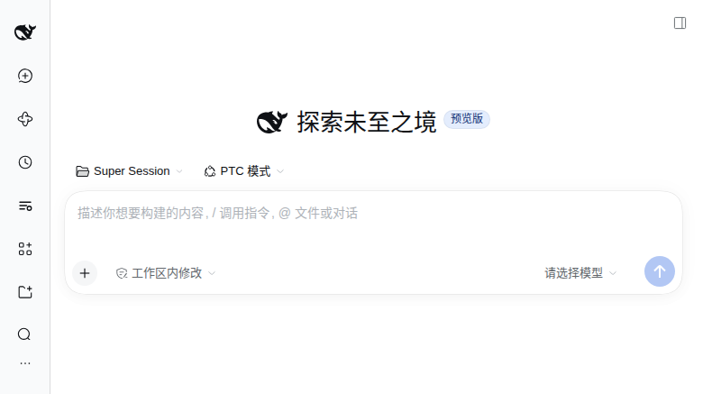
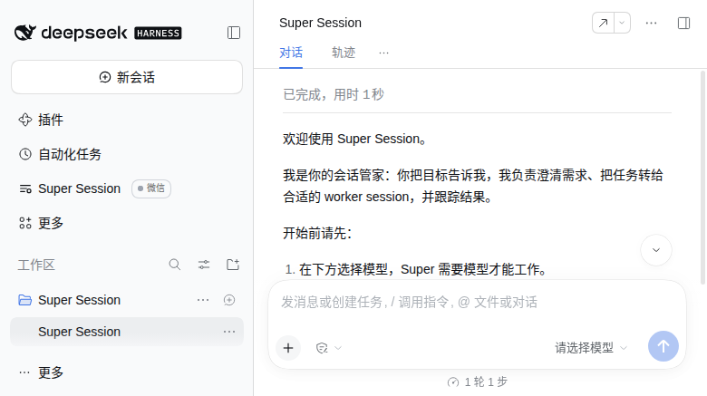
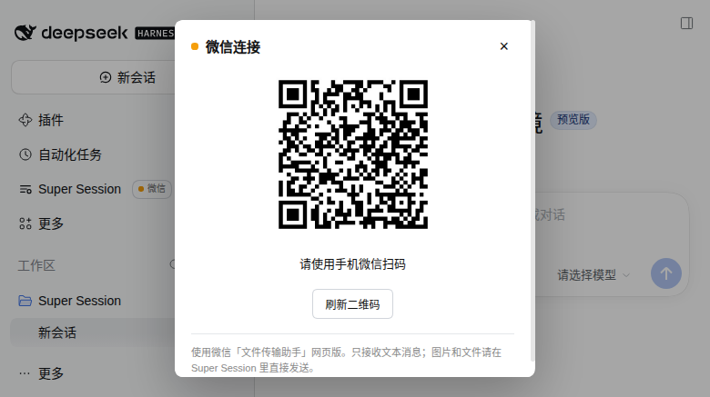

# dsh-super-session

一个 DSH Web 插件：全局只有一个 Super Session。它不直接承担实现工作，而是管理用户已有的顶层 Session：转述需求、跟踪进度、总结经验并分发。

Super 自己是一个普通的顶层 DSH Session，运行 PTC preset，带管理者 prompt 和 6 个 super_session_* 工具。worker 侧不需要安装任何东西，收到的就是普通用户消息。

## 当前状态

- Phase 0–6 已实现：单例、PTC 创建、任务、转述、读取、memory、重启恢复、侧边栏入口、进程内微信和入口右侧的微信 chip、worker 审批可见性，以及新会话欢迎消息。
- 已验证环境：DSH 0.2.2-rc.1，Node 26，真实 Web profile 的隔离副本。
- 微信只支持文本；扫码登录需要在弹层里完成一次，之后 DSH 重启会自动复用凭据。

## 安装

在项目目录执行：

~~~bash
dsh plugin --profile web add file:/home/gkl/Desktop/vibe_proj/dsh-super-session
~~~

然后重启 dsh web，让 Host 和 client bundle 重新加载。

如果 pnpm 的全局 store 不在可写范围，可以进入 profile 目录手动安装：

~~~bash
cd ~/.dsh/profiles/web
pnpm add --ignore-scripts file:/home/gkl/Desktop/vibe_proj/dsh-super-session
~~~

开发时也可以不改 profile，直接用 patch 叠加：

~~~bash
DSH_HOME=$PWD/.verify-home dsh --profile supertest --patch ./cordis.patch.yml --port 3099 --host 127.0.0.1 --no-open
~~~

## 使用

左侧边栏出现 Super Session 入口。第一次点击会 ensure：创建唯一 Super，并把界面切到它；之后点击只是重新打开同一个 Session。

Super 的 cwd 固定在：

~~~text
DSH_HOME/state/super-session
~~~

DSH 的正常会话界面要求 Session 属于一个 Workspace。插件会为该目录创建一个标题为 Super Session 的专用 Workspace，并把 Super 挂进去。因此工作区列表里会多一个 Super Session，这是输入框可用的必要条件，不是可选的 UI 装饰。

Super 运行 PTC 模式：模型直接看到 run_code 和生成的 SDK，6 个 super_session_* 工具通过 SDK 调用。创建时固定 agentPreset=ptc；如果 ptc preset/runtime 不可用，会明确报错，不会退回 standard。

## 欢迎消息

新建 Super 后第一次打开，会看到一条 assistant 侧的欢迎消息：提示先选模型、设置权限（建议 danger-full-access + 审批策略），然后直接说想做什么。

- 只在 `created=true` 的新建路径追加一次；已存在或重启后的 Super 不会重复。
- 通过 Session.append 写入一个合成的完整 turn（turn/start、step/start、assistant/message、step/end、turn/end），因此显示为正常的 assistant 消息，不占用户消息位，也不调用模型。
- 欢迎消息失败只记 warn，不影响 Super 创建。
- 模型会看到这条消息；manager prompt 要求把它当作已经说过的话，不要重复。

## 微信

Super Session 入口标题右侧有一个“微信”chip。点开后可以扫码登录微信「文件传输助手」网页版、查看连接状态和退出登录。

- 微信客户端运行在 DSH 进程内，不启动 bridge 进程，不占端口。
- 凭据和去重/待发状态在 `DSH_HOME/state/super-session/wechat/`，文件权限 0600。
- 微信发来的文本原样作为普通用户消息进入 Super，不加前缀，也不直接进 worker。
- Super 的每条 assistant 文本回复都会同步回微信。
- 只处理文本；图片和文件仍建议直接在 Super Session 界面发送。
- DSH 重启后如有 creds 会自动重连；待发文本超过 10 条时只补发最后 10 条，并先提示跳过了多少条。
- chip 只在宽侧边栏显示；折叠侧边栏不插入。

## 工具

| 工具 | 作用 |
|---|---|
| super_session_task | 建/改任务。字段：goal、acceptance、executor（self 或一个顶层 worker sessionId）、status（open/working/blocked/done/cancelled）。一个任务只有一个 executor。 |
| super_session_status | 查看任务和可管理的顶层 Session。可带 scope=tasks 或 scope=sessions。不会 resume 冷会话。 |
| super_session_request | 把消息发给一个或多个 worker。mode=queue 或 steer；content 支持 text/image/file；带 taskId 时 executor 必须匹配。 |
| super_session_read | 读某个 Session 的近期消息。live 用 snapshotEvents，冷会话用持久化 events，不 resume。 |
| super_session_approval | 列出正在等待审批的 worker（仅限有 active task 的 executor）。只读：不批准、不拒绝、不替 UI answerer 作答。 |
| super_session_memory | read/remember/forget。写 stateDir/memory.md，0600，上限 4096 字节。 |

### 审批可见性

- 插件在根上下文监听 `approval/request`，只记录有 open/working task 的 executor 的待审批请求：worker session、task、工具、callId、原因、时间。
- 记录后立即调用 `next()`，把决定权交回原有 UI answerer；插件从不改变审批结果。
- `super_session_approval` 只返回当前 pending 列表。pending 在审批结束、AbortSignal 取消、15 分钟超时或 DSH 重启后清除。
- 不做自动唤醒或推送：用户问进度、或 Super 主动检查时，才用这个工具查。
- 用户要批准/拒绝时，仍需打开对应 worker 会话操作；Super 只能转告是哪个 worker、哪个工具、什么原因。

Super 的系统 prompt 要求：需求不明确时先和用户澄清，再下发；不要凭猜测开工；任务要有验收标准；进度按需查询；经验按 case 集总结（需求、错误做法、正确做法），默认只在对话里输出，用户指定路径时才写文件；重启后先 read 再决定是否继续；不要重复新建会话的欢迎消息。

## 任务与转述

- task 是管理记录，不是 DSH 内置对象；保存在 super.json。
- request 是真正的 Session 消息。发送前先写 pending delivery，prompt 被接受后删除；失败保留，重启或下次 ensure 时按原 requestId 重试。
- request 的 worker 侧来源是普通的 user 消息，不伪装成系统消息，也不改 worker 的 tools。
- 进度默认不自动推送；Super 需要时调 status/read，或用户让它查看。
- Super 需要定时唤醒时，使用 DSH 官方 schedule_create；插件不实现调度循环。

## 重启恢复

Host 启动后延迟 1.5 秒：

- 没有 active task：只重试 pending delivery，不创建 Super。
- 有 open/working task：ensure Super，重试 pending delivery，并给 Super 发一条恢复消息，列出 taskId、executor、goal、acceptance。
- 同一 task 自动恢复最多 3 次。

## 状态文件

~~~text
DSH_HOME/state/super-session/
  super.json      # superSessionId、superPreset、tasks、pending deliveries
  memory.md       # 用户偏好和长期记忆
  wechat/creds.json  # 微信登录凭据，0600
  wechat/state.json  # 已处理的微信消息 id、待发文本
~~~

不保存聊天 transcript。Super 的原始 Session 日志仍由 DSH 写在 DSH_HOME/sessions 下。

## HTTP API

前缀：/plugins/dsh-super-session/api

- POST /ensure：创建或打开唯一 Super。
- GET /state：superSessionId、tasks、pendingDeliveries。
- GET /health：健康检查。
- GET /wechat/status：微信登录和连接状态。
- POST /wechat/login：获取登录二维码。
- POST /wechat/logout：退出微信登录。
- POST /wechat/start：用已有凭据重连。

所有请求校验 DSH 同源；没有额外的 loopback 端口。

## 测试

~~~bash
npm test
~~~

smoke 使用 mock ctx 覆盖 ensure、Workspace 挂载、6 个工具、request、status、read、memory、持久化，以及欢迎消息的五事件序列和第二次 ensure 不重复；wechat 测试覆盖 assistant 文本提取、入口事件过滤、微信入站去重/回显过滤、失败标记、reconnect skip 和状态视图；approvals 测试覆盖只记录活跃 executor、始终 next()、abort/超时/shutdown 清理和 lossless 输出。

## 限制

- 微信协议依赖「文件传输助手」网页版，只有文本；扫码登录和消息收发需要真实微信账号验证。
- 审批目前只做可见性，不代批、不自动唤醒 Super；阶段二的临时 worker 权限调整尚未实现。
- 不做 needs_input/failed 的即时自动唤醒；需要时用官方 schedule 或用户回来问。
- 不做多实例防双开。
- 澄清门禁是 prompt 行为，不是 Host 强制状态机。
- Super 依赖 PTC preset；standard 模式不会作为后备。
- 额外创建一个 Super Session Workspace 是当前 DSH UI 的硬要求。
- 欢迎消息使用合成的 turn 0 才能显示为 assistant 气泡，因此 UI 会把它计为“1 轮 1 步”并显示“已完成”。

## 安全

- memory.md 和微信 creds/state 权限 0600；memory.md 禁止写凭据/token。
- 微信凭据只在本地 stateDir；没有额外的 loopback API，UI API 校验 DSH 同源。
- 不自动上传、不遥测。
- Super 可以读 Session、发消息、建任务；这些能力只在用户明确要求时使用。
- `approval/request` 监听器只读：记录 pending 后调用 next()，从不返回审批结果。
- 删除 Super 不会自动删除 task、memory 和 Workspace；需要时手动清理。