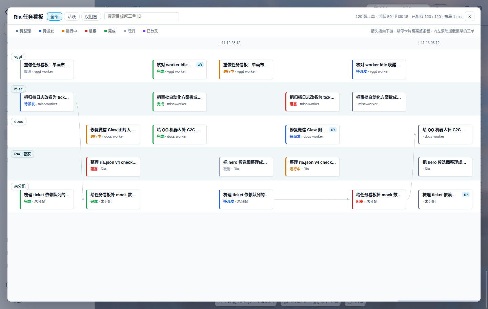

# 任务看板预览

看板是只读的全屏浮层，不写工单、不派发消息。截图 1440×857，使用 mock 的 120 张工单驱动真实 DSH Web shell 与工作区里的 `lib/client.js`，覆盖 5 条项目带（vggt / misc / docs / Ria · 管家 / 未分配）、跨带依赖链、清单进度和各种状态；不是本机 ria.json 的实时投影。

## 布局

- 单画布：横轴按 `createdAt` 排序，每 3 张卡一列；有依赖的列整体右移。
- 纵轴按 worker 所属 workspace 分成水平项目带；`self` 与 Ria 归入「Ria · 管家」，找不到会话的 worker 进「未分配」，未分配永远在最后。带底色交替，带之间用 1px 分隔线。
- 每条带顶部留出标签条：项目名在带内左上角，横向滚动时用 `position: sticky` 固定在左侧；名称取 workspace 标题，没有标题时取 cwd 末段。标签条与卡片分层，标签不会压在卡片上。
- 带高按该带实际行数自适应，卡片只在所属带内换行，上游行中位数对齐也只在同带内生效，卡片不会跨带；跨带依赖只画箭头、不搬卡片。
- 卡片 160×58：第一行是去掉空白与首句、最多 22 字的 goal 摘要，第二行是「状态 · 执行者」，右上角是清单进度（如 3/7），不再显示工单短 id。
- 依赖用 cubic SVG 箭头从上游指向下游，允许跨带；悬停卡片时整条上下游链高亮，其余卡片与边淡出，并弹出完整信息浮层（goal、状态/waitingOn、执行者与 sessionId、创建/关闭时间与历时、依赖/被依赖数、清单进度、排队原因）。
- 顶部有搜索框和全部/活跃/仅阻塞筛选；图例可高亮状态。默认加载最新 60 张并停在最右；向左滚到距左缘 180px 时自动按 `before` 加载更早的 60 张，加载后保持视口位置。

## 数据与复现

端点：

~~~bash
curl -s "http://127.0.0.1:3080/plugins/dsh-ria/api/board?limit=60"
~~~

返回 `counts`、`page:{limit,before,returned,total,hasMore,nextBefore}`、`lanes` 和 `tickets`；每张工单带 `dependentCount`、`archived`、`progress` 等字段。`before` 是上一页最旧一张的 `createdAt`，服务端合并热存与归档日志后按 `createdAt` 升序取最后 `limit` 张，所以首屏总是最新的一批。

在真实 Web UI 查看：先同步安装副本并重启 dsh web（重启前先征得同意），展开侧栏，点 Ria 入口右侧的「▦ 看板」（顺序：Ria 入口 | 看板 | 设置 | 连接）。

~~~bash
cp -a lib/. ~/.dsh/profiles/web/node_modules/dsh-ria/lib/
dsh-daemon restart
~~~

截图 `assets/ria-board-tooltip.png` 是悬停 `ticket_mock_104` 时的完整信息浮层与链高亮。

## 已覆盖的边界

- 没有工单、筛选后为空、worker 会话缺失、worker 已归档、workspace registry 读取失败。
- 无依赖的工单不画箭头；有依赖时只高亮整条相关链。
- 热存与归档日志合并；归档工单带 `archived:true`，不会因为不在热存里而从看板消失。
- 分页去重、加载更早失败提示、没有更早数据时停止请求。
- 120 张 mock 工单实测：画布宽 7970px，面板 1396×813，默认 `scrollLeft` 6574 等于最大滚动值，布局约 1ms；横向滚动 240px 后项目标签仍停在屏幕 x=32，验证 sticky 生效；仅阻塞筛选 15 张，搜索无结果显示空状态。
