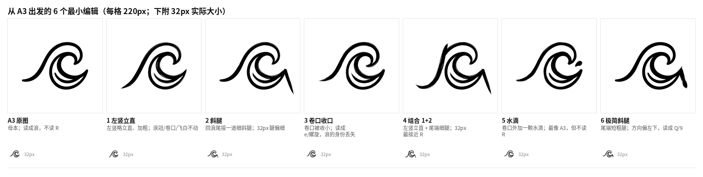
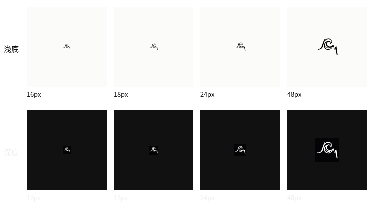

# v5：从 A3 出发的 6 个最小编辑

这组图只回答一个问题：**在 A3 这张浪上做最小改动，能不能让它读成 R？**

- 母本：`docs/icon-concepts/v3/raw/A3.png`（1024×1024，白底；左下一道长浪脊、右上 C 形卷口、下方回浪线）。A1/A3 原图未动。
- 方法：图生图（gemini-3.1-flash-image），把 A3 作为参考图直接编辑；每题只改一个变量，其余尽量保持原样。
- 结论：**没有一张同时做到“改动最小”和“明确读 R”。** 按 A3 保真选 A3e-1/A3e-5；按 32px 可读性选 A3e-4。最终矢量以 A3e-4 为骨架，并把细腿加粗。



## 调用方式

网关（与 v4 相同的图生图通道）：

```text
POST https://aigc.sankuai.com/v1/google/models/gemini-3.1-flash-image:imageGenerate
GET  https://aigc.sankuai.com/v1/google/models/gemini-3.1-flash-image:imageGenerateQuery
Authorization: Bearer <AIGC_APPID>
```

请求体：

```json
{
  "contents": [{
    "parts": [
      { "inlineData": { "mimeType": "image/png", "data": "<base64 of A3 or variant>" } },
      { "text": "<prompt>" }
    ]
  }],
  "generationConfig": {
    "responseModalities": ["TEXT", "IMAGE"],
    "seed": 1001,
    "imageConfig": { "aspectRatio": "1:1", "imageSize": "1K" }
  }
}
```

提交后返回纯文本 operationId；轮询 query，`status == 1` 时从 `data.candidates[].content.parts[].inlineData.data` 取图片 URL 再下载 PNG，`status == -1` 为失败。AIGC_APPID 只在运行时通过环境变量传入，不写进仓库。

A3e-2/A3e-6 在参考图上加了一条红色定位线（仅用于告诉模型“腿从这里出发、往右下”，prompt 明确要求移除红线）。A3e-4 是把 A3e-2 的输出再作为参考图做第二遍，只改左竖。红线图与生成脚本仅作过程材料，未提交。

## 六张变体

每张的 seed、参考图、改动和 prompt 原文如下。prompt 均为英文原文，未改写。

### A3e-1 左竖立直

- seed：1001
- 参考图：A3
- 改动：只把左侧涌起的长笔稍微立直、加粗一点，让它更像 R 的左竖；浪冠、卷口、笔触、飞白不动。

```text
Use the supplied image as the exact base. Keep the existing black brush strokes, composition, stroke-weight variation, dry-brush texture, curl direction, negative space, and white background unchanged. Do not redraw, restyle, recolor, crop, rotate, add a frame, or add any text. Only make this one change: gently straighten and slightly thicken the long left-hand rising stroke where it climbs from the lower left toward the crest, so it reads more like the straight left stem of a capital R. Keep the crest, the curl, the taper, and the dry-brush edge exactly as they are. The change must be subtle; do not turn the wave into a letter R and do not add any new stroke.
```

判断：与 A3 极接近，只左脊略直、略粗；远看仍是浪，不读 R。是“最像 A3”的两张之一。

### A3e-2 斜腿

- seed：1002
- 参考图：`A3-leg-guide.png`（A3 + 一条从回浪尾尖端指向右下的红线）
- 改动：在回浪尾（右侧尖端）接一道向右下的斜腿，不交叉；其余不动。

```text
Use the supplied image as the exact base. The red line is only a placement guide for one new leg; it is not part of the design. Replace the red line with a single straight black brush leg that follows the same path: it starts at the pointed right tip of the wave and runs down and to the right, ending outside the wave. The leg is tapered, with a dry-brush edge like the rest of the wave, and must not cross, touch, or overlap the lower backwash stroke except at its starting point. Remove every trace of red. Keep all existing strokes, composition, stroke-weight variation, dry-brush texture, curl direction, negative space, and white background unchanged. Do not add any other element, text, frame, or shadow; do not redraw, restyle, recolor, crop, or rotate anything.
```

判断：腿的位置这次对了，从尾尖出发、不交叉；但腿很细，32px 只剩一个小勾，R 感弱。是“改动最小”的一张，但不足以独立成标。

### A3e-3 卷口收口

- seed：1003
- 参考图：A3
- 改动：把顶部卷浪的开口极小地收一点，让碗内更像 R 的 loop；要求保留开口、不闭死。

```text
Use the supplied image as the exact base. Keep the existing black brush strokes, composition, stroke-weight variation, dry-brush texture, curl direction, negative space, and white background unchanged. Do not redraw, restyle, recolor, crop, rotate, add a frame, or add any text. Only make this one change: slightly close the opening of the top curl by extending the inner tip a little toward the outer lip, so the curl reads more like the closed bowl/loop of a capital R. Keep the gap visible; do not close it completely. Keep every other stroke, including the lower backwash line, exactly as it is.
```

判断：模型把开口收死了，整体读成 e/螺旋，浪的身份丢失。失败。说明“收口”这个动作对模型的尺度控制太敏感，不适合做单变量。

### A3e-4 组合 1+2

- seed：1004
- 参考图：`raw/A3e-2.png`
- 改动：在 A3e-2 基础上把左竖略立直、加粗；腿保持 A3e-2 原样。

```text
Use the supplied image as the exact base. Keep the new diagonal leg at the lower right exactly as it is: same position, angle, length, thickness, and tapered tip. Only make the left rising stroke slightly straighter and a little thicker, without moving its top or bottom, so it reads more like the left stem of a capital R. Do not change the curl, the lower backwash, the leg, the composition, the dry-brush texture, or the white background. Do not add any other element, text, frame, or shadow; do not redraw, restyle, recolor, crop, or rotate anything.
```

判断：32px 下最接近 R 的一张——左竖、碗、腿三段都成立；但左竖被模型明显立直、加粗，改动幅度大于“最小”，而且腿仍偏细，16px 会消失。它是“读 R”的最好选择，不是“保真 A3”的最好选择。

### A3e-5 加一颗水滴

- seed：1005
- 参考图：A3
- 改动：保留 A3 的水点，只在卷口外上方加 1 颗小水滴；不改变任何笔画。

```text
Use the supplied image as the exact base. Keep the existing black brush strokes, composition, stroke-weight variation, dry-brush texture, curl direction, negative space, and white background unchanged. Do not redraw, restyle, recolor, crop, rotate, add a frame, or add any text. Only make this one change: keep all existing water dots exactly where they are, and add exactly one small solid black water droplet just outside the mouth of the curl, at the upper right of the opening, in the same brush language as the existing dots. Do not add more than one droplet; do not change any stroke, the composition, or the background.
```

判断：最像 A3，水滴也成立；但完全不读 R。它适合作为“水滴版 A3”继续发展，不适合作为 R 标。

### A3e-6 极简斜腿

- seed：1036
- 参考图：`A3-leg-guide4.png`（A3 + 一条更短、更靠下的红线）
- 改动：只加一道从回浪尾尖端向右下的短粗腿，不交叉；其余完全不动。

```text
Use the supplied image as the exact base. The red line is only a placement guide for one new leg; it is not part of the design. Replace the red line with one short, thick black brush leg that starts at the pointed right tip of the wave and runs down and slightly right, ending well above the bottom of the image. The leg is as thick as the lower backwash stroke, with a dry-brush edge and a blunt, slightly tapered end; it must not cross or touch the lower backwash stroke except at its starting point. Remove every trace of red. Keep all existing strokes, composition, stroke-weight variation, dry-brush texture, curl direction, negative space, and white background unchanged. Do not add any other element, text, frame, or shadow.
```

判断：腿的粗细这次对了，但模型把方向做成了向左下，压在下回浪上；读成 Q/9，不是 R。失败。红引导线在这里被忽略，说明“方向”不能只靠一条线约束。

## 最终矢量

选用 A3e-4 作为骨架（它是六张里唯一在 32px 能读成 R 的），做 24×24 填充式矢量：

- `trace-fill.svg`：`viewBox="0 0 24 24"`，两条 path，均 `fill="currentColor"`，无 `stroke`、无渐变、无文字。
- 主 path 用 `fill-rule="evenodd"`，保留卷口内的白孔；腿是独立 path。
- 生成：A3e-4 灰度阈值 128 → 裁内容 bbox 加 pad=36 → 缩到 480 → `skimage.measure.find_contours(0.5)` + `approximate_polygon(tolerance=7.0)` → 映射到 24 画布 → 丢掉面积 <1.2 的碎屑。得到 2 条主轮廓（面积 63.3 / 11.8）。
- 栅格里的细腿因面积太小被丢掉；手工补了一条上宽下窄的腿：`M20.85 14.25 L22.3 13.5 L23.45 21.95 L22.65 22.35 Z`（约 1.4→0.8），避免 16px 时腿消失。
- 整体 `translate(-1.13 -2.0)`，让合成 bbox（x 1.68–22.32，y 3.65–20.35）在 24 画布里居中。



## 16px 实际表现

- **飞白**：48px 还能看到左竖外侧的毛边和笔触缺口；24px 只剩轻微不规则；16px 基本糊成实心，飞白不可辨。
- **回浪尾**：48px 是完整的一道回勾；24px 还保留弧线；16px 只剩左竖末端一个小缺口/小尾巴，读不出“回浪”。
- **卷口内白**：24px 约 2px，仍能形成“碗”的负形；16px 约 1px，只剩一个白点。
- **腿**：24px 约 2px，方向清楚；16px 约 1px，仍能看出是一条斜腿，但和回浪尾几乎粘在一起。
- 结论：16px 勉强读成“带腿的 R 形标记”，但浪的身份基本消失。**这张矢量建议 24px 起用；如果 16px 是主场景，应单独做一版去掉飞白、只保留轮廓的简化稿，而不是直接缩小这张。**

## 文件

- `contact.png`：A3 + 6 变体的 220px 对比，含每张的改动说明与 32px 实际大小。
- `trace-fill.svg`：24×24 最终填充矢量。
- `trace-preview.png`：16/18/24/48px × 浅/深底预览。
- `raw/A3e-1.png` … `raw/A3e-6.png`：六张原始生成图。
- 本文件。

未改 `lib/client.js`，未重启 dsh web，未推送；A1/A3 原图未动。
