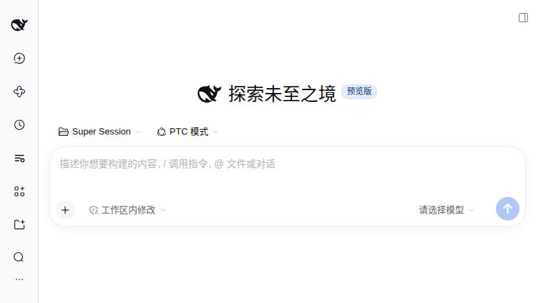
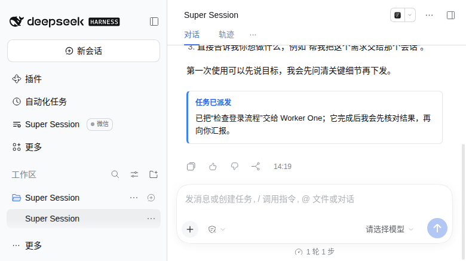

# 运行与任务流程

> **v2 提示：** 插件现在默认运行 v2（Chatbot / Advisor / Router / Worker）。本文其余部分描述的是 legacy manager 模式（`{ v2: false }`），保留作为兼容与对照。v2 的角色、ticket 流转和工具见 [design-v2.md](design-v2.md) 与 [ticket-flow.md](ticket-flow.md)。

本文记录 Ria 的入口与运行方式、工单生命周期、派发确认、重启恢复等运行时行为。设计背景与取舍见 [design-history.md](archive/design-history.md)。

## 入口与运行方式

左侧边栏出现 Ria 入口。第一次点击会 ensure：创建全局唯一的 Ria，并把界面切到她；之后点击只是重新打开同一个 Session。

Ria 的 cwd 固定在：

~~~text
DSH_HOME/state/ria
~~~

DSH 的正常会话界面要求 Session 属于一个 Workspace。插件会为该目录创建一个标题为 Ria 的专用 Workspace，并把 Ria 挂进去。因此工作区列表里会多一个名为 Ria 的条目，这是输入框可用的必要条件，不是可选的 UI 装饰。

Ria 运行 PTC 模式：模型直接看到 run_code 和生成的 SDK，15 个 ria_* 工具通过 SDK 调用。创建时固定 agentPreset=ptc；如果 ptc preset/runtime 不可用，会明确报错，不会退回 standard。

Ria 自己是一个普通的顶层 DSH Session，运行 PTC preset，带管理者 prompt 和 15 个 ria_* 工具。worker 侧不需要安装任何东西，收到的就是普通用户消息；防误发提示由 agent 作用域的 system prompt section 提供，不修改消息内容。

## 欢迎提示

新建 Ria 后第一次打开（会话还没有任何 turn）时，输入框上方会显示一张欢迎卡片：提示先选模型、设置权限（建议 danger-full-access + 审批策略），然后直接说想做什么。

- 卡片由 client 插件渲染（`conversation.input.dock`，id=ria-welcome），只在当前会话等于 Ria 且处于 blank 状态时出现；发出第一条消息后自动消失，已存在或重启后的 Ria 不会重复。
- 不写 session 日志：不占 turn、不占用户消息位、不调用模型，也不进入模型上下文。
- 早期实现是在 Host 侧通过 Session.append 写一个合成的 assistant turn。该 turn 排在真实 turn 的 system/message 之前，会让 DSH session-format v4 校验失败（`system/message requires a protected first surface head`），重启后加载历史报 corrupt，因此改为纯 client 卡片。

## 任务与转述

- 工单是管理记录，不是 DSH 内置对象；保存在 ria.json。
- 每条真实用户消息进入 Ria 的 turn 时，Host 在 `agent/pre-step` 自动登记一条 `intake` 工单，并在同一 turn 注入一条 `[Task intake]` 提示（source.kind=`ria-task-host`，不会被再次捕获）。Ria 必须用 `ria_resolve` 给出归宿；否则 `agent/turn-stopping` 会先 steer 提醒一次，第二次仍未给归宿就自动标成 `blocked`，并产生一张卡片。
- 8 个状态：`intake`、`open`、`working`、`blocked`、`forked`、`done`、`failed`、`cancelled`。`answered`、`merged`、`control` 是 `done.resolution.kind`。只有 `RiaStore.transitionTicket` 能改状态，非法转移返回错误而不是静默改写。
- request 是真正的 Session 消息。发送前先写 pending delivery，prompt 被接受后删除；失败保留，重启或下次 ensure 时按原 requestId 重试。
- `ria_request` 必须带 `ticketId` 和 `note`；工单的 executor 必须等于目标 sessionId。消息内容原样发送，不加任何前缀。防误发提示由 Host 注册在每个 agent 上的 system prompt section 提供：只有在做另一件明显不同的事或完全对不上时，才先向用户确认、不直接执行。
- note 最多 500 字。派发成功后，Host 把卡片和微信镜像都先写进副作用 outbox（`stateDir/outbox.json`）。有活跃 turn 时立即把 note 写入 `ria.json`（最多保留 100 条），插件 client 通过 `GET /plugins/dsh-ria/api/dispatch-notes?sessionId=...&turn=...` 读取，并在 `conversation.chat.turnTail` slot 渲染成当前轮次末尾的卡片；没有活跃 turn 时条目留在 outbox，下一次 turn/start、startup 或 30 秒 tick 补投；此保证仅适用于已成功持久化的条目。
- 卡片不属于 turn process，不会被完成后的流程折叠隐藏；它不进入模型上下文，也不依赖 session log；已经写入的卡片在重启后仍能从 ria.json 读到。
- note 缺失、纯空白或超过 500 字时，工具直接报错，消息不投递、不 concludeTurn。卡片写入失败会按 outbox 退避重试；6 次仍失败则标 failed 并保留原因，`ria_status` 可查，不阻断已经成功的派发。
- 同一个 note 也会在派发成功后进入副作用 outbox，再由微信内部 Outbound 队列发送“📌 任务已派发：<note>”。镜像目标是当前活跃的微信侧通道：优先最近收到用户消息的「文件传输助手」或微信 Claw，两个都不可用时保持 pending；QQ 机器人不接收 note。通道选择和降级规则见 [wechat.md](wechat.md#派发审批-note-走哪个微信通道)。
- 微信文本会带前缀后再走现有 markdown/长度判定（阈值按包含前缀的完整文本计算）；note 最多 500 字，默认 800 字阈值下不会转成 .md，若配置了更低阈值则按同一规则处理。
- 微信发送失败（未登录、暂停、网络异常）由 outbox 按 10s/1m/5m/15m/1h 退避重试，最多 6 次；暂停期间不外发，恢复后若仍未超过重试窗口会补发。失败不影响派发，也不影响 concludeTurn。
- 早期实现用 `command/run` + `command/done`，但 DSH 把 turn 内 command 节点当作 process member，turn 完成后默认折叠，真实 UI 看不到。现已移除该路径。
- 该 section 是静态通用文本，对所有 agent 生效，内容不针对具体消息，因此对普通会话无害；它不修改 worker 的消息历史、tools 或 preset。设置页可以关闭它，关闭后 section 文本为空，DSH 会直接丢弃空 section。
- worker 的 turn 结束时 Host 会自动通知 Ria（见下节）；其余进度不轮询、不自动推送，Ria 需要时调 status/read。
- Ria 需要定时唤醒时，使用 DSH 官方 schedule_create；插件不实现调度循环。

### 派发 note 卡片与微信确认

网页端在 Ria 当前轮次末尾显示“任务已派发 / 消息已转交”卡片；微信端同时收到一条以同样标题开头的文本。两处共用同一个 note 原文，措辞一致；网页看到卡片、微信收到文本是预期行为，不是重复发送。

### 副作用 outbox

派发卡片、微信镜像，以及恢复/blocked 时发给 Ria 的提示，都是“消息已经派发成功之后”的副作用。插件先将条目写入 `stateDir/outbox.json`，再由投递器执行；已成功持久化的条目在重启后可继续按退避和重试上限投递。这是至少一次（at-least-once）语义，发送成功但送达状态未落盘时可能重复；并非派发与副作用的原子事务。派发接受到 outbox 落盘前的崩溃，以及入队写盘失败，仍可能丢失确认，不能承诺所有副作用绝不丢失。

- 至少一次：条目在成功投递后才标 `delivered`；中途崩溃会重试。因此极端情况下微信可能收到重复文本；卡片按 `noteId` 去重，不会重复插入同一条 dispatch note。
- 幂等键由 kind、ticketId、note 文本与 turn 生成；重复入队返回已有条目，不重复发送。卡片与微信镜像共用同一个 noteId，卡片写入 ria.json 时再按 noteId 去重。
- 有活跃 turn 时立即投递卡片；没有活跃 turn 时不丢弃，留到下一次 turn/start、startup 或 30 秒 tick 补投。微信镜像不依赖 turn，入队后即可投递。
- 失败按 10 秒、1 分钟、5 分钟、15 分钟、1 小时退避，最多 6 次；超过后标 `failed` 并保留 `lastError`，不会静默消失。
- `delivered` 条目保留 24 小时用于去重，之后清理；队列上限 500 条，超限先清最旧的 `delivered`，再清最旧的 `failed`，`pending` 不清理。
- `ria_status` 的任意工单响应带 `outbox` 汇总与未投递条目；带 `ticketId` 时只看该工单。
- 微信服务自己的 `Outbound` 队列负责文本/文件/图片的串行发送与去重；副作用 outbox 负责“这条派发确认有没有送达”。两者层次不同，不要混用。

## 派发后 60 秒确认

`sessionController.prompt()` 返回 `accepted` 只表示消息被接收入队，不代表 worker 真的开了 turn。为避免“派发成功、工单变 working、worker 从未开跑”的静默丢失，Host 对每次对外派发做确认：

- 派发前先登记 pending（requestId、目标 session、工单、登记时间），再 `await prompt()`；因此 worker 的 `turn/start` 早于 prompt 返回也能命中。
- `turn/start` 的 sessionId 等于该工单 executor 时，把该工单最后一次 attempt 的 `confirmedAt` 写为当前时间；该 attempt 视为已落地。
- `mode=steer` 注入正在运行的 turn，不会产生新的 `turn/start`，登记时直接视为已确认（`attempt.immediate=true`），不参与超时判定。
- 每 30 秒的 outbox tick 和 startup 都会检查 working 工单：最后一次 attempt 有 `lastRequestId`、无 `confirmedAt`，且距 `startedAt` 已满 60 秒，就把工单迁到 `blocked`、`waitingOn=environment`、`failure.code=dispatch_unconfirmed`，`blockedReason` 写明 requestId 与“60 秒内未开始执行”。
- 同时经 outbox 发一条用户可见告警（kind=`dispatch_unconfirmed`），并镜像到微信；告警说明可能已归档、队列卡住或会话异常，附带 requestId 与 worker 会话 id。
- 已经是 `done`/`failed`/`cancelled`/`blocked` 的工单、以及 Ria 自己的 turn 不参与判定；同一工单 + requestId 只告警一次。
- 这个兜底只改变“派发被接受但未开跑”的工单；worker 正常开始后不会因为 60 秒到期而被误判。

## Router 事件日志

`stateDir/router-events.jsonl` 记录控制面过程事件；它不是 ticket history（状态快照），也不是 `audit.jsonl`（审批/授权决策审计）。

- 当前文件：`stateDir/router-events.jsonl`；跨月或超过 64MB 时轮转到 `stateDir/router-events-YYYY-MM.jsonl`，启动时保留最新 12 个月。`lib/router-events.mjs` 实现，无定时器。
- 每条字段：`ts/event/ticketId/sessionId/actor/reason/payload`。事件包括 `ticket.created`、`advisor.plan`、`dispatch.attempt`、`dispatch.confirmed`、`dispatch.blocked`、`ticket.state`、`approval.asked`、`approval.decided`、`lesson.injected`。
- 查询：`ria_status { scope: "events", ticketId, type, from, to, limit, offset }`，`type` 支持 `dispatch.*` 前缀，时间接受毫秒或 ISO；只读，按 ts 倒序。HTTP 同参数：`GET /plugins/dsh-ria/api/events`。
- 事件写失败只告警，不影响建票、派发或审批；所有埋点都在既有回调点，没有轮询。

## 任务归档

终态工单不会无限留在 ria.json。热文件保留所有非终态，加上最近 24 小时内关闭的终态和按 closedAt 倒序最新 50 条终态；超出的写进 `~/.dsh/state/ria/tickets.log.jsonl`，并按 closedAt 的 UTC 月份同时追加到 `tickets-YYYY-MM.jsonl`（保留最新 12 个月）。新写入只用 `tickets.log.jsonl` / `tickets-YYYY-MM.jsonl`。启动时会一次性把遗留的 `tasks.log.jsonl` / `tasks-YYYY-MM.jsonl` 改名到新名（目标已存在则跳过，失败只记日志）；读取端同时兼容新旧名，并按 `ticketId + closedAt` 去重。先写成功再从内存删除；写失败时工单留在 ria.json，下次启动重试。

`ria_status scope=history` 和 `ria_status ticketId=<id>` 会按需扫日志；`ria_ticket status=open` 与 `ria_resolve kind=control action=reopen/retry` 可以先把归档工单捞回热存储再走正常转移，history/reopenCount 都会保留。

## 重启恢复

Host 启动后延迟 1.5 秒：

- 先补投副作用 outbox 里到期的条目（无需 Ria 在线也能发微信镜像）；补投不会创建 Ria。
- 没有未收敛工单、也没有 pending delivery：不再做其他事。
- 恢复单位是工单：`intake`（还没有归宿）、`open`（尚未派发）、`working`（worker 可能已中断）。`forked` 父容器只递归 `childTicketIds`，父本身不单独恢复；`blocked`、`failed`、`done`、`cancelled` 不自动恢复。
- 有 pending delivery 先重试；重试成功会把对应工单拉回 `working` 并重置恢复计数。
- 所有候选工单合并成一条恢复 prompt，逐条列出 ticketId、status、executor、goal、acceptance、原消息、开始时间、最近动作与 `recovery=n/3`。intake 要求先 `ria_read` 自己的会话再 `ria_resolve`；working 要求先读 worker 与工作区、检查已改文件和测试，再判断继续/done/failed/blocked；open 要求先检查 executor，再派发或标 blocked。
- 每个工单连续自动恢复最多 3 次。达到 3/3 时不再发 prompt，而是把工单标成 `blocked`，写入 `blockedReason`（自动恢复已达上限）与 `failure.code=recovery_exhausted`，并产生一次 `recovery_exhausted` 卡片；下一个启动不会再处理它。
- 恢复计数按工单存在 `recovery.count`；`ria_ticket` 更新、成功派发或用户重新打开都会归零。因此它统计的是连续无人处理的重启次数。
- startup recovery 本身抛错时，也会向 Ria 发送失败通知（错误内容和“需要手动处理”），不只写日志。
- 旧的顶层 `inFlight` 记录在 schema v2 迁移时转成一条 `open`（或到上限时 `blocked`）工单，`origin.kind=legacy_inflight`；迁移后不再有顶层 `inFlight` 字段。

## Worker 完成自动唤醒

默认开启。Host 监听 DSH 的 `agent/status` 事件；当某个正在执行的 worker 变回 `idle`，并且它是至少一个 `working` 工单的 executor 时，给 Ria 发一条普通队列消息。Ria 不用轮询，也不会错过 worker 的结束点。

- 只读事件：从 worker 的事件日志读取最后一个 `turn/end` 的 reason，不改 worker 的 prompt/tools，不往 worker 会话写消息，也不 resume 冷 worker。唯一动作是唤醒 Ria；若最后一轮是 `aborted(user)`，同时把对应 `working` 工单标为 `blocked`。
- 排除 Ria 自己，避免自我唤醒循环。
- 只匹配 `status=working` 且 `executor` 等于该 worker 的工单；`open`、`done`、`cancelled`、`blocked` 都不触发。
- 同一 worker + 同一工单在 30 秒内只通知一次；多个工单分别计时。
- 通知写明“worker X 的 turn 已结束”和最后一轮结束原因（`completed`、`blocked`、`error`、`aborted(user)` 等），并明确要求 Ria 用 `ria_read` 确认，不假设任务完成。`ria_read` 的返回值也带 `lastTurn`。
- 当原因是 `aborted(user)`（用户手动取消/叫停）时，通知明确写“必须停下来等用户决定”，不再建议发 continuation；对应工单由 Host 标为 `blocked`，Ria 只需向用户报告并询问下一步。worker 在消息里明确拒绝任务时，Ria 同样标 `blocked` 后停下来问用户。`completed`、`blocked` 等其他原因保持原有流程，不被拦截。
- `idle` 仍无法区分“完成”“等用户输入”和“明确拒绝”，这三者要看 worker 最近消息；如果 worker 在等审批，通常仍是 `running`，不会产生 idle 通知。
- 通知投递失败只记 warn，不重试；worker 侧状态不受影响。

关闭或调整：

~~~yaml
- id: ria
  config:
    notifyOnWorkerIdle: false
    workerIdleThrottleMs: 30000
~~~

环境变量优先级更高：`DSH_RIA_WORKER_IDLE=0` 一键关闭，`DSH_RIA_WORKER_IDLE_THROTTLE_MS` 调整节流窗口（1 秒–10 分钟）。

日志前缀是 `dsh-ria: worker-idle:`。`info` 记录已通知、节流跳过和关闭状态，`debug` 记录“无 working 工单”等其他跳过原因。

## 审批等待

默认开启「审批自动代批」。worker 触发 `approval/request` 时，宿主先查设置项 `approvalAutomation`，再按风险规则决定：

- **低风险**：只读命令、工作区内的构建与测试等，直接把本次调用放行（`allowed-once`），不唤醒 Ria、不阻塞工单，只写一条 `audit.jsonl`。
- **中风险**：工作区内写文件、无法归类的调用等，把 active 工单标成 `blocked` + `waitingOn=approval`，写 kind=approval 的 attention，排一张 `approval_note` 卡片和一条微信提醒，并用 `source.kind=ria-approval` 的消息唤醒 Ria。Ria 必须在 2 分钟内用 `ria_approval_decision` 选择 `allow` / `deny` / `ask-user`。
- **高风险**：网络、删除/覆盖、工作区外写入、系统目录、密钥/凭据等，只允许 Ria 选择 `ask-user` 或 `deny`；`allow` 会被工具拒绝。
- **硬拒绝**：`sudo`、`rm -rf /`、`~/.ssh`、`~/.dsh` 核心状态、`dsh-daemon stop/uninstall` 等直接拒绝，不唤醒 Ria。

`allow` 只对当前这次调用生效，不会改变 sandbox 或 approval policy。超时、唤醒失败、审计写入失败都按拒绝处理（fail closed），并给用户发一条结果通知。`ask-user` 会调用宿主的原生审批 UI，用户最终决定同样写入审计。审批结束、abort 或超时后工单从 `blocked` 经 `open` 回到 `working`；多个审批同时挂在一个工单时，等最后一个结束再恢复。审批队列只在内存中，重启后 startup 会把没有对应 pending 的 blocked+approval 工单恢复为 working，不会永久卡住。

审批监听器以 prepend 注册，排在宿主 web 的浏览器转发器之前；不匹配 active 工单的请求会调用 `next()`，仍由原生 UI 决定。若某个 `approval/request` 到了 Ria 但没有匹配到 active 工单，会在 `stateDir/approval-diagnostics.jsonl` 留一行诊断（agentId、toolName、callId、原因），排查「worker 日志有 approval/asked、Ria 侧无记录」时先看这个文件。

关闭设置里的「审批自动代批」后，回到旧行为：插件只观察、把工单标成 blocked 并通知，由用户在 worker 会话或原生 UI 决定，15 分钟 TTL 后恢复；`ria_approval` 可查看，`ria_approval_decision` 会返回 `approval_automation_disabled`。

## daemon 重启不弹浏览器

dsh web 由 daemon 的 watchdog 拉起时，命令一直带 `--no-open`（见 watchdog 日志的 `launched dsh web ... --no-open`）。重启后仍会新开页面的根因不在 `dsh web`，而在 watchdog 的**启动 token seed**：dsh 用启动 token 完成 30 天 cookie 的首次握手，watchdog 在检测到本次 launch 的新 token 后会主动打开一次 token URL 来 seed cookie，日志里表现为：

~~~
[watchdog] web auth URL out of date (recorded token is not from the running process) — re-seeding
[watchdog] web auth token: http://127.0.0.1:3080/?token=…
[watchdog] opening browser: http://127.0.0.1:3080/?token=…
~~~

是否开页面由生成期常量 `const OPEN_BROWSER` 决定（`~/.dsh/daemon/watchdog.js`）。它不是在运行时读取环境变量，而是**安装/重装（`dsh-daemon install|reinstall`）时**读取 `DSH_DAEMON_OPEN_BROWSER` 后写死进脚本（插件 `@chenkai114/dsh-daemon` 的 `lib/index.js`：`envVal('DSH_DAEMON_OPEN_BROWSER')` → `const OPEN_BROWSER = 1|0`）。默认是 `1`，所以每次重启都会开一次页面。

关闭方式（一次重装 + 一处持久化）：

~~~bash
# 1) 用环境变量重新生成 watchdog（写死 const OPEN_BROWSER = 0;）
DSH_DAEMON_OPEN_BROWSER=0 dsh-daemon reinstall

# 2) 校验
grep -n 'const OPEN_BROWSER' ~/.dsh/daemon/watchdog.js   # 应为 const OPEN_BROWSER = 0;

# 3) 给 user unit 持久化，GUI 里再次 reinstall 也能继承
systemctl --user edit --force --full dsh-watchdog.service   # 或在 [Service] 段加一行：
# Environment=DSH_DAEMON_OPEN_BROWSER=0
systemctl --user daemon-reload
~~~

生效后，重启日志会变成 `browser open disabled (DSH_DAEMON_OPEN_BROWSER=0) — open manually: …`，不再出现 `opening browser:`；token URL 仍然写入 `~/.dsh/daemon/.web-auth-url`（`dsh-daemon status` 也会显示），需要时手工打开即可。

手动运行 `dsh web` 时同理：加 `--no-open` 即不打开页面（`dsh web --port 3080 --no-open`），URL 与实际 token 由进程自己打印。

注意：`dsh plugin --profile web add … ` 只改 profile 的 node_modules/锁文件，**不会**改写 daemon 的启动参数或 `watchdog.js` 的 `OPEN_BROWSER`；排查“重启弹页面”时不要怀疑插件安装。

## 截断会话日志后的必做项

截断会话日志（删除某个事件及其之后的全部记录）时，除了重写内容，还必须同时满足下面两点，否则会话可能从宿主 session/list 里消失：

1. **按行重新分帧。** DSH 读取会话日志 header 的方式是：取文件开头若干字节，扫描第一个 zstd frame，解压它，并要求它**恰好是一行**（header 行）。DSH 自己的追加写就是「一行一帧」。若把解压后的内容整段重压成一个 30MB 的大 frame（或按 64KB 块分帧、首帧含多行），header 校验失败，listArtifacts 会把该会话静默跳过——表现为磁盘上有目录、zstdcat 也正常，但 session/list 里没有。正确做法：**把每一行（含行尾换行）压成一个独立 zstd frame 后拼接**，首帧即 header 行；内容字节必须与截断结果逐字节一致（用 `sha256sum <(zstdcat 文件)` 对比）。
2. **失效对应的 session_projcache。** 缓存里 `record.rows[*].seq` 记录的是截断前的旧 seq（例如 56513）。不失效的话投影与日志不一致，会话可能仍不出现或显示异常。做法：先备份（`cp -p` 校验字节一致），再删除/改名该会话的 `~/.dsh/storages/session_projcache/sessions/<sessionId>.json`，让宿主下次冷读按新日志重建；确认重建后 `record.rows[*].seq` 等于新的最后事件 seq（例如 56200）。注意：宿主进程可能在内存里仍持有旧 projection（session/list 会显示 `asOfSeq=56513` 的 `cached` 条目），此时只删文件不够，需要让宿主丢一次内存态——优先让用户关闭/重新打开会话触发冷读，确有必要才延迟重启一次（`systemd-run --user --collect --on-active=30s --property=KillMode=process --unit=ria-restart-<HHMMSS> dsh-daemon restart`）。延迟 30s 是为了给报告/日志收尾留时间；预期空窗仍是 4–5s（延迟只影响触发时刻，不影响空窗长度）。重启后 `session/projections` 会按新日志重新冷读。
3. 若列表仍缺，再查搜索索引 `~/.dsh/state/session-query.sqlite` 的 revision 是否停在旧日期，必要时重建索引；**不要删除日志正文**，备份文件（`.bak-*`）保留用于回滚。

安全脚本：`node scripts/repair-session.mjs --session <id>`（默认 dry-run，打印帧数、内容 sha256、行数、最后事件与缓存状态）；确认无误后加 `--apply`（必要时 `--force`）执行「备份 → 按行重新分帧并校验内容 sha256 → 备份并移除 projcache」。脚本不访问网络、不重启服务、不删除日志正文。

## 代码 review 的标准流程

代码 review 与实现任务分开管理：review 只做只读审查，不顺手修代码，也不复用会话。每次 review 都按下面五条约定执行。

### 五条约定

1. **每次 review 新开专用 worker，不复用。** 不复用上一轮的 review worker、不改它的 preset/cwd 继续用；每张 review 工单创建独立的 review worker，结束即归档。
2. **模型固定 `mccodex/ide/gpt-6.1-sol`，`reasoningEffort=max`。** 创建 review worker 时显式指定 provider/model 与 reasoningEffort，不继承默认会话模型；模型不可用时阻塞上报，不降级到其它模型。
3. **在独立目录用 `git worktree` checkout 指定 commit 后只读审查。** review worker 的 cwd 必须是该 worktree，而不是主工作树；这样主工作树上的并发改动、未提交改动或后续提交都不会影响 review 基线。review 只允许读取、搜索、`git diff/log/show` 等只读操作，不改文件、不 commit、不安装依赖、不跑构建。
4. **review worker 一次性使用，任务结束即归档。** 一张 review 工单对应一个 review worker；报告交回后归档该会话/worktree，不复用于下一张 review。
5. **其它类型任务不得派给 review worker。** 实现、修 bug、部署、数据迁移等任务走普通 WorkOrder 与普通 Worker；review worker 只审查代码并给出结论。

### 创建与清理 worktree

review 的基线是一个明确的 commit，不是「当前 HEAD」。用仓库脚本在仓库父目录创建独立 worktree（脚本用法见文件头部注释）：

~~~bash
# 1) 为基线 commit 创建 worktree（默认目录：<repo 父目录>/ria-review-<短sha>-<yyyymmddHHMMSS>）
scripts/review-worktree.sh --repo /path/to/dsh-ria --commit <完整或短 sha>
# 输出：
# worktree=/path/to/ria-review-9ad03f38-20261119190500
# head=9ad03f389897055da1739abe9b74b99bac05b581

# 2) 需要固定目录名时显式 --dir
scripts/review-worktree.sh --repo /path/to/dsh-ria --commit <sha> --dir /tmp/ria-review-<name>

# 3) review 结束后清理（可重复执行；目录已不存在视为成功）
scripts/review-worktree.sh --repo /path/to/dsh-ria --cleanup /tmp/ria-review-<name>
~~~

- worktree 以 `--detach` 检出指定 commit，不切换/创建分支；不要在主工作树里做 review。
- 重复执行同一个 `--dir` + 同一 commit 是幂等的：直接复用并输出同样的路径与 HEAD；目录已存在但 HEAD 不同则报错，绝不覆盖。
- 清理使用 `git worktree remove --force`，随后 `git worktree prune`；目录已不存在时清理也返回成功，便于重试。
- 脚本失败时向 stderr 输出一行可读原因并以非 0 退出（缺 `--repo`/`--commit`、路径不是 git 仓库、commit 无法解析、worktree 归属不符、目标 HEAD 不符等）。

### 报告开头必须记录基线

每份 review 报告的第一段必须显式写明基线，禁止只写短 sha 或「当前 HEAD」：

~~~text
基线 commit: <完整 40 位 sha>
worktree: <worktree 绝对路径>
模型: mccodex/ide/gpt-6.1-sol（reasoningEffort=max）
~~~

基线 commit 必须等于 `git -C <worktree> rev-parse HEAD` 的实际值；worktree 路径必须是本次 review 专用的目录。报告中的文件行号、diff 结论都以该 commit + 该 worktree 为准。
