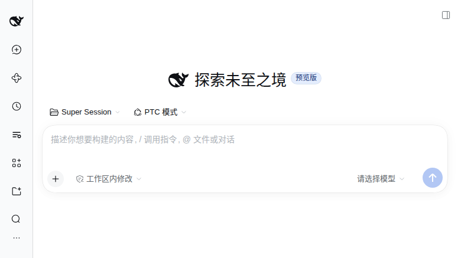
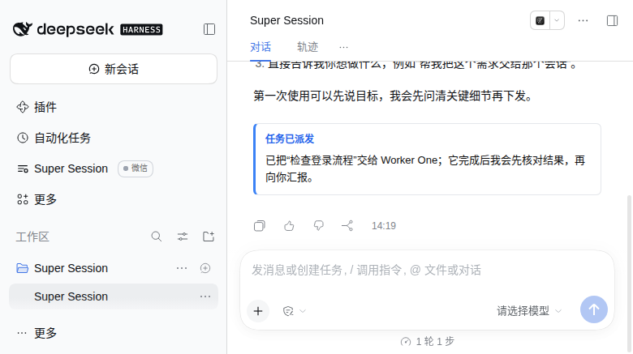
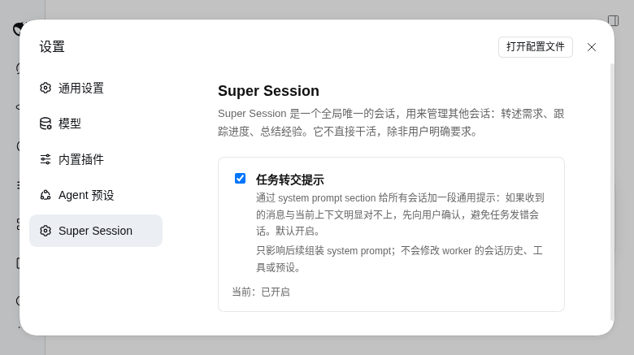

# 运行与任务流程

本文记录 Ria 的入口与运行方式、ticket 生命周期、派发确认、重启恢复等运行时行为。设计背景与取舍见 [DESIGN.md](../DESIGN.md)。

## 入口与运行方式

左侧边栏出现 Ria 入口。第一次点击会 ensure：创建全局唯一的 Ria，并把界面切到她；之后点击只是重新打开同一个 Session。

Ria 的 cwd 固定在：

~~~text
DSH_HOME/state/ria
~~~

DSH 的正常会话界面要求 Session 属于一个 Workspace。插件会为该目录创建一个标题为 Ria 的专用 Workspace，并把 Ria 挂进去。因此工作区列表里会多一个名为 Ria 的条目，这是输入框可用的必要条件，不是可选的 UI 装饰。

Ria 运行 PTC 模式：模型直接看到 run_code 和生成的 SDK，12 个 ria_* 工具通过 SDK 调用。创建时固定 agentPreset=ptc；如果 ptc preset/runtime 不可用，会明确报错，不会退回 standard。

Ria 自己是一个普通的顶层 DSH Session，运行 PTC preset，带管理者 prompt 和 12 个 ria_* 工具。worker 侧不需要安装任何东西，收到的就是普通用户消息；防误发提示由 agent 作用域的 system prompt section 提供，不修改消息内容。

## 欢迎提示

新建 Ria 后第一次打开（会话还没有任何 turn）时，输入框上方会显示一张欢迎卡片：提示先选模型、设置权限（建议 danger-full-access + 审批策略），然后直接说想做什么。

- 卡片由 client 插件渲染（`conversation.input.dock`，id=ria-welcome），只在当前会话等于 Ria 且处于 blank 状态时出现；发出第一条消息后自动消失，已存在或重启后的 Ria 不会重复。
- 不写 session 日志：不占 turn、不占用户消息位、不调用模型，也不进入模型上下文。
- 早期实现是在 Host 侧通过 Session.append 写一个合成的 assistant turn。该 turn 排在真实 turn 的 system/message 之前，会让 DSH session-format v4 校验失败（`system/message requires a protected first surface head`），重启后加载历史报 corrupt，因此改为纯 client 卡片。

## 任务与转述

- ticket 是管理记录，不是 DSH 内置对象；保存在 ria.json。
- 每条真实用户消息进入 Ria 的 turn 时，Host 在 `agent/pre-step` 自动登记一条 `intake` ticket，并在同一 turn 注入一条 `[Task intake]` 提示（source.kind=`ria-task-host`，不会被再次捕获）。Ria 必须用 `ria_resolve` 给出归宿；否则 `agent/turn-stopping` 会先 steer 提醒一次，第二次仍未给归宿就自动标成 `blocked`，并产生一张卡片。
- 8 个状态：`intake`、`open`、`working`、`blocked`、`forked`、`done`、`failed`、`cancelled`。`answered`、`merged`、`control` 是 `done.resolution.kind`。只有 `RiaStore.transitionTicket` 能改状态，非法转移返回错误而不是静默改写。
- request 是真正的 Session 消息。发送前先写 pending delivery，prompt 被接受后删除；失败保留，重启或下次 ensure 时按原 requestId 重试。
- `ria_request` 必须带 `ticketId` 和 `note`；ticket 的 executor 必须等于目标 sessionId。消息内容原样发送，不加任何前缀。防误发提示由 Host 注册在每个 agent 上的 system prompt section 提供：只有在做另一件明显不同的事或完全对不上时，才先向用户确认、不直接执行。
- note 最多 500 字。派发成功后，Host 把卡片和微信镜像都先写进副作用 outbox（`stateDir/outbox.json`）。有活跃 turn 时立即把 note 写入 `ria.json`（最多保留 100 条），插件 client 通过 `GET /plugins/dsh-ria/api/dispatch-notes?sessionId=...&turn=...` 读取，并在 `conversation.chat.turnTail` slot 渲染成当前轮次末尾的卡片；没有活跃 turn 时条目留在 outbox，下一次 turn/start、startup 或 30 秒 tick 补投；此保证仅适用于已成功持久化的条目。
- 卡片不属于 turn process，不会被完成后的流程折叠隐藏；它不进入模型上下文，也不依赖 session log；已经写入的卡片在重启后仍能从 ria.json 读到。
- note 缺失、纯空白或超过 500 字时，工具直接报错，消息不投递、不 concludeTurn。卡片写入失败会按 outbox 退避重试；6 次仍失败则标 failed 并保留原因，`ria_status` 可查，不阻断已经成功的派发。
- 同一个 note 也会在派发成功后进入副作用 outbox，再由微信内部 Outbound 队列发送“📌 任务已派发：<note>”。镜像目标是当前活跃的微信侧通道：优先最近收到用户消息的「文件传输助手」或微信 Claw，两个都不可用时保持 pending；QQ 机器人不接收 note。通道选择和降级规则见 [wechat.md](wechat.md#派发审批-note-走哪个微信通道)。
- 微信文本会带前缀后再走现有 markdown/长度判定（阈值按包含前缀的完整文本计算）；note 最多 500 字，默认 800 字阈值下不会转成 .md，若配置了更低阈值则按同一规则处理。
- 微信发送失败（未登录、暂停、网络异常）由 outbox 按 10s/1m/5m/15m/1h 退避重试，最多 6 次；暂停期间不外发，恢复后若仍未超过重试窗口会补发。失败不影响派发，也不影响 concludeTurn。
- 早期实现用 `command/run` + `command/done`，但 DSH 把 turn 内 command 节点当作 process member，turn 完成后默认折叠，真实 UI 看不到。现已移除该路径。
- 该 section 是静态通用文本，对所有 agent 生效，内容不针对具体消息，因此对普通会话无害；它不修改 worker 的消息历史、tools 或 preset。设置页可以关闭它，关闭后 section 文本为空，DSH 会直接丢弃空 section。
- worker 的 turn 结束时 Host 会自动通知 Ria（见下节）；其余进度不轮询、不自动推送，Ria 需要时调 status/read。
- Ria 需要定时唤醒时，使用 DSH 官方 schedule_create；插件不实现调度循环。

### 派发 note 卡片与微信确认

网页端在 Ria 当前轮次末尾显示“任务已派发 / 消息已转交”卡片；微信端同时收到一条以同样标题开头的文本。两处共用同一个 note 原文，措辞一致；网页看到卡片、微信收到文本是预期行为，不是重复发送。

### 副作用 outbox

派发卡片、微信镜像，以及恢复/blocked 时发给 Ria 的提示，都是“消息已经派发成功之后”的副作用。插件先将条目写入 `stateDir/outbox.json`，再由投递器执行；已成功持久化的条目在重启后可继续按退避和重试上限投递。这是至少一次（at-least-once）语义，发送成功但送达状态未落盘时可能重复；并非派发与副作用的原子事务。派发接受到 outbox 落盘前的崩溃，以及入队写盘失败，仍可能丢失确认，不能承诺所有副作用绝不丢失。

- 至少一次：条目在成功投递后才标 `delivered`；中途崩溃会重试。因此极端情况下微信可能收到重复文本；卡片按 `noteId` 去重，不会重复插入同一条 dispatch note。
- 幂等键由 kind、ticketId、note 文本与 turn 生成；重复入队返回已有条目，不重复发送。卡片与微信镜像共用同一个 noteId，卡片写入 ria.json 时再按 noteId 去重。
- 有活跃 turn 时立即投递卡片；没有活跃 turn 时不丢弃，留到下一次 turn/start、startup 或 30 秒 tick 补投。微信镜像不依赖 turn，入队后即可投递。
- 失败按 10 秒、1 分钟、5 分钟、15 分钟、1 小时退避，最多 6 次；超过后标 `failed` 并保留 `lastError`，不会静默消失。
- `delivered` 条目保留 24 小时用于去重，之后清理；队列上限 500 条，超限先清最旧的 `delivered`，再清最旧的 `failed`，`pending` 不清理。
- `ria_status` 的任意 ticket 响应带 `outbox` 汇总与未投递条目；带 `ticketId` 时只看该票。
- 微信服务自己的 `Outbound` 队列负责文本/文件/图片的串行发送与去重；副作用 outbox 负责“这条派发确认有没有送达”。两者层次不同，不要混用。

## 任务转交提示与设置页

防误发提示不是消息前缀，而是插件为每个 agent 注册的 system prompt section（name 为 dsh-ria:dispatch-guard，order 4100）。

- 插件启动时给已有 agent 安装，并监听 agent/created 给新 agent 安装；agent/disposed 和插件卸载时 dispose，避免重载时同名 section 冲突。
- section 文本是固定的通用提示，不按 ticket 或具体消息变化；关闭开关后 text 返回空字符串，DSH 的 renderPrompt 会丢弃空 section。
- 开关在“设置 > Ria”，默认打开；状态保存在 ria.json 的 settings.dispatchGuard。
- 开关只影响后续 system prompt 的组装，不改 worker 已经收到的历史消息、tools 或 preset；也不会替模型做硬拦截。

## 任务归档

终态 ticket 不会无限留在 ria.json。热文件保留所有非终态，加上最近 24 小时内关闭的终态和按 closedAt 倒序最新 50 条终态；超出的写进 `~/.dsh/state/ria/tasks.log.jsonl`，并按 closedAt 的 UTC 月份同时追加到 `tasks-YYYY-MM.jsonl`（保留最新 12 个月）。先写成功再从内存删除；写失败时 ticket 留在 ria.json，下次启动重试。

`ria_status scope=history` 和 `ria_status ticketId=<id>` 会按需扫日志；`ria_ticket status=open` 与 `ria_resolve kind=control action=reopen/retry` 可以先把归档 ticket 捞回热存储再走正常转移，history/reopenCount 都会保留。

## 重启恢复

Host 启动后延迟 1.5 秒：

- 先补投副作用 outbox 里到期的条目（无需 Ria 在线也能发微信镜像）；补投不会创建 Ria。
- 没有未收敛 ticket、也没有 pending delivery：不再做其他事。
- 恢复单位是 ticket：`intake`（还没有归宿）、`open`（尚未派发）、`working`（worker 可能已中断）。`forked` 父容器只递归 `childTicketIds`，父本身不单独恢复；`blocked`、`failed`、`done`、`cancelled` 不自动恢复。
- 有 pending delivery 先重试；重试成功会把对应 ticket 拉回 `working` 并重置恢复计数。
- 所有候选 ticket 合并成一条恢复 prompt，逐条列出 ticketId、status、executor、goal、acceptance、原消息、开始时间、最近动作与 `recovery=n/3`。intake 要求先 `ria_read` 自己的会话再 `ria_resolve`；working 要求先读 worker 与工作区、检查已改文件和测试，再判断继续/done/failed/blocked；open 要求先检查 executor，再派发或标 blocked。
- 每个 ticket 连续自动恢复最多 3 次。达到 3/3 时不再发 prompt，而是把 ticket 标成 `blocked`，写入 `blockedReason`（自动恢复已达上限）与 `failure.code=recovery_exhausted`，并产生一次 `recovery_exhausted` 卡片；下一个启动不会再处理它。
- 恢复计数按 ticket 存在 `recovery.count`；`ria_ticket` 更新、成功派发或用户重新打开都会归零。因此它统计的是连续无人处理的重启次数。
- startup recovery 本身抛错时，也会向 Ria 发送失败通知（错误内容和“需要手动处理”），不只写日志。
- 旧的顶层 `inFlight` 记录在 schema v2 迁移时转成一条 `open`（或到上限时 `blocked`）ticket，`origin.kind=legacy_inflight`；迁移后不再有顶层 `inFlight` 字段。

## Worker 完成自动唤醒

默认开启。Host 监听 DSH 的 `agent/status` 事件；当某个正在执行的 worker 变回 `idle`，并且它是至少一个 `working` ticket 的 executor 时，给 Ria 发一条普通队列消息。Ria 不用轮询，也不会错过 worker 的结束点。

- 只读事件：从 worker 的事件日志读取最后一个 `turn/end` 的 reason，不改 worker 的 prompt/tools，不往 worker 会话写消息，也不 resume 冷 worker。唯一动作是唤醒 Ria；若最后一轮是 `aborted(user)`，同时把对应 `working` ticket 标为 `blocked`。
- 排除 Ria 自己，避免自我唤醒循环。
- 只匹配 `status=working` 且 `executor` 等于该 worker 的 ticket；`open`、`done`、`cancelled`、`blocked` 都不触发。
- 同一 worker + 同一 ticket 在 30 秒内只通知一次；多个 ticket 分别计时。
- 通知写明“worker X 的 turn 已结束”和最后一轮结束原因（`completed`、`blocked`、`error`、`aborted(user)` 等），并明确要求 Ria 用 `ria_read` 确认，不假设任务完成。`ria_read` 的返回值也带 `lastTurn`。
- 当原因是 `aborted(user)`（用户手动取消/叫停）时，通知明确写“必须停下来等用户决定”，不再建议发 continuation；对应 ticket 由 Host 标为 `blocked`，Ria 只需向用户报告并询问下一步。worker 在消息里明确拒绝任务时，Ria 同样标 `blocked` 后停下来问用户。`completed`、`blocked` 等其他原因保持原有流程，不被拦截。
- `idle` 仍无法区分“完成”“等用户输入”和“明确拒绝”，这三者要看 worker 最近消息；如果 worker 在等审批，通常仍是 `running`，不会产生 idle 通知。
- 通知投递失败只记 warn，不重试；worker 侧状态不受影响。

关闭或调整：

~~~yaml
- id: ria
  config:
    notifyOnWorkerIdle: false
    workerIdleThrottleMs: 30000
~~~

环境变量优先级更高：`DSH_RIA_WORKER_IDLE=0` 一键关闭，`DSH_RIA_WORKER_IDLE_THROTTLE_MS` 调整节流窗口（1 秒–10 分钟）。

日志前缀是 `dsh-ria: worker-idle:`。`info` 记录已通知、节流跳过和关闭状态，`debug` 记录“无 working ticket”等其他跳过原因。

## 审批等待

worker 触发 `approval/request` 时，Host 会把它的 active ticket 标成 `blocked`、`waitingOn=approval`，并把一句中文问题写进 `attention`（kind=approval，askedBy=worker，ref=approvalId）。同时排一张 `approval_note` 卡片和一条微信提醒；审批结束、abort 或 15 分钟超时后 ticket 回到 `working`，`waitingOn=worker`，attention 清空。审批队列只在内存中，重启后 startup 会把没有对应 pending 的 blocked+approval ticket 恢复为 working，不会永久卡住。Ria 仍然只能查看（`ria_approval`），不能代批。
