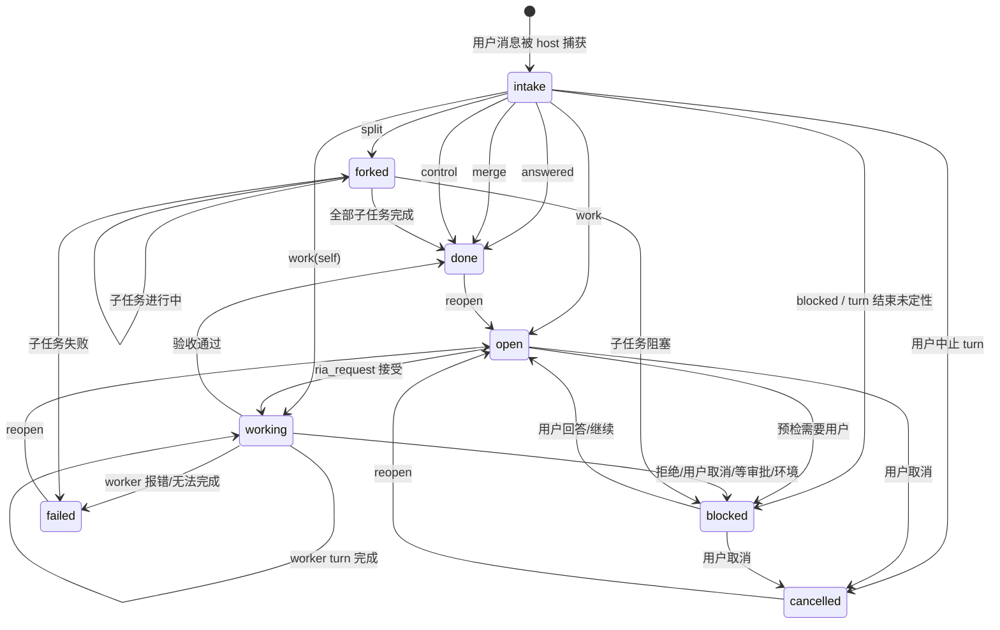

# Ria 完整任务模型设计方案

- 状态：草案 v1（待确认后实施）
- 日期：2026-11-11
- 范围：Ria 插件（`dsh-ria`）的任务生命周期、反馈契约、持久化结构与重启恢复
- 不在本方案：多 Ria 实例、跨机器同步、worker 内部实现、UI 视觉设计
- 约束：本文件只做设计；不改 `lib/`，不改测试，不重启 dsh web

一句话摘要：**把“用户消息”变成任务系统的唯一入口（host 在 `agent/pre-step` 自动登记 intake），把“任务有归宿”变成 host 的强制不变量（`agent/turn-stopping` + `RiaStore.transitionTask`），把现在平行的 `inFlight` 补丁收编成未收敛任务的一种状态。**

---

## 0. 结论先行

1. **每条真实用户消息都建一个 root task**，包括寒暄和提问；寒暄/提问在同 turn 内以 `done + resolution.kind='answered'` 收敛，不进活跃看板。这样“每条消息有归宿”不再依赖模型记得调 `ria_task`。
2. **状态从 5 个扩展到 8 个**：`intake / open / working / blocked / forked / done / failed / cancelled`。`answered / merged / control` 是 `done` 的 `resolution.kind`，不是状态。
3. **分叉采用方案 B：父 task 派生多个子 task**。父 task 只做容器（`status='forked'`, `executor=null`），每个子 task 仍然遵守“一个 task 一个 executor”。
4. **所有状态变更只经过 `RiaStore.transitionTask`**；它在同一次写盘里校验不变量、写 feedback 记录、触发卡片/微信。任何非终态 task 必须有 `waitingOn`，明确“卡在谁那里”。
5. **删除顶层 `inFlight`**。重启时扫描未收敛的 task（`forked` 父容器只递归子 task，不作为恢复单元），合并成一条恢复 prompt；恢复上限按 task 计算，不再有独立的 in-flight 计数。

---

## 1. 用户消息 → task 的自动建立

### 1.1 事实来源与捕获点

DSH 的 `agent/pre-step` 是模型看到消息之前的 waterfall（`dsh-agent-loop/lib/index.js:685`），payload 含 `agent / messages / turn / step / signal`。它返回 `{kind:'enter', messages}` 后，模型才会收到这一批消息。现有插件只监听 `session/event`，那是**事后通知**，存在与 pre-step 的竞态，不能作为“每条消息必建 task”的强制点。

新增一个只作用于 Ria 自己 session 的 pre-step 监听：

```js
// lib/index.js（示意，不在本次提交）
riaAgent.ctx.on('agent/pre-step', async (payload, next) => {
  const decision = await next()
  if (decision.kind !== 'enter') return decision
  const captured = []
  for (const message of decision.messages) {
    if (message.source?.kind !== 'user') continue      // host / action-cards / ria-task-host 注入不算
    if (isHostRequestId(message.source?.rpcId)) continue // host_ 恢复 prompt 不算
    captured.push(this.store.captureIntake({
      sessionId: riaId,
      turn: payload.turn,
      message,
    }))
  }
  if (!captured.length) return decision
  return {
    ...decision,
    messages: [
      ...decision.messages,
      createUserMessage({
        source: { kind: 'ria-task-host', form: 'notice', summary: 'Captured user request' },
        content: [{ type: 'text', text: intakeNotice(captured) }],
      }),
    ],
  }
}, { prepend: true })
```

关键点：

- **只认 `message.source.kind === 'user'`**。DSH 的 host prompt 也记 `source.kind='user'`，但 `rpcId` 以 `host_` 开头；微信消息 `rpcId` 以 `wx_` 开头，仍然算用户消息。
- 注入的 host notice 用 `source.kind='ria-task-host'`，不是 `'user'`，所以下一次 pre-step 不会把它当成新用户消息，避免递归。`dsh-action-cards/lib/index.js:395-430` 已有同样的做法（`source.kind='action-cards'`）。
- **先写盘再让模型开工**。如果 `captureIntake` 写失败，不要静默继续：记录 error、在 turn 里注入可见的错误 notice，并让当前 turn 失败；宁可让用户看到“未能登记这条消息”，也不要让消息在系统里消失。
- 去重键：`(sessionId, message.id)` 为主，`(sessionId, turn, rpcId, contentHash)` 为辅。DSH 重投/重放同一消息时返回已有 task，不重复建。
- 每条消息只建一个 root task；后续的合并/拆分都在 root 上由 `ria_resolve` 决定。

### 1.2 哪些消息建 task

| 消息类型 | 例子 | 是否建 root | 初始状态 | 正常归宿 |
|---|---|---|---|---|
| 明确诉求 | “把登录页的重构做完，跑通测试” | 是 | `intake` | `work` → `open/working` → `done/failed/blocked` |
| 追问/查询 | “现在到哪一步了？” | 是 | `intake` | `answered` → `done`；若问的是活跃 task，关联该 task 但不改其状态 |
| 寒暄/确认 | “好的”“谢谢”“收到” | 是 | `intake` | `answered` → `done`；若正处于 `blocked(waitingOn=user)`，`merge` 到该 task 并按 T22 回到 `open` |
| 控制指令 | “停”“取消 X”“继续 Y” | 是 | `intake` | `control` → 目标 task 的 `cancelled/reopen/retry`，root `done` |
| 同一请求的补充 | “另外验收再加一条：必须兼容 Node 22” | 是 | `intake` | `merge` 到目标 task，更新 `goal/acceptance`，root `done` |
| 多诉求 | “A 做完再做 B；C 另开一个 worker” | 是 | `intake` | `split` → 父 `forked` + 子 task |
| 纯附件（无文字） | 一张截图/一个文件 | 是 | `intake` | 文本用 `[附件: ...]` 占位；Ria 必须澄清或 `blocked` |
| worker idle 通知 | `[Worker idle]` | **否** | — | 不经过 pre-step；走 `session/event` / `agent/status` |
| host 恢复 prompt | `host_` 开头 | **否** | — | 不建 root；启动恢复只更新已有 task |
| Ria 自己注入的 notice | `ria-task-host` | **否** | — | 仅模型可见 |
| 系统/运行时上下文 | runtime-context | **否** | — | 不是用户诉求 |

**为什么寒暄也建 task**：这不是为了把寒暄当工作，而是为了让“每条用户消息都有归宿”成为可检查的事实。寒暄 task 立即 `done`、`resolution.kind='answered'`，不出现在活跃看板、不发卡片、不进微信，只留在审计记录里。

### 1.3 反例：不建 task 的情况

- 非 Ria session 的消息（worker 自己的对话）。
- `source.kind !== 'user'` 的注入消息。
- `rpcId` 以 `host_` 开头的恢复/唤醒 prompt。
- 系统事件、工具结果、assistant 消息。
- 同一条消息的重复投递（按 1.1 的去重键返回已有 task）。
- 用户只是点“停止”而没有发消息：这是 `aborted(user)` 事件，走 5.4 的 turn/end 处理，不建新 root。

### 1.4 去重与合并

**两层机制，先机械后语义：**

1. **机械去重**（host，不依赖模型）：相同 `message.id` 或相同 `(turn, rpcId, contentHash)` 只建一个 root。重复投递时返回已有 task，并在 notice 里标明 `deduped=true`。
2. **语义合并**（Ria，通过 `ria_resolve kind=merge`）：host 在 intake notice 里给出候选 task，Ria 必须显式选择，不能由 host 猜。

host 给候选的规则（只给建议，不自动合并）：

- 若上一条 Ria turn 结束时存在 `blocked(waitingOn='user')` 的 task，且新消息在 24h 内，候选第一优先是它。
- 若消息里出现 `task_xxx` 或与某个活跃 task 的 `goal` 有唯一匹配的关键词，候选是该 task。
- 否则列出最近 5 个活跃 task 的 `taskId + goal` 摘要，并明确写“这是新请求时用 `kind=work`，不是补充时不要 merge”。
- 同一 turn 里如果连续两条消息内容高度重复，第二条默认候选是第一条的 root；Ria 可 `merge` 或 `answered`。

**合并的语义：**

- 合并只更新目标 task 的 `goal/acceptance`，追加 `updates[]` 记录，不重置 `recovery.count`（用户补充算人工介入，可以重置；见 6.3）。
- 如果目标正在 `working`，合并**不自动重发**给 worker；Ria 必须判断补充是否影响 acceptance：
  - 不影响：只更新记录，发 `updated` 反馈（默认不发卡片）。
  - 影响：用 `ria_request` 发补充 note 给同一 worker；若 worker 已进入不可打断的长任务，标 `blocked(waitingOn='user')` 问用户是否等它结束。
- 合并到终态 task 时，先 `reopen` 再合并；reopen 需要用户意图（用户补充/明确要求继续），不能由 host 自动做。

**不能合并的情况：**

- 目标 task 已 `cancelled` 且用户没有说继续。
- 目标 task 的 executor 已不存在/归档，且用户没有指定新 executor。
- 两条消息是两个独立交付物（见 1.5），应 `split` 而不是 merge。

### 1.5 多诉求拆分

拆分判据（满足任意两条即拆）：

- 有两个以上**独立交付物**，可以分别验收。
- 需要两个以上**不同 executor**，且彼此没有先后依赖。
- 其中一个失败不应阻塞另一个完成。
- 用户明确说“分别/各自/并行/另一个 worker”。

不拆的情况：

- 同一交付物的连续步骤（先改后端再改前端再跑测试），应放在一个 task 的 `goal` 里，用 checklist 描述。
- 同一 executor 的串行接力，且中间不需要用户决策；可以一个 task，必要时在 task 内记录 handoff。
- 拆完会超过 8 个子任务或深度超过 2：先问用户是否分阶段，不要自动爆炸。

拆分结果：

- root task `status='forked'`、`executor=null`、`fork.mode='parallel'|'serial'|'mixed'`。
- 每个子 task 一个 executor、一份 acceptance；`parentTaskId` 指向 root，`rootTaskId` 指向最顶层。
- `dependsOn` 只允许指向同一父下的兄弟；host 校验无环、无跨父依赖。
- 父 task 不派发、不设 executor；它的状态由子任务聚合（见 2.5）。

### 1.6 自动建立后的 host notice

notice 只给模型看，不当作新用户消息。建议格式（短，避免占上下文）：

```text
[Task intake] 本 turn 登记了 2 条用户消息，请用 ria_resolve 逐条给出归宿：
- task_abc123 | "把登录页重构做完" | 候选: 新建
- task_def456 | "验收再加一条：兼容 Node 22" | 候选: task_prev（blocked 等你回答）
规则：answered/work/merge/split/control/blocked 六选一；不要用 ria_task 直接改 intake。
```

notice 里不写完整用户消息（已在 session 历史里），只写 taskId、截断 120 字的摘要、候选。这样即使长消息也不会把 prompt 撑爆。

---

## 2. 完整状态机

### 2.1 状态定义

| 状态 | 含义 | 是否活跃 | 是否终态 | 必须有 | 禁止 |
|---|---|---|---|---|---|
| `intake` | 用户消息已登记，尚未定性 | 是 | 否 | `origin` | `executor`、`closedAt` |
| `open` | 已定性为工作，等待派发 | 是 | 否 | `goal`、`executor`、`waitingOn` | `closedAt` |
| `working` | 已投递给 worker，等待其 turn/事件，或等待 Ria 核对结果 | 是 | 否 | `executor`、`attempt.lastRequestId` | `closedAt` |
| `blocked` | 等用户/审批/环境，不能自动推进 | 是 | 否 | `blockedReason`、`waitingOn` | 自动续派 |
| `forked` | 父容器，子任务进行中 | 是 | 否 | `childTaskIds`（≥2） | `executor`、直接派发 |
| `done` | 已交付并验收 | 否 | 是 | `resolution.summary` | 再改字段（除 reopen） |
| `failed` | 执行失败，未达成 acceptance | 否 | 是 | `failure.code/message` | 自动重试（需 reopen） |
| `cancelled` | 用户/父任务明确取消 | 否 | 是 | `resolution.reason` | 自动恢复 |

`answered / merged / control` 不是状态，是 `done.resolution.kind` 的取值；它们让寒暄、追问、补充、控制指令都能落在一个终态 task 上，而不需要额外状态。

### 2.2 转移表

| # | From | 触发 | To | 守卫/副作用 | 用户反馈 |
|---|---|---|---|---|---|
| T1 | — | pre-step 捕获用户消息 | `intake` | 去重；写 `origin` | 无（内部） |
| T2 | `intake` | `ria_resolve kind=answered` | `done` | `resolution.kind='answered'`，必须有 summary | 默认无卡片；状态可见 |
| T3 | `intake` | `ria_resolve kind=work` | `open` | 设 goal/acceptance/executor；executor 校验 | 无 |
| T4 | `intake` | `ria_resolve kind=work, executor='self'` 且 Ria 本 turn 开始做 | `working` | 只允许 self；记 attempt | 可选“开始处理” |
| T5 | `intake` | `ria_resolve kind=merge` | `done` | 目标必须存在；更新目标；必要时 reopen | 目标有实质变化时 `updated` |
| T6 | `intake` | `ria_resolve kind=split` | `forked` | 2–8 个子 task；深度 ≤2 | `forked` 卡片 |
| T7 | `intake` | `ria_resolve kind=control` | `done` | 对目标执行 cancel/reopen/retry | 目标状态卡片 |
| T8 | `intake` | `ria_resolve kind=blocked` | `blocked` | 必须有 `blockedReason` + `waitingOn` | `blocked` 卡片 |
| T9 | `intake` | turn 结束仍无 resolve（host 兜底） | `blocked` | `blockedReason='Ria 未在 turn 内给出归宿'`，`waitingOn='user'` | `blocked` 卡片一次 |
| T10 | `intake` | 用户中止该 turn（`aborted(user)`） | `cancelled` | `resolution.kind='aborted'`；不自动恢复 | 无（用户自己停的） |
| T11 | `open` | `ria_request` 预检通过且 prompt 接受 | `working` | 写 `attempt`；requestId 幂等 | `dispatched` 卡片 + 微信 |
| T12 | `open` | 预检失败且 Ria 可修正（`not_top_level`/`task_executor_mismatch`） | `open` | 保持 open，写 `failure`；Ria 改 exec 后重试 | `dispatch_rejected` 低干扰卡片 |
| T13 | `open` | 预检失败且需要用户（`session_missing/archived/workspace_missing`） | `blocked` | `waitingOn='user'`，保留 code | `blocked` 卡片 + 微信 |
| T14 | `open` | 用户取消 | `cancelled` | `resolution.reason='user'` | `cancelled` 卡片 |
| T15 | `working` | worker turn `completed` | `working` | 只更新 `lastWorkerTurn`/`progress`，`waitingOn='ria'`；Ria 必须读后决定 | `progress`（默认无卡片） |
| T16 | `working` | worker turn `error/max-tokens` | `failed` | 写 `failure`；不自动重试 | `failed` 卡片 + 微信 |
| T17 | `working` | worker 明确拒绝 | `blocked` | `waitingOn='user'`，`failure.code='worker_refused'` | `blocked` 卡片 + 微信 |
| T18 | `working` | 用户取消 worker turn（`aborted(user)`） | `blocked` | `waitingOn='user'`，`failure.code='worker_cancelled'`；不自动续派 | `blocked` 卡片 + 微信 |
| T19 | `working` | 等审批/等用户输入/环境不可用 | `blocked` | `waitingOn='approval'|'user'|'environment'` | 对应卡片 |
| T20 | `working` | Ria 验收通过 | `done` | 必须有 `resolution.summary` + 证据 | `done` 卡片 + 微信 |
| T21 | `working` | Ria 判断无法完成 | `failed` | 必须有 `failure` | `failed` 卡片 + 微信 |
| T22 | `blocked` | 用户回答/补齐信息 | `open` | 清 `failure/blockedReason`；重置 recovery；保留 history | 无 |
| T23 | `blocked` | 用户说继续/重试 | `open` 或 `working` | 目标必须可运行；旧 attempt 保留历史 | `dispatched` |
| T24 | `blocked` | 用户取消 | `cancelled` | `resolution.reason='user'` | `cancelled` |
| T25 | `forked` | 任一子 task 进入活跃 | `forked` | 重算 aggregate | 父卡片只在创建/收敛时发 |
| T26 | `forked` | 没有运行中的子 task（全部 done/failed/cancelled/blocked） | `done/failed/cancelled/blocked` | 聚合优先级见 2.5；blocked 子任务使父为 `blocked` | 父汇总卡片 |
| T27 | `done/failed/cancelled` | `ria_task action=reopen` | `open` | 仅用户意图；保留历史；`closedAt=null` | `updated` 或 `dispatched` |
| T28 | 任意 | 用户取消父 task | `cancelled` | 级联取消 active 子 task；写 feedback | 父 + 子各一次汇总 |

### 2.3 不变量（`transitionTask` 校验）

1. `taskId` 唯一；`status` 必须在 8 个枚举内。
2. `status` 不是 `intake`/`forked` 时，`executor` 必须是 `'self'` 或一个顶层 session id；`intake`/`forked` 时 `executor === null`。
3. `blocked` 必须有非空 `blockedReason` 和非空 `waitingOn`。
4. `done` 必须有 `resolution.summary`；`failed` 必须有 `failure.code` + `failure.message`；`cancelled` 必须有 `resolution.reason`。
5. 所有非终态 task 必须有 `waitingOn`：`intake→ria`、`open→ria`、`working→worker|ria`（worker 在跑时为 `worker`，worker turn 已结束、等 Ria 核对时为 `ria`）、`blocked→user/approval/environment`、`forked→children`。
6. `working` 必须有 `attempt.lastRequestId`（v1 迁移的 legacy task 例外：`attempt.lastRequestId=null` 且 `attempt.legacy=true`，startup 仍按 working 候选处理）；同一 task 的重复 requestId 不得产生第二个 attempt。
7. 父子关系无环；`forkDepth ≤ 2`；每个父的 `childTaskIds.length` 在 2–8。
8. 终态写 `closedAt`；reopen 清空 `closedAt`、`failure`、`resolution`，但保留 `history`。
9. 每次变更 `revision += 1`；工具调用可带 `expectedRevision`，不匹配返回 `stale_revision`，不覆盖并发更新。
10. 只有 `transitionTask` 能改 `status`；`updateTask` 只能改 `goal/acceptance/executor/blockedReason/progress` 等非状态字段。

### 2.4 终态收敛与 reopen

- 终态是 `done/failed/cancelled`；`blocked` 不是终态，只是“等外部输入”。
- 任何终态 task 都可以 `reopen`，但必须由用户意图触发（用户说“继续/重试/还没完”或 `ria_resolve kind=control` 指向它）。Ria 不能因为“看起来还能救”就自行 reopen。
- reopen 后 `status='open'`，`recovery.count=0`，保留旧 `attempts[]` 和 `history[]`；旧失败不删除，避免用户失去“已经试过什么”的信息。
- `forked` 父 task 不单独 reopen；reopen 子 task 后父 task 由聚合自动回到 `forked`。

### 2.5 并发 task 与同一用户消息

- **一条用户消息 = 一个 root task**。即使消息被拆成 3 个子任务，root 仍然唯一，且 root 的 `origin` 记录原始消息。
- 多个 root 可以并发存在；Ria 的 turn 是串行的，但 worker 可以并行。`ria_status` 按 `updatedAt` 排序，`scope=tasks` 默认只展示非终态 + 最近 10 个终态。
- 同一 executor 可以排队多个 task；是否并行由 Ria 决定。`ria_status` 返回 `executorLoad`（该 session 的 working task 数），避免 Ria 无意识地把同一 worker 排爆。
- `dependsOn` 只表达“开始顺序”，不表达“数据依赖”；真正的数据依赖写在 `goal` 里。host 只校验无环，不自动调度。
- 父 task 的聚合规则（每次子 task 变更后重算）。先看是否还有运行中的子任务，再按 `blocked > failed > cancelled > done` 的优先级收敛：
  - 任一子 task 是 `intake/open/working/forked` → 父 `forked`。
  - 否则（子 task 都停在 `done/failed/cancelled/blocked`）有 `blocked` → 父 `blocked`，`waitingOn='user'`，`blockedReason` 列出阻塞子任务及未完成数量。
  - 否则有 `failed` → 父 `failed`，`failure.code='child_failed'`，`summary` 写清 2/3 完成、1 失败。
  - 否则有 `cancelled` → 父 `cancelled`（全部取消或部分取消），`resolution.reason` 写清完成/取消数量。
  - 否则全部 `done` → 父 `done`，`resolution.summary='所有子任务完成'`。
- 父 task 的 `forked` 状态不是终态；它不会出现在“done 列表”，但会出现在“进行中”看板。UI 用树形展示。

### 2.6 状态图



---

## 3. 「分叉」语义：两个候选

### 3.1 候选 A：一个 task 由多个 worker 并行/接力

**数据模型：**

```json
{
  "taskId": "task_abc",
  "goal": "把三个页面都重构完",
  "executor": null,
  "assignments": [
    { "sessionId": "session-a", "role": "parallel", "status": "working", "requestId": "req_1" },
    { "sessionId": "session-b", "role": "parallel", "status": "open", "requestId": null },
    { "sessionId": "session-c", "role": "handoff", "status": "waiting", "dependsOn": ["session-a"] }
  ],
  "status": "working"
}
```

**反馈方式：** 一张 task 卡片列出多个 assignment 的状态；每个 assignment 的完成/失败更新同一张卡。

**优点：**

- 用户视角只有一个 taskId，卡片少。
- 适合“同一件事、多人协作”的叙事。

**缺点：**

- 违反现有“一个 task 一个 executor”的不变量，`working` 的语义变成“至少一个 assignment 在跑”。
- 部分失败/部分完成无法用单一 status 表达；需要第二套 assignment 状态机。
- 每个 worker 有独立的 turn、上下文和验收，父 task 的 `acceptance` 很难统一判断。
- 恢复时要扫描 `assignments`，不能复用现有的 task 级 recovery；inFlight 式的补丁会以另一种形式回来。
- UI/微信卡片要么很长，要么丢失某个 worker 的失败。

### 3.2 候选 B：父 task 派生子 task

**数据模型：**

```json
{
  "taskId": "task_parent",
  "status": "forked",
  "executor": null,
  "goal": "把三个页面都重构完",
  "acceptance": "三个页面各自的验收都通过",
  "childTaskIds": ["task_a", "task_b", "task_c"],
  "fork": {
    "mode": "parallel",
    "aggregate": { "total": 3, "done": 1, "working": 1, "blocked": 0, "failed": 1 }
  }
}
```

子 task：

```json
{
  "taskId": "task_a",
  "parentTaskId": "task_parent",
  "rootTaskId": "task_parent",
  "forkDepth": 1,
  "goal": "重构登录页",
  "acceptance": "登录页测试通过，截图附上",
  "executor": "session-a",
  "status": "done",
  "dependsOn": []
}
```

**反馈方式：**

- 创建分叉时，父 task 发一张 `forked` 卡片：“已拆成 3 个子任务”，列出子 task 的 goal/executor。
- 每个子 task 派发时各发一张 `dispatched` 卡片（或合并成一张摘要，见 5.3）。
- 子 task 完成/失败各发自己的卡片；父 task 在所有子任务收敛后发一张汇总卡片。
- `ria_status scope=tasks` 返回树：父节点带 `children` 数组；默认折叠终态子任务。

**优点：**

- 完全复用现有“一个 task 一个 executor”的不变量和 `ria_request` 预检。
- 每个子 task 可以独立失败、重试、取消、恢复；不需要 assignment 二级状态机。
- 反馈天然对齐：谁失败就报谁，父只汇总。
- 测试可以逐条覆盖：父创建、子派发、子失败、父聚合、取消级联。
- 与现有 `taskId` 工具参数兼容：每个子 task 就是一个普通 task。

**缺点：**

- task 数量变多；需要父子索引和树形展示。
- 父 task 的状态是派生的，不能直接派发；需要明确“父只做容器”。
- 需要限制子任务数量和深度，否则用户看板会爆炸。

### 3.3 对比与推荐

| 维度 | A：一个 task 多 worker | B：父 task 派生子 task |
|---|---|---|
| 现有不变量 | 破坏“一个 task 一个 executor” | 保持 |
| 部分失败表达 | 需要 assignment 状态机 | 子 task 天然表达 |
| 恢复粒度 | assignment 级，复杂 | task 级，复用现有 recovery |
| 反馈清晰度 | 一张卡很长，易丢细节 | 每个子任务一张卡，父汇总 |
| 用户心智 | 一个任务多人做 | 一个目标拆成几个任务 |
| 实现成本 | 中高（新 assignment 模型） | 中（父子关系 + 聚合） |
| 与 ria_request 兼容 | 需改造多目标语义 | 每个子任务一次普通派发 |
| 推荐 | 不采用 | **采用** |

**推荐 B 的理由：**

1. 现有代码的 `toolRequest` 预检、`task.executor` 校验、`worker-idle` 的“按 working task 找 executor”都以单 executor 为前提；B 不需要重写这些路径。
2. “失败/分叉/反馈”在 B 里是同构的：每个子 task 走同一套状态机，父 task 只是聚合器。A 会引入第二套状态机，长期维护成本更高。
3. 用户看到的是“目标拆成了哪几件事、每件卡在谁那里”，比“一个任务里三个 worker 各自什么状态”更容易理解。
4. 恢复和上限按子 task 计算，不会出现“父 task 恢复 3 次但某个 worker 一次没恢复”的歧义。

### 3.4 分叉的边界

- 子任务数量 2–8；超过 8 先问用户是否分阶段。
- 深度最多 2：root（depth 0）→ 子任务（1）→ 孙任务（2）。到 depth 2 不能再 `split`；如果确实需要，先让它收敛、由用户确认后另开 root。
- `fork.mode`：
  - `parallel`：子任务无依赖，可同时派发。
  - `serial`：子任务按 `dependsOn` 串行；前一子任务 `done` 后，Ria 派发下一个。
  - `mixed`：部分并行、部分串行；host 只校验依赖无环，调度由 Ria 做。
- 父 task 的 `acceptance` 是“所有子任务 acceptance 都满足”；不单独派发。
- 取消父 task：级联取消所有 `intake/open/working/blocked` 子 task；已终态的子 task 保留。取消前如果还有 working 子任务，先向用户确认一次（避免误杀）。
- 子 task 失败不自动重试；父 task 汇总为 `failed`，等用户决定重试哪个子任务。

---

## 4. 失败分类与用户可见反馈

### 4.1 分类原则

- **失败必须有 code**，不能只有一句自然语言。
- **失败必须能回答“卡在谁那里”**：`waitingOn` 取 `user / ria / worker / approval / environment / children`；`children` 只用于 `forked` 父 task。
- **能由 Ria 修正的**（选错目标、task/executor 不一致）保持 `open`，不要让用户替 Ria 修 bug。
- **需要用户决策/环境恢复的**进 `blocked`，发卡片，不自动改派。
- **worker 真实报错**进 `failed`（终态），用户决定 reopen/retry；不要静默重试。
- **用户主动取消**不是失败，是 `blocked`（等待用户下一步）或 `cancelled`（用户明确取消 task）；两者都不自动恢复。

### 4.2 失败矩阵

| 场景 | 检测点 | code | status | waitingOn | 用户反馈 | 谁处理 |
|---|---|---|---|---|---|---|
| 目标是 Ria 自己 | `toolRequest` 预检 | `not_top_level` | `open` | `ria` | `dispatch_rejected` 低干扰卡片 | Ria 换目标 |
| 目标是 subagent | 同上 | `not_top_level` | `open` | `ria` | 同上 | Ria 换目标 |
| 目标 session 不存在 | 同上 | `session_missing` | `blocked` | `user` | `blocked` 卡片 + 微信 | 用户新建/指定 worker |
| 目标 session 已归档 | 同上 | `session_archived` | `blocked` | `user` | `blocked` 卡片 + 微信 | 用户取消归档或换目标 |
| 目标 cwd 不存在/不可读 | 同上 | `workspace_missing` | `blocked` | `user` | `blocked` 卡片 + 微信 | 用户恢复目录 |
| task.executor 与目标不一致 | 同上 | `task_executor_mismatch` | `open` | `ria` | `dispatch_rejected` | Ria 修 task 或换目标 |
| worker turn 报错 | `turn/end reason.kind='error'` | `worker_error` | `failed` | `user` | `failed` 卡片 + 微信 | 用户决定 retry/reopen |
| worker 输出被截断/超 token | `turn/end` 的 error detail | `worker_truncated` | `failed` | `user` | `failed` 卡片 | 用户决定缩小任务/重试 |
| worker 明确拒绝 | Ria 在 idle 后 `ria_read` 判定（host 不自动判定语义） | `worker_refused` | `blocked` | `user` | `blocked` 卡片 + 微信 | 用户决定换人/改需求 |
| 用户取消 worker turn | `turn/end aborted(user)` | `worker_cancelled` | `blocked` | `user` | `blocked` 卡片 + 微信 | 用户决定继续/取消 |
| 等审批 | `ria_approval`/审批事件 | `approval_pending` | `blocked` | `approval` | 审批卡片（不重复发 task 卡） | 用户审批 |
| 等用户补充信息 | `ria_resolve kind=blocked` | `needs_input` | `blocked` | `user` | `blocked` 卡片（含问题） | 用户回答 |
| 环境不可用（GPU/网络/依赖） | Ria 判断或 worker 报告 | `environment_unavailable` | `blocked` | `environment` | `blocked` 卡片 + 微信 | Ria 重试/用户处理 |
| 恢复次数耗尽 | startup 扫描 | `recovery_exhausted` | `blocked` | `user` | `recovery_exhausted` 卡片一次 + 微信 | 用户手动 reopen |
| 投递重试耗尽 | startup/ria_request | `delivery_failed` | `blocked` | `user` | `blocked` 卡片 | 用户检查 worker |
| 子 task 失败 | 父聚合 | `child_failed` | `failed`（父） | `user` | 父汇总卡片；子卡片已发 | 用户决定重试哪个子任务 |
| 子 task 阻塞 | 父聚合 | `child_blocked` | `blocked`（父） | `user` | 父汇总卡片 | 用户回答 |
| Ria 未在 turn 内定性 | turn-stopping 兜底 | `intake_unresolved` | `blocked` | `user` | `blocked` 卡片一次 | 用户/Ria 下次处理 |

### 4.3 几个容易混淆的边界

**worker 报错 vs worker 拒绝：**

- 报错是“执行失败”（进程错误、API 错误、超时、max tokens），任务可能做了一半；进 `failed`，用户决定是否 reopen。
- 拒绝是“不愿/不能做这个任务”（权限、范围、明确说 no），通常没有产出；进 `blocked`，等用户换人/改需求。
- 两者都不能自动改派；区别只在终态与恢复语义：`failed` 可 reopen 重试，`blocked` 等用户指令。

**用户取消 worker turn vs 用户取消 task：**

- 用户点“停止”只中止当前 worker turn，未必想放弃整个 task。host 只能看到 `aborted(user)`，所以默认进 `blocked(waitingOn='user')`，卡片写“已停止，等待你的下一步”，不自动续派。
- 用户明确说“取消这个任务/不做了”时，走 `ria_resolve kind=control action=cancel`，进 `cancelled`。
- 这个区分避免了“用户只是暂停一下，任务却被永久取消”。

**恢复耗尽：**

- 每个 task 的 `recovery.count` 在每次启动自动恢复时 +1；达到 3 时转 `blocked`，写 `failure.code='recovery_exhausted'`，发一次卡片，之后不再自动恢复。
- 用户手动 reopen 时 `recovery.count=0`，可以重新获得 3 次自动恢复。
- 恢复耗尽不是 `failed`：任务本身可能没失败，只是 host 不再自动推进；所以用 `blocked`。

---

## 5. 反馈契约

### 5.1 定义

每条 feedback 是一个不可变记录，描述“任务发生了什么、用户该知道什么”：

```json
{
  "feedbackId": "fb_...",
  "taskId": "task_...",
  "kind": "dispatched",
  "at": 1760000000000,
  "actor": "host",
  "title": "已派发给 session-a",
  "body": "任务：重构登录页。目标会话已接受，完成后我会回报。",
  "code": null,
  "waitingOn": "worker",
  "requestId": "req_...",
  "channels": { "card": true, "wechat": true },
  "meta": { "workerTurn": 3 }
}
```

约束：

- `body ≤ 500` 字符（沿用现有 note 限制）；超出截断，不丢 code。
- `taskId` 必填；`kind` 枚举固定；`at` 单调（同一毫秒用自增序号）。
- 同一 `(taskId, kind, code, workerTurn)` 在 5 秒内重复出现时去重，避免 worker 事件风暴刷屏。
- feedback 由 `transitionTask` 在同一个 `save()` 里追加，保证“状态改了但反馈没写”不会发生。

### 5.2 事件表

| kind | 触发 | 卡片 | 微信 | 默认 body |
|---|---|---|---|---|
| `captured` | 用户消息登记 | 否 | 否 | 内部记录，不打扰 |
| `dispatched` | `open→working` | 是 | 是 | 使用 `note`；无 note 用模板 |
| `progress` | worker turn 结束 | 默认否（P2 可开） | 否 | “worker 完成一轮，Ria 正在核对” |
| `updated` | goal/acceptance/executor 实质变化 | 视情况 | 否 | “任务已更新” |
| `blocked` | 任意进 `blocked` | 是 | 是 | reason + 等谁 |
| `failed` | 任意进 `failed` | 是 | 是 | failure + 可重试提示 |
| `done` | 工作类 task 进 `done` | 是 | 是 | summary + 证据链接 |
| `cancelled` | 进 `cancelled` | 是 | 是 | reason |
| `forked` | 父 task 创建 | 是 | 是（一条汇总） | 子任务列表 |
| `recovery_exhausted` | 恢复上限 | 是 | 是 | “已停止自动恢复，需要你处理” |
| `dispatch_rejected` | 预检可修正失败 | 是（低干扰） | 否 | code + 目标 |

**寒暄/追问的归宿不发卡片**：它们 `done + answered`，只在 `ria_status` 里可见。否则用户每说一句“谢谢”就收到一张卡，反馈系统会变成噪音。

### 5.3 卡片、微信、tick 的规则

**卡片（Ria 会话内的 note/turn-tail）：**

- 复用现有 dispatch note 的视觉；新增 `taskFeedback` 卡片，显示 `title/body/status/waitingOn`。
- `dispatched` 必须显示 `note`（沿用“派发必须写 note”的规则）；没有 note 时 host 用模板补，不让卡片空着。
- `blocked/failed/done/cancelled` 必须显示“下一步能做什么”（例如“回复‘继续’重试”“取消归档后我再派发”）。
- 同一个 task 的连续 `progress` 合并为一张“进行中”卡片，避免每个 worker turn 一张。

**微信镜像：**

- 只镜像 `dispatched / blocked / failed / done / cancelled / forked / recovery_exhausted`。
- 不镜像 `captured / progress / updated / answered`，避免打扰。
- 沿用现有微信暂停开关；暂停时只写状态，不发消息。
- 微信发送失败只 warn，不影响 task 状态和卡片。

**tick / 进展播报：**

- 默认**不做定时轮询播报**。每次 worker turn 结束是一个天然 tick：更新 `lastWorkerTurn/progress`，需要时由 Ria 在下一 turn 汇报。
- `working` task 超过 30 分钟没有任何事件：`stale=true`，`ria_status` 显示“可能卡住”，不自动发卡。
- P2 可加 `settings.progressCards=true`：每个 task 最多每 30 分钟一张 `progress` 卡，最多 3 张；默认关闭。
- 卡片/微信的发送是**副作用**，失败不能回滚 task 状态；但要在 `feedback.channels` 里记录 `card:false/wechat:false`，便于排查。

### 5.4 “每条用户消息必须有归宿”的强制点

这是本方案的核心。**prompt 只负责“定性得好不好”，不负责“有没有定性”。** 强制点分四层：

| 层 | 代码位置 | 保证 |
|---|---|---|
| 1. 捕获 | Ria 的 `agent/pre-step` + `RiaStore.captureIntake` | 模型看到消息前，root task 已写盘；写失败则当前 turn 失败并可见报错，不静默 |
| 2. 定性 | 新工具 `ria_resolve` + `RiaStore.resolveIntake` | 只有它能消费 `intake`；每个 root 只能定性一次；非法 disposition 返回明确错误 |
| 3. 兜底 | `agent/turn-stopping` | turn 本可结束时扫描本 turn 未定性的 intake：第一次 `agent.steer` 提醒并列出 taskId；第二次仍无则 host 自动 `blocked` + 卡片，再允许关闭 |
| 4. 异常收尾 | `session/event turn/end` | 用户中止（`aborted(user)`）→ 未定性 intake 转 `cancelled`；进程崩溃/异常 → 保留 intake，startup 恢复 |

补充约束：

- `agent/turn-stopping` 的 payload 是 `{ agent, turn, signal }`（`dsh-agent/lib/types/runtime-types.d.ts:422`），是 serial hook；监听者可以调用 `agent.steer(createUserMessage(...))` 让 turn 继续（`:405-426`）。
- steer 的消息用 `source.kind='ria-task-host'`，不会被第 1 层再次捕获；`nudgeCount` 存在 task 上，保证只提醒一次。
- 如果 `signal.aborted` 已置位，不再 steer；交给第 4 层。
- 第 3 层自动 `blocked` 的 task 仍然有 `origin`，用户可以看到原消息；不会丢。
- 如果 turn 在 pre-step 之前就被拒绝（`decision.kind='reject'`），说明消息没有进入模型；capture 放在 `next()` 返回 `enter` 之后，避免给未处理的消息建“假 task”。

### 5.5 为什么 prompt 不够

- 模型可能直接结束 turn，不调用任何工具；prompt 只是“请求”，不是“保证”。
- 上下文压缩后，模型可能忘记前面还有一条未定性的消息。
- 工具调用可能失败（参数错误、store 写失败），模型可能选择继续而不是重试。
- 用户可能在模型调用之间中止 turn。
- 进程可能被 kill，turn/end 根本不会发生。
- 因此：**prompt 负责语义质量（怎么拆、怎么合并、怎么问），host hook 负责存在性（有没有 task、有没有归宿、有没有反馈）。** 两者缺一不可。

### 5.6 客户端与 API

- 新增 `GET /api/task-feedback?sessionId=...&since=...`，返回 `{ items, nextSince }`；按 `feedbackId` 去重。
- 保留 `GET /api/dispatch-notes` 一个版本，内部从 `taskFeedback` 读 `kind='dispatched'` 的记录；客户端迁移后再删。
- `ria_status scope=tasks` 增加：`status`、`waitingOn`、`parentTaskId`、`childTaskIds`、`fork`、`lastFeedback`、`stale`、`revision`。
- `ria_read` 已有 `lastTurn`，保持不变；worker 完成通知里继续带 `outcome`（`completed / aborted(user) / ...`）。

---

## 6. `inFlight` 并入 task

### 6.1 现状回顾

当前 `lib/index.js` 有一套与 task 平行的 `inFlight`：

- 顶层 `data.inFlight = { turnId, startedAt, lastUserMessage, lastPhase, recoveryCount }`（`:166-177`、`:208-225`）。
- `subscribe` 监听 Ria 自己的 `session/event`：`user/message` 写 inFlight（`:593`），`tool/call` 更新内存 phase，`turn/end` 清除或保留（`:622`）。
- `startup` 读 `store.inFlight()`，单独算 recovery，和 task 恢复拼成一条 prompt（`:1331-1415`）。
- 测试 `test/startup.mjs` 有 inFlight 的 a/b/c/d 四个场景。

它的本质是“Ria 自己有一个未完成的 turn”，但它没有 taskId、没有 acceptance、没有 executor、没有 feedback；和 task 恢复是两套逻辑，所以是补丁。

### 6.2 字段映射

| inFlight 字段 | 新位置 | 说明 |
|---|---|---|
| `turnId` | `task.origin.turn` | 原始用户消息所在 turn |
| `startedAt` | `task.origin.at` | 捕获时间 |
| `lastUserMessage` | `task.origin.text` | 截断 500 用于恢复摘要；完整文本在 session 日志 |
| `lastPhase` | `task.progress.lastPhase` | 最近工具/动作，仅内存节流写盘 |
| `recoveryCount` | `task.recovery.count` | 每次启动恢复 +1，上限 3 |
| （新） | `task.origin.messageId/rpcId` | 去重与追踪 |
| （新） | `task.origin.sessionId` | Ria 自己的 session |
| （新） | `task.lastWorkerTurn` | 从 worker 事件来，不靠模型自述 |

### 6.3 启动恢复的新算法

不再有 `storedInFlight`。启动时：

1. `grants.reconcile()`。
2. 读 `deliveries`；有 pending 先重试（最多 30s，沿用）。
3. 扫描 task：
   - `intake`：未定性的用户消息。
   - `open`：已定性但未派发。
   - `working`：已派发、worker 可能还在跑。
   - `forked`：父容器；递归检查子 task，父本身不作为恢复单元。
   - `blocked/failed/done/cancelled`：不自动恢复。
4. 对每个候选：
   - `recovery.count >= 3` → `transitionTask(status='blocked', failure.code='recovery_exhausted', waitingOn='user')`，发一次 `recovery_exhausted` 卡片；不再进 prompt 的“继续”列表。
   - 否则 `recovery.count += 1`，进候选列表。
5. 如果没有候选、没有 exhausted、没有 pending → 安静返回。
6. 有候选 → `ensure()` 后发**一条** prompt（`requestId=host_...`），内容包括：
   - 每个候选的 `taskId/status/executor/goal/acceptance/origin.text/progress.lastPhase/recovery`。
   - `intake` 候选特别标注“这条用户消息还没有归宿，请先 ria_read 自己的会话确认，再 resolve”。
   - `working` 候选标注“先 ria_read worker 会话，检查工作区/已改文件/测试，判断继续、done、failed 或 blocked；不要重复已完成部分”。
   - 候选超过 10 个时，前 10 个详细列出，其余只列 taskId + goal 摘要。
7. exhausted 的 task 不再自动 prompt；只发用户卡片。Ria 下次被用户唤醒时能在 `ria_status` 看到。

**恢复上限的计算：**

- 按 task 计，不按 Ria 的 turn 计。一个 task 连续 3 次启动恢复都没有收敛 → blocked。
- 成功派发（`open→working`）、用户对该 task 的补充/回答、用户 reopen，都会把 `recovery.count` 归零。
- worker 的普通 turn 完成/进度更新**不**归零，否则一个长任务永远不会触发上限。
- 上限常量沿用 `MAX_RECOVERY_ATTEMPTS=3`（`:27`）。

**恢复时的状态选择：**

- `intake` 恢复：Ria 读自己的会话，把消息定性；如果已经处理过一部分，可以 `work/answered/merge/blocked`。
- `open` 恢复：Ria 检查 executor 是否可用，然后 `ria_request` 或 `blocked`。
- `working` 恢复：Ria 读 worker 的 `lastTurn` 和工作区，决定 `done/failed/blocked` 或继续派发；不能假设“worker 还在跑”。
- `forked` 恢复：只恢复子 task；父由聚合自动更新，不单独发 prompt。

### 6.4 要删除/改写的代码与测试

**删除：**

- `RiaStore` 的 `data.inFlight` 字段、`inFlight()/setInFlight()/clearInFlight()`。
- `RiaService.inFlightPhase`、`observeInFlightMessage()`、`finishInFlight()`。
- `startup()` 里 `storedInFlight`、`inFlightMode` 及两段 inFlight prompt。
- `IN_FLIGHT_MESSAGE_LIMIT / IN_FLIGHT_PHASE_LIMIT` 两个常量（改名为 `ORIGIN_TEXT_LIMIT / PROGRESS_PHASE_LIMIT`，供 task 使用）。
- `test/startup.mjs` 的 inFlight a/b/c/d 用例；改为 task 恢复用例。
- README/DESIGN 里“顶层 inFlight”字段说明。

**改写：**

- `subscribe()` 仍保留，但只用于 `turn/end` 的异常收尾（aborted/error）和 worker 事件；不再写 inFlight。
- `onSessionEvent()` 对 Ria 自己的 session：`turn/end` → 查本 turn 的 intake，按 reason 处理；不再做“保留 inFlight”。
- `startup()` 改为扫描 task（6.3）。
- `worker-idle.mjs` 的 `aborted(user)` 分支从 `store.updateTask` 改为 `transitionTask(status='blocked', failure.code='worker_cancelled', waitingOn='user')`，并写 feedback。
- `test/smoke.mjs` 的 ria.json 字段断言删掉 `inFlight`，增加 `version:2`、`taskFeedback`。
- `package.json` 的 test 串增加新 suite。

### 6.5 旧 `ria.json` 兼容

- `load()` 读到 `version:1` 或没有 `version`：先备份 `ria.json.v1.bak`，再迁移（见 7.4）。
- 如果存在 `parsed.inFlight`：
  - 先找是否有活跃 task 的 `origin.text`/`goal` 与 `lastUserMessage` 匹配；有则把 `recovery.count` 取最大值、`progress.lastPhase` 补进去，不新建 task。
  - 没有则新建一个 `status='open'`（`executor='self'`、`waitingOn='ria'`）、`origin.kind='legacy_inflight'` 的 task；`recovery.count>=3` 时直接 `blocked` + `recovery_exhausted`。它对应的是一条已经开始执行的用户消息，不是新捕获的 intake。
  - 迁移完成后删除顶层 `inFlight`。
- 旧的 `dispatchNotes` 转成 `taskFeedback` 的 `kind='dispatched'`；没有 taskId 的旧 note 保留 `taskId=null`，只做展示，不再参与状态。
- 旧 task 没有 `origin/waitingOn/recovery/fork`：用默认值补齐（7.4），不丢字段。
- 迁移必须幂等：第二次启动读到 `version:2` 不再迁移；迁移写盘用原子写，失败保留旧文件并记录 error，不阻塞 DSH 启动。

---

## 7. `ria.json` schema 变更

### 7.1 前后对比

| 项 | v1（现状） | v2（本方案） |
|---|---|---|
| `version` | `1` | `2` |
| 顶层 `inFlight` | 有 | **删除** |
| `tasks[].status` | 5 种 | 8 种 |
| `tasks[].origin` | 无 | 必填 |
| `tasks[].waitingOn` | 无 | 非终态必填 |
| `tasks[].parentTaskId/rootTaskId` | 无 | 分叉用 |
| `tasks[].fork` | 无 | 父容器用 |
| `tasks[].recovery` | `recoveryCount` 数字 | `{ count, lastAt }` |
| `tasks[].progress` | 无 | `{ lastPhase, lastEventAt, stale }` |
| `tasks[].lastWorkerTurn` | 无 | `{ turn, outcome, at }` |
| `tasks[].failure/resolution` | 无 | 终态/失败必填 |
| `tasks[].revision` | 无 | 并发保护 |
| `taskFeedback` | 无 | 新增，替代 `dispatchNotes` 的写入 |
| `dispatchNotes` | 有 | 只读兼容，不再新增 |
| `settings.progressCards` | 无 | 默认 `false` |
| `deliveries[].attempts/lastError` | 无 | 重试诊断 |

### 7.2 task 对象（v2）

```json
{
  "taskId": "task_mwc24eee_d2e2cb098f",
  "status": "working",
  "goal": "重构登录页并通过测试",
  "acceptance": "测试通过，附截图与 commit",
  "executor": "session-edd7b6d7-5f43-4c54-bb36-a182348ef3c6",
  "waitingOn": "worker",
  "origin": {
    "kind": "user_message",
    "sessionId": "session-56448aa3-1d10-4277-96ed-c156792dbdd8",
    "turn": 42,
    "messageId": "msg_...",
    "rpcId": "wx_...",
    "text": "重构登录页并通过测试",
    "at": 1760000000000
  },
  "parentTaskId": null,
  "rootTaskId": "task_mwc24eee_d2e2cb098f",
  "forkDepth": 0,
  "childTaskIds": [],
  "dependsOn": [],
  "fork": null,
  "attempt": {
    "count": 1,
    "lastRequestId": "req_...",
    "startedAt": 1760000001000
  },
  "lastWorkerTurn": { "turn": 7, "outcome": "completed", "at": 1760000100000 },
  "progress": {
    "lastPhase": "bash: npm test",
    "lastEventAt": 1760000100000,
    "stale": false
  },
  "recovery": { "count": 0, "lastAt": null },
  "blockedReason": "",
  "failure": null,
  "resolution": null,
  "feedback": { "lastAt": 1760000002000, "lastKind": "dispatched" },
  "revision": 3,
  "createdAt": 1760000000000,
  "updatedAt": 1760000100000,
  "closedAt": null
}
```

分叉父 task：

```json
{
  "taskId": "task_parent",
  "status": "forked",
  "goal": "把三个页面都重构完",
  "acceptance": "三个子任务都通过验收",
  "executor": null,
  "waitingOn": "children",
  "parentTaskId": null,
  "rootTaskId": "task_parent",
  "forkDepth": 0,
  "childTaskIds": ["task_a", "task_b", "task_c"],
  "fork": {
    "mode": "parallel",
    "aggregate": { "total": 3, "done": 1, "working": 1, "blocked": 0, "failed": 1 }
  },
  "origin": { "kind": "user_message", "text": "把三个页面都重构完", "at": 1760000000000 },
  "recovery": { "count": 0, "lastAt": null },
  "revision": 1,
  "createdAt": 1760000000000,
  "updatedAt": 1760000100000,
  "closedAt": null
}
```

### 7.3 顶层结构（v2）

```json
{
  "version": 2,
  "riaSessionId": "session-56448aa3-1d10-4277-96ed-c156792dbdd8",
  "riaPreset": "ptc",
  "createdAt": 1760000000000,
  "tasks": [],
  "taskFeedback": [],
  "deliveries": [],
  "grants": [],
  "recentWorkers": {},
  "dispatchNotes": [],
  "settings": {
    "dispatchGuard": true,
    "progressCards": false
  }
}
```

- `taskFeedback` 上限 500 条（沿用 `DISPATCH_NOTE_HISTORY=100` 的思路，但反馈更多）；超出丢最旧，保留终态 task 的最后一条。
- `dispatchNotes` 不再写入；保留读取一个版本，方便旧客户端。
- `recentWorkers` 结构不变。

### 7.4 默认值与迁移函数

`normalizeTask(old)`：

```js
const TERMINAL_STATUSES = new Set(['done', 'failed', 'cancelled'])
function isTerminal(status) { return TERMINAL_STATUSES.has(status) }
function defaultWaitingOn(status) {
  if (status === 'intake' || status === 'open') return 'ria'
  if (status === 'working') return 'worker'
  if (status === 'blocked') return 'user'
  if (status === 'forked') return 'children'
  return null
}

function normalizeTask(old) {
  const status = TASK_STATUSES.includes(old.status) ? old.status : 'open'
  const resolution = old.resolution || (status === 'done'
    ? { kind: 'legacy', summary: '迁移自 v1，未记录完成总结' }
    : status === 'cancelled'
      ? { kind: 'user', reason: old.blockedReason || '迁移自 v1，未记录取消原因' }
      : null)
  const failure = old.failure || (status === 'failed'
    ? { code: 'legacy_failure', message: old.blockedReason || '迁移自 v1，未记录失败原因' }
    : null)
  const attempt = old.attempt || (status === 'working'
    ? { count: 0, lastRequestId: null, legacy: true }
    : null)
  return {
    ...old,
    status,
    origin: old.origin || {
      kind: 'legacy',
      sessionId: null,
      turn: null,
      messageId: null,
      text: old.goal || '',
      at: old.createdAt || Date.now(),
    },
    waitingOn: old.waitingOn || defaultWaitingOn(status),
    parentTaskId: old.parentTaskId || null,
    rootTaskId: old.rootTaskId || old.taskId,
    forkDepth: old.forkDepth || 0,
    childTaskIds: old.childTaskIds || [],
    dependsOn: old.dependsOn || [],
    fork: old.fork || null,
    attempt,
    lastWorkerTurn: old.lastWorkerTurn || null,
    progress: old.progress || { lastPhase: '', lastEventAt: old.updatedAt || old.createdAt, stale: false },
    recovery: old.recovery || { count: old.recoveryCount || 0, lastAt: null },
    blockedReason: old.blockedReason || (status === 'blocked' ? '迁移自 v1：原记录缺少阻塞原因' : ''),
    failure,
    resolution,
    feedback: old.feedback || { lastAt: null, lastKind: null },
    revision: old.revision || 1,
    createdAt: old.createdAt || Date.now(),
    updatedAt: old.updatedAt || old.createdAt || Date.now(),
    closedAt: isTerminal(status) ? (old.closedAt || old.updatedAt || Date.now()) : null,
  }
}
```

`migrateV1(data, file)`：

```js
function migrateV1(data, file) {
  if (data.version === 2) return data
  backup(file, file + '.v1.bak')
  const tasks = (data.tasks || []).map(normalizeTask)
  const feedback = (data.dispatchNotes || []).map(note => ({
    feedbackId: note.noteId,
    taskId: note.taskId || null,
    kind: 'dispatched',
    at: note.at || Date.now(),
    actor: 'host',
    title: '历史派发记录',
    body: note.note,
    channels: { card: false, wechat: false },
    meta: { legacy: true, sessionId: note.sessionId, turn: note.turn },
  }))
  if (data.inFlight?.lastUserMessage) {
    const text = data.inFlight.lastUserMessage
    const match = tasks.find(t => !isTerminal(t.status) && (t.origin.text === text || t.goal === text))
    if (match) {
      match.recovery.count = Math.max(match.recovery.count, data.inFlight.recoveryCount || 0)
      if (data.inFlight.lastPhase) match.progress.lastPhase = data.inFlight.lastPhase
    } else {
      tasks.push(normalizeTask({
        taskId: newId('task_'),
        status: (data.inFlight.recoveryCount || 0) >= MAX_RECOVERY_ATTEMPTS ? 'blocked' : 'open',
        goal: text,
        acceptance: '',
        executor: 'self',
        waitingOn: 'ria',
        blockedReason: (data.inFlight.recoveryCount || 0) >= MAX_RECOVERY_ATTEMPTS
          ? '自动恢复次数已达上限（迁移自 inFlight）' : '',
        origin: {
          kind: 'legacy_inflight',
          sessionId: data.riaSessionId,
          turn: data.inFlight.turnId,
          text,
          at: data.inFlight.startedAt,
        },
        recovery: { count: data.inFlight.recoveryCount || 0, lastAt: null },
        createdAt: data.inFlight.startedAt || Date.now(),
        updatedAt: Date.now(),
      }))
    }
  }
  data.version = 2
  data.tasks = tasks
  data.taskFeedback = feedback.concat(data.taskFeedback || []).slice(-500)
  delete data.inFlight
  data.settings = { ...(data.settings || {}), progressCards: false }
  return data
}
```

迁移注意：

- 旧 `inFlight` 迁移为 `open`/`blocked`（`executor='self'`），不是 `intake`：它对应的是一条已经被 Ria 接住并开始执行的用户消息，不是新捕获的输入；`intake` 只用于新消息。
- `normalizeTask` 保留 `...old`，未知字段不丢；避免未来版本回退时丢数据。
- 旧 `recoveryCount` 保留在对象上作为兼容字段，但新代码只读写 `recovery.count`；下个大版本删除。
- 迁移写盘失败：保留 `.v1.bak`，内存里用迁移后结构运行，下次启动重试；不要覆盖原文件。
- 如果 `version > 2`：只读加载并 warn；不要降级写回（避免新版本字段被旧代码破坏）。

### 7.5 工具/API 变更

| 工具/接口 | 变更 |
|---|---|
| `ria_resolve`（新） | 消费 `intake`：`answered/work/merge/split/control/blocked`；每个 root 一次 |
| `ria_task` | 支持新状态；`failed` 必须带 failure；`reopen` 走 `action` 或 `status='open'` + 用户意图；不再允许直接改 `intake`；`create` 只允许子 task 或显式标记 `origin.kind='ria'` 的内部任务（不进用户消息归属审计）；用户 root 只能来自 capture，避免绕过“每条消息有归宿” |
| `ria_request` | `taskId` 必填；一次一个目标（分叉用子 task）；预检失败映射到 4.2；不再允许“无 task 的快速派发” |
| `ria_status` | 增加 `waitingOn/parentTaskId/childTaskIds/fork/lastFeedback/stale/revision/executorLoad`；`scope=tasks` 返回树 |
| `ria_read` | 不变，继续返回 `messages/lastTurn` |
| `GET /api/task-feedback` | 新增，支持 `since`；返回 feedback 列表 |
| `GET /api/dispatch-notes` | 保留一版，内部读 `taskFeedback(kind=dispatched)` |

**`ria_request` 改 required 的影响：**

- 现有测试里“无 taskId 的快速派发”（`test/smoke.mjs:336/348/389/414/446/454/462/621`）要改成先建 task 或走 `ria_resolve`。
- 现有 prompt 里“探查/just checking”类调用要改为“建一个 probe task 并 done”，否则违反“每条派发都有归宿”。
- 这是一次有意的破坏性变更；P0 版本应在工具描述和错误里写清楚 `task_required`。

---

## 8. 测试矩阵

### 8.1 原则

- 每个状态转移至少一条测试；每条“失败分类”至少一条；每个强制点至少一条“模型不配合”的测试。
- 测试用 fake ctx/agent，不启动真实 dsh；沿用 `test/smoke.mjs` 的 `fakeRiaAgent` 结构。
- 所有测试断言“状态 + feedback + 是否写盘”，不只断言返回值。
- 现有 9 个 suite 必须继续全绿；新增 suite 加到 `package.json` 的 test 串。

### 8.2 测试矩阵

| ID | 场景 | 文件 | 关键断言 |
|---|---|---|---|
| TS-01 | 合法状态转移表逐条 | `test/task-state.mjs` | 每个 from/to 成功；非法转移抛 `invalid_transition` |
| TS-02 | `blocked` 缺 reason/waitingOn | 同上 | 拒绝；task 不变 |
| TS-03 | `done` 缺 summary / `failed` 缺 failure | 同上 | 拒绝 |
| TS-04 | `revision` 并发 | 同上 | 旧 revision 返回 `stale_revision`，不覆盖 |
| TS-05 | 终态 reopen | 同上 | `closedAt` 清空，历史保留，recovery=0 |
| TS-06 | 父/子环与深度 >2 | 同上 | 拒绝 |
| IN-01 | 真实用户消息建 root | `test/intake.mjs` | 1 条消息 → 1 个 intake；origin 字段完整 |
| IN-02 | 寒暄/提问 → answered done | 同上 | 不进 active；无卡片 |
| IN-03 | host_ 消息不建 root | 同上 | 0 个 intake |
| IN-04 | 同一 message.id 重投 | 同上 | 1 个 task，deduped=true |
| IN-05 | 同 turn 两条消息 | 同上 | 2 个 root；notice 列出两个 |
| IN-06 | 多诉求 split | 同上 | 父 forked，2 个子 task |
| IN-07 | 补充 merge | 同上 | 目标 acceptance 更新；root done(merged) |
| IN-08 | 控制 cancel/continue | 同上 | 目标状态正确；root done(control) |
| IN-09 | 模型不 resolve，turn-stopping 第一次 | 同上 | steer 一次；task 仍 intake |
| IN-10 | 第二次仍不 resolve | 同上 | 自动 blocked + 卡片；turn 可关闭 |
| IN-11 | 用户 aborted(user) | 同上 | intake → cancelled；不 steer |
| IN-12 | pre-step 写盘失败 | 同上 | turn 失败/可见错误；不静默 |
| FR-01 | 父 task 创建与聚合 | `test/fork.mjs` | 子任务 2–8；aggregate 正确 |
| FR-02 | 子 task 全部 done | 同上 | 父 done；汇总卡片 |
| FR-03 | 子 task 失败 | 同上 | 父 failed；子卡已发 |
| FR-04 | 子 task blocked | 同上 | 父 blocked(waitingOn=user) |
| FR-05 | 取消父 task | 同上 | 活跃子任务级联 cancelled |
| FR-06 | serial dependsOn | 同上 | 依赖顺序；无环 |
| FR-07 | 超过 8 个/深度 2 | 同上 | 拒绝并提示分阶段 |
| FB-01 | dispatched 卡片 + 微信 | `test/feedback.mjs` | 两条 channel 都 true；body=note |
| FB-02 | blocked/failed/done 镜像 | 同上 | 微信只发白名单 kind |
| FB-03 | answered/progress 不发 | 同上 | channels 均 false |
| FB-04 | 5 秒重复去重 | 同上 | 只有一条 feedback |
| FB-05 | `GET /api/task-feedback?since` | 同上 | 分页/nextSince 正确 |
| FB-06 | 微信失败不回滚 | 同上 | task 状态保持；channels.wechat=false |
| MG-01 | v1 → v2 迁移 | `test/migration.mjs` | version=2；字段补齐；.v1.bak 存在 |
| MG-02 | inFlight 迁移为 intake | 同上 | 无顶层 inFlight；recovery 保留 |
| MG-03 | inFlight 与已有 task 合并 | 同上 | 不重复建；count 取 max |
| MG-04 | 旧 dispatchNotes 转 feedback | 同上 | kind=dispatched；legacy=true |
| MG-05 | 迁移幂等 | 同上 | 第二次不改文件 |
| ST-01 | 无 task 无 pending | `test/startup.mjs` | 0 prompt |
| ST-02 | 仅 pending delivery | 同上 | 重试一次，不 prompt |
| ST-03 | intake 恢复 | 同上 | 1 条 prompt，含 ria_read/任务文本 |
| ST-04 | working 恢复 | 同上 | 含 lastTurn/工作区检查；recovery+1 |
| ST-05 | 多 task 合并一条 prompt | 同上 | 1 条，不重复“DSH 刚刚重启” |
| ST-06 | recovery=3 | 同上 | blocked + 卡片；不再恢复 |
| ST-07 | 父 forked 恢复 | 同上 | 只恢复子 task，父不单独 prompt |
| SM-01 | prompt 含新原则 | `test/smoke.mjs` | 每条消息有归宿、不要静默改派 |
| SM-02 | `ria_request` 无 taskId | 同上 | `task_required`，不投递 |
| SM-03 | 预检失败不投递 | 同上 | task 不变/按 4.2；无 delivery |
| SM-04 | ria.json v2 字段 | 同上 | version/taskFeedback/无 inFlight |
| WI-01 | worker completed | `test/worker-idle.mjs` | 只更新 progress；不自动 done |
| WI-02 | worker aborted(user) | 同上 | blocked + feedback；不续派 |
| WI-03 | worker refused | 同上 | blocked + feedback；不续派 |
| WI-04 | worker error | 同上 | failed + feedback |
| WI-05 | 30s 节流 | 同上 | 同一 worker/task 不重复通知 |

### 8.3 测试脚手架要点

- `fakeRiaAgent` 要能触发 `agent/pre-step`、`agent/turn-stopping`、`session/event`；当前 `smoke.mjs` 只有 session/event，需要补一个 `emitHook` 辅助。
- `createUserMessage` 的 `source.kind='user'` 与 `host_` 分两条 fixture。
- `transitionTask` 的 store 级测试不依赖 service，直接构造 `RiaStore`。
- 迁移测试用临时目录写 v1 JSON，不要在真实 `~/.dsh/state/ria` 上跑。
- 恢复测试用注入的 clock，固定 `startedAt`，避免 flaky。

---

## 9. 分阶段落地

### P0：最小闭环（先让“每条消息有归宿”成立）

范围：

1. schema v2 + 迁移函数 + 备份；删除顶层 `inFlight`。
2. `agent/pre-step` 捕获 intake；`ria_resolve`；`agent/turn-stopping` 兜底；`turn/end` 异常收尾。
3. 状态机 8 状态；`transitionTask` + 不变量；`waitingOn`。
4. 失败矩阵的前 6 类（预检、worker error、refused、aborted(user)、needs_input、recovery_exhausted）；feedback + 卡片 + 微信白名单。
5. `ria_request taskId` required；预检映射；不再有无 task 的快速派发。
6. startup 扫描 task 恢复；合并一条 prompt；上限 3。
7. 测试：TS/IN/FB/MG/ST/SM/WI 的 P0 子集。

验收：

- 连续发 10 条消息（含寒暄、追问、工作、补充、多诉求），10 个 root task；无一条停留在 `intake` 超过一个 turn。
- 模型故意不调 `ria_resolve` 时，turn 结束前被 steer 一次；第二次自动 blocked + 卡片。
- 进程在 Ria turn 中 kill，重启后只发 1 条恢复 prompt；3 次后 blocked + 卡片。
- 旧 `ria.json` 迁移后 `version=2`、无 `inFlight`、task 可读；第二次启动不重复迁移。
- 现有 9 suite + 新增 suite 全绿。

**P0 不做：** split/forked（`ria_resolve kind=split` 返回 `not_supported`，提示 P1）、progress 定时卡片、客户端树形 UI。

### P1：分叉

范围：

1. `forked` 父 task、子 task、`parentTaskId/rootTaskId/dependsOn/forkDepth`。
2. 父子聚合、父卡片、子卡片、取消级联。
3. `ria_status` 树形返回；`ria_task` 的 fork 校验。
4. 测试 FR-01..07。

验收：

- “A 和 B 分别做” → 父 + 2 子；两个子任务各自派发/反馈；全部完成后父 done。
- 一个子失败 → 父 failed，另一个子仍可完成；用户可只重试失败子。
- 取消父 → 活跃子全部 cancelled，已终态子保留。

### P2：反馈增强

范围：

1. `progress` 卡片开关（默认关）、stale 检测、每 task 限流。
2. 客户端树形任务面板 + feedback 流；微信摘要合并。
3. task/feedback 保留策略：终态 task 按 §13 的窗口归档到 `tasks.log.jsonl`，feedback 保留 500 条；不再用单一 500 条上限硬截断。
4. 指标：每条用户消息的 intake→终态时长、blocked 率、recovery 次数、无人认领 task 数。

验收：

- 默认配置下不增加卡片噪音；打开 `progressCards` 后每 task 最多 3 张/90 分钟。
- 客户端能展开父 task 看子 task，不需要读 ria.json。

---

## 10. 风险与待确认

1. **自动建 task 会不会太吵？** 寒暄/追问立即 done、不发卡片，只占审计记录；如果用户觉得 `ria_status` 太长，`scope=tasks` 默认过滤 answered/merged。建议保留 500 条上限。
2. **模型定性错误怎么办？** host 只保证“有归宿”，不保证“归得对”。错误可以通过 `ria_task action=reopen/merge` 修正；不要让 host 做语义分类。
3. **`ria_request taskId` 必填是破坏性变更**：现有快速派发测试和 prompt 要改。P0 发布说明要写清楚；如果担心兼容，可先加 `task_required` 错误一个月，再删旧路径。
4. **turn-stopping steer 的递归风险**：必须用 `nudgeCount` 限制一次；steer 的消息 source 不能是 `user`；`signal.aborted` 时不再 steer。
5. **多 Ria 实例/多进程**：当前 store 是单进程内存 + 原子写；本方案不解决多进程并发。若未来多实例，需要文件锁或单写者网关。
6. **进程在 capture 之后、模型之前崩溃**：task 是 `intake`，startup 会恢复；这是期望行为，不是丢消息。
7. **用户中止 turn 时多条 intake**：全部 cancelled；如果用户只是误触，可 reopen。是否需要“确认取消”由客户端决定，host 不做。
8. **父 task 聚合的语义**：部分失败时父 `failed` 还是 `blocked`？本方案用优先级 `blocked > failed > cancelled > done`：有子任务 blocked（需要用户）时父 `blocked`；只有 failed 且无 blocked 时父 `failed`。这样不会把“等用户回答”误报成失败。若产品希望只按失败聚合，可在 P1 调整，但必须只选一种。
9. **feedback 与 dispatchNotes 双写期**：P0 只写 `taskFeedback`，`dispatchNotes` 只读；旧客户端看不到新卡片。需要客户端同版本发布，或在 P0 同时写一份 `dispatchNotes` 兼容。

---

## 11. 附录：代码落点索引

| 关注点 | 现有位置 | 本方案落点 |
|---|---|---|
| 状态枚举 | `lib/index.js:26` | 扩展为 8 状态 |
| 恢复上限 | `lib/index.js:27` | 沿用 3，按 task |
| store 结构 | `lib/index.js:166-177` | v2 顶层 + task 字段 |
| load/校验 | `lib/index.js:182-232` | 迁移 + v2 校验 |
| addTask/updateTask | `lib/index.js:348-380` | 保留；新增 `transitionTask/captureIntake/resolveIntake` |
| activeTasks | `lib/index.js:345` | 含 intake/open/working/blocked/forked；终态排除 |
| managerPrompt | `lib/index.js:435-472` | 增加 resolve 规则、waitingOn、分叉说明；删除 inFlight 段 |
| 工具注册 | `lib/index.js:682-797` | 新增 `ria_resolve`；改 `ria_request` 描述 |
| toolTask | `lib/index.js:809` | 状态校验、reopen、failure 必填 |
| toolStatus | `lib/index.js:919` | 树形、waitingOn、feedback、executorLoad |
| toolRequest | `lib/index.js:1027` | taskId 必填、单目标、预检映射、transition |
| toolRead | `lib/index.js:1165` | 不变 |
| startup | `lib/index.js:1331` | 扫描 task，删 inFlight |
| inFlight 写入/清除 | `lib/index.js:549/558/587/615` | 删除；pre-step + turn/end 替代 |
| worker idle | `lib/worker-idle.mjs:51-80,130-165` | transitionTask + feedback；不自动 done |
| turn-end | `lib/turn-end.mjs:26-51` | 保留；新增 intake 收尾 |
| 客户端卡片 | `lib/client.js` dispatch note | 新 card + `/api/task-feedback` |
| 测试 | `test/smoke.mjs`、`startup.mjs`、`worker-idle.mjs` | 改断言 + 新增 5 个 suite |

---

## 12. M2：task ↔ task merge

### 12.1 为什么需要 merge

用户会改主意、把两件事合并成一件、或者发现两个 task 其实是同一个诉求。没有 merge 时，Ria 只能把一个 task 标 done、再给另一个 task 派发，结果：

- 两个 task 都留下 feedback，用户看到重复卡片；
- 已派发的消息还挂在旧 executor 上，新 task 不知道旧进度；
- 旧 task 的子任务没有归宿，父级聚合永远收敛不了。

merge 是**收敛**操作，不是“删除”：source 以 `done + resolution.kind='merged'` 结束，target 获得 source 的历史、未完成子任务和待投递消息。所有 ID 永久保留，便于 `ria_status taskId` 与日志追溯。

### 12.2 工具接口

`ria_task` 新增 action：

```json
{
  "action": "merge",
  "sourceTaskId": "task_a",
  "targetTaskId": "task_b",
  "reason": "用户把两件事合并为一次排查",
  "note": "可选，写进 target 的 history 与 feedback"
}
```

约束与错误码（全部在 `RiaStore.mergeTask` 内校验，先校验后写入）：

| code | 条件 | 用户可见文案要点 |
|---|---|---|
| `merge_self` | source === target | 不能把 task 合并到自己 |
| `task_missing` | 任一 task 不存在 | 点名缺失的 taskId |
| `source_closed` | source 已是 done/cancelled/failed | source 已收敛，不能再 merge |
| `target_closed` | target 已是 done/cancelled/failed | 只能合并到未收敛的 task |
| `merge_cycle` | target 是 source 的后代（沿 parentTaskId 上溯可到 source） | 合并会形成环 |
| `merge_root_mismatch` | 两者都有 parentTaskId 但 rootTaskId 不同 | 跨树合并请先拆成独立 task |
| `target_busy` | source 有活跃子任务，且 target 有 executor 或 target 不是容器 | 先把 target 变成容器（executor=null） |
| `merge_irreversible` | 对已 merged 的 source 再次 merge/reopen | 只能操作 target 或新建 task |

`ria_task` 的 merge 成功返回 `{ ok:true, source: {...}, target: {...}, movedChildren:[...], movedDeliveries:n }`；失败统一 `{ ok:false, code, message, error:message }`，不产生任何写入。

### 12.3 数据模型增量

task 顶层新增三个可选字段（旧 `ria.json` 没有时按空数组/undefined 处理）：

```ts
type TaskHistoryEntry = {
  at: number
  kind: 'created' | 'dispatched' | 'status' | 'merge' | 'reopen' | 'feedback'
  actor: 'host' | 'ria' | 'user' | 'worker'
  from?: string
  to?: string
  reason?: string
  snapshot?: Record<string, unknown>
}

type TaskAttempt = {
  at: number
  executor: string
  outcome: 'completed' | 'failed' | 'blocked' | 'cancelled' | 'aborted(user)'
  reason?: string
  turn?: number
}

type TaskResolution = {
  kind: 'completed' | 'merged' | 'cancelled' | 'superseded'
  at: number
  mergedInto?: string
  note?: string
}

type Task = {
  // ...现有字段（taskId/goal/acceptance/executor/status/createdAt/updatedAt/
  // recoveryCount/blockedReason/parentTaskId/rootTaskId/forkDepth/childTaskIds）
  history: TaskHistoryEntry[]
  attempts: TaskAttempt[]
  resolution?: TaskResolution
}
```

- `history` 只追加，不原地改；`merge` 记录必须带 `snapshot`（source 在合并前的 status/executor/attempts.length/childTaskIds）。
- `attempts` 记录“一次派发/一轮执行”的结果；worker idle 的 turn/end、Ria 的恢复、用户取消都追加一条，而不是只改 `recoveryCount`。
- `resolution` 只在终态出现；`failure` 与 `resolution` 互斥（失败用 `failure`，成功/合作用 `resolution`）。

### 12.4 merge 的执行顺序

`RiaStore.mergeTask(sourceId, targetId, { reason, note, actor })` 是唯一入口，顺序固定：

1. 读取并校验 source/target（12.2 全部规则）。
2. 给 source 拍快照：`{ goal, acceptance, executor, status, attempts, childTaskIds, resolution }`。
3. 给 target 追加 history：`{ kind:'merge', from:sourceId, to:targetId, actor, reason, snapshot }`。
4. 给 target 追加一条 attempt 摘要：`{ at, executor:source.executor ?? 'none', outcome:'blocked'|'completed', reason:'merged from '+sourceId }`；**不**把 source 的 attempts 逐条复制进 target，避免重复计数；完整 attempts 留在 source 与归档记录里。
5. 子任务重挂（12.5）。
6. 待投递消息改写（12.6）。
7. `transitionTask(source, 'done', { resolution:{kind:'merged', mergedInto:targetId, at, note} })`；这一步触发 source 的终态 feedback、归档与父级聚合。
8. target 状态：若 target 有活跃子任务且 `target.executor == null`，把 target 置为 `forked`；否则保持原状态。target 的 goal/acceptance 不改。
9. 写盘一次（`save()`），返回 12.2 的结果。

第 7 步必须走 `transitionTask`，不能直接 `updateTask({status:'done'})`；否则 source 的 feedback、`closedAt`、归档都不会发生。

### 12.5 子任务重挂

- source 的 `childTaskIds` 逐一并入 target：`child.parentTaskId = targetId`，`child.rootTaskId = target.rootTaskId`，`child.forkDepth = target.forkDepth + 1`。
- 去重：target 已有同 id 子任务时只保留一份；source 的 `childTaskIds` 清空。
- target 的 `childTaskIds` 排序稳定（按 createdAt, taskId），避免每次 save 抖动。
- 若子任务已经在运行：不打断、不重发消息，只改归属；其 worker 的后续 turn/end 仍归到 target 的聚合。
- 若 source 是 root 且 target 是另一个 root：允许，但要求两者都没有 parentTaskId（`merge_root_mismatch` 只拦“跨子树”）；合并后 source 的 root 身份消失，所有子任务改挂 target。
- 若 target 是 source 的后代：拒绝（`merge_cycle`）。若 source 是 target 的后代：同样拒绝，避免把祖先并进后代后父子关系倒置。

### 12.6 待投递消息与已投递消息

- `store.deliveries` 中 `taskId === sourceId` 且尚未投递的记录：把 `taskId` 改为 `targetId`，`requestId` 不变；投递失败重试时仍按新 task 记账。
- 已经 `sessionController.prompt` 成功、但 worker 还没回执的消息：无法撤回，保留在 source 的 history 里；target 的 history 记一条 `dispatched` 摘要（target 不重复发送同一内容）。
- 如果 source 有 `working` 的 executor，merge 不取消它的 turn；turn 结束后 worker idle 看到 task 已 merged，只记录 attempt，不再自动续派。

### 12.7 冲突规则汇总

| 维度 | 规则 |
|---|---|
| executor | **保留 target 的 executor**；source 的 executor 只进 snapshot/resolution，不转移 |
| goal / acceptance | 保留 target；需要合并目标时由用户显式 `ria_task action=update` 改 target，merge 不猜 |
| status | target 原状态保留；有活跃子任务且 target 无 executor 时置 `forked` |
| recoveryCount | target 不变；source 的恢复次数写入 snapshot，不叠加 |
| blockedReason | source 的 blockedReason 进 snapshot；target 的 blockedReason 不变 |
| feedback | target 收到一条 `merged` feedback；source 收到一条终态 `merged into <target>` feedback；不重复发派发卡片 |
| 归档 | source 立即进入终态归档流程；target 继续留在活跃窗口 |
| reopen | 已 merged 的 source 不能 reopen（`merge_irreversible`）；要恢复工作请 reopen target 或新建 task |

### 12.8 测试点（新增 `test/merge.mjs`）

1. 基本 merge：source done + `resolution.kind='merged'`、`mergedInto=target`、target history 有 merge 条目、source 不在默认 `ria_status tasks` 的活跃列表。
2. 自合并、缺失、source/target 已终态、跨子树、祖先/后代：分别返回对应 code，且 store 无变化。
3. 子任务重挂：source 两个子任务 → target；`parentTaskId/rootTaskId/forkDepth` 正确、`childTaskIds` 去重、target 变 `forked`。
4. target 有 executor + source 有活跃子任务 → `target_busy`，不写入。
5. 待投递消息：source 的 delivery 改挂 target，requestId 不变；已投递消息不重发。
6. attempts/history：source 的 attempts 完整保留，target 只多一条 merge 摘要，不重复计数。
7. 聚合：source 是父、target 是另一个父，合并后 target 的子任务全部完成后 target done，source 不再参与聚合。
8. reopen source 被拒；reopen target 正常。

---

## 13. 终态日志归档

### 13.1 目标与边界

`ria.json` 是热状态文件，不能无限增长。终态 task（done/cancelled/failed，以及 merged 收敛后的 source）只保留一个短窗口；更早的记录追加到 state 目录的 JSONL 日志，按月滚动 12 个月。活跃 task、窗口内终态、grants、deliveries、settings 仍在 `ria.json`。

归档是**追加写 + 后裁剪**：先把完整记录写进日志并 flush，再从 `ria.json` 删除；任何一步失败都不删热数据。日志允许重复行（崩溃在 append 与 prune 之间），读取时按 `(taskId, closedAt)` 去重，后写覆盖先写。

### 13.2 文件布局

```text
<stateDir>/
  ria.json                  # 热状态：非终态 + 最近 24h/50 条终态
  tasks.log.jsonl           # 当月热日志，一行一个 task 归档记录
  tasks-YYYY-MM.jsonl       # 已封存的月日志（UTC 月份），保留 12 个月
```

- 生产环境 `stateDir` 就是 `~/.dsh/state/ria`（测试可注入临时目录），所以热日志是 `~/.dsh/state/ria/tasks.log.jsonl`，月日志是 `~/.dsh/state/ria/tasks-YYYY-MM.jsonl`。
- 当月新归档一律 append 到 `tasks.log.jsonl`。
- 启动时、以及每次写日志前，如果 `tasks.log.jsonl` 的 mtime 月份早于当前 UTC 月份，执行 `rotateTaskLog()`：逐行解析、按记录 `closedAt` 的月份追加到对应 `tasks-YYYY-MM.jsonl`，成功后把热日志截断为空。跨月混合行也能正确分流。
- `tasks-YYYY-MM.jsonl` 只追加，不重写；重复行由读取端去重。
- 保留 12 个月：删除文件名月份早于 `currentMonth - 11` 的月日志；`tasks.log.jsonl` 不参与删除。

### 13.3 归档记录格式

一行一个 JSON 对象，字段固定（新增字段只能追加，不能改名）：

```json
{
  "schema": 1,
  "taskId": "task_mw...",
  "goal": "排查无人车底商 GPU 方案",
  "executor": "session-1213b363-...",
  "status": "done",
  "resolution": { "kind": "completed", "at": 1762... },
  "failure": null,
  "attempts": { "count": 3, "lastAt": 1762..., "lastOutcome": "completed", "lastReason": null },
  "recoveryCount": 1,
  "parentTaskId": null,
  "rootTaskId": "task_mw...",
  "forkDepth": 0,
  "childTaskIds": [],
  "createdAt": 1761...,
  "updatedAt": 1762...,
  "closedAt": 1762...,
  "feedback": { "count": 2, "lastText": "已完成", "lastAt": 1762... },
  "task": { "...": "完整 task 快照，供 reopen 原样恢复" }
}
```

- `resolution` 与 `failure` 至多一个非 null；`status=done` 且无 failure 时 resolution 必填。
- `attempts` 是摘要，完整 attempts 在 `task.attempts`；`feedback` 是摘要，完整 feedback 在 `task.feedback`（若 P0 尚未有 feedback 字段，则只写 `lastText/lastAt`）。
- `task` 是归档时的完整对象（含 history/attempts/resolution/childTaskIds），保证 reopen 不需要拼接多行。
- `goal` 可能很长，原样保存；列表接口返回 `goalPreview`（前 200 字符），精确查询返回全文。

### 13.4 裁剪策略（`ria.json` 保留窗口）

每次 `transitionTask` 进入终态后执行 `pruneClosedTasks(now)`：

1. 活跃 task（intake/open/working/blocked/forked）= 全保留。
2. 终态 task 计算 `keep`：`closedAt >= now - 24h` **或** 位于按 `closedAt` 倒序的前 50 条终态之内（两者取并集；24h 内爆发超过 50 条也不丢）。
3. 不在 `keep` 的终态 task：逐条 `archiveTask(task)`；全部 append 成功后才从内存/`ria.json` 删除。
4. 单次裁剪最多处理 200 条，剩下的下次 startup 继续，避免长时间阻塞事件循环。
5. 归档失败（磁盘满、权限）：保留该 task，记 warn，下一次再试；绝不先删后写。

`load()` 时也执行一次裁剪：旧版本 `ria.json` 里可能已经积累大量终态，启动时按同一规则迁移。

### 13.5 查询与 `ria_status`

- `ria_status { scope:'tasks' }`（默认）：活跃 + 13.4 窗口内终态；排序为活跃在前（按 updatedAt 倒序），终态在后（按 closedAt 倒序）。不读日志。
- `ria_status { scope:'history', limit?, month? }`：返回归档摘要列表（不含完整 `task`），默认 `limit=50`，按 `closedAt` 倒序；`month='YYYY-MM'` 只读该月文件，不传则从当月向前合并最近 12 个月。
- `ria_status { taskId }`：先查内存（活跃 + 窗口），未命中再查 `tasks.log.jsonl`，再查当月、上月月日志；仍未命中时从新到旧扫其余月日志（最多 12 个文件），命中即返回完整 task + `archived:true`。
- `ria_task action=reopen` 使用同一 lookup；`reopen` 成功后把 task 插回 `ria.json`，状态置 `open`，清 `closedAt/resolution`（原 resolution 进 history），`reopenCount++`，`updatedAt=now`；旧日志行不删除，下次关闭时追加新行，读取端以 `closedAt` 最新者为准。
- 默认列表永不返回归档 task，避免 `ria_status` 越用越长；需要历史必须显式 `scope=history` 或 `taskId`。

### 13.6 与 merge、reopen 的关系

- merged 的 source 走普通终态归档；target 仍在活跃窗口，`scope=taskId source` 返回 `resolution.mergedInto`，客户端可跳转 target。
- `reopen` 一个已归档 task：从日志捞回完整 `task` 快照，保留原 `taskId/createdAt/history`，追加 `{kind:'reopen', actor, reason}`；`attempts` 不清空，`recoveryCount` 归零。
- 已归档且 merged 的 source：`reopen` 返回 `merge_irreversible`，不捞回。

### 13.7 兼容与迁移

- 旧 `ria.json` 没有 `tasks.log.jsonl`：首次启动不创建空日志；第一次有 task 超窗时才创建。
- 归档记录 `schema:1`；未来字段变更只追加，读取端对未知字段忽略。
- `closedAt` 统一用毫秒时间戳（与现有 `createdAt/updatedAt` 一致），月份按 UTC 计算，避免本地时区跨月歧义。
- 月日志读取按行 `JSON.parse`，单行损坏只跳过该行并 warn，不阻塞整个列表。

### 13.8 测试点（新增 `test/archive.mjs`）

1. 终态超过 24h 且不在前 50：写日志后从 `ria.json` 删除；日志行含 13.3 全部字段，`task` 快照可 reopen。
2. 24h 内但第 51 条：仍保留在 `ria.json`（并集规则）。
3. append 失败（mock 抛错）：`ria.json` 不删、task 仍在内存、warn 被记录。
4. 月滚动：热日志含两个月记录，rotate 后分别落到两个 `tasks-YYYY-MM.jsonl`，热日志为空；重复行读取去重。
5. 保留 12 个月：第 13 个月文件被删除，最近 12 个保留。
6. 默认 `ria_status tasks` 不含归档；`scope=history` 含摘要且可按 month 过滤；`taskId` 能查当月/上月/更早。
7. reopen 归档 task：插回活跃列表、`closedAt` 清除、`reopenCount=1`、history 有 reopen 条目；再次关闭追加新日志行。
8. 旧 `ria.json`（无 history/attempts/resolution）启动迁移不报错，归档记录字段有默认值。

### 13.9 术语说明：task → ticket

后续阶段会把对外命名统一为 **ticket**：`ria_task` → `ria_ticket`、`taskId` → `ticketId`、`ria.json` 的 `tasks[]` → `tickets[]`、`taskFeedback` → `ticketFeedback`。本棒（M2/归档）**不改命名**，只保证数据层新增字段不依赖 `task` 前缀，迁移时可以做纯改名。现有 `dispatchNotes`、`deliveries.taskId` 等内部字段在改名时一并映射，旧客户端在一个版本内继续接受 `taskId` 别名。

---

## 14. 一句话版本

**用户消息一进来就由 host 建 root task（intake），Ria 在同一 turn 内用 `ria_resolve` 定性；host 用 `turn-stopping` 保证没有未定性的消息；所有状态只走 `transitionTask`，非终态必须有 `waitingOn` 和 feedback；分叉用父 task + 子 task；重启只扫描未收敛 task，不再维护 `inFlight`。**
