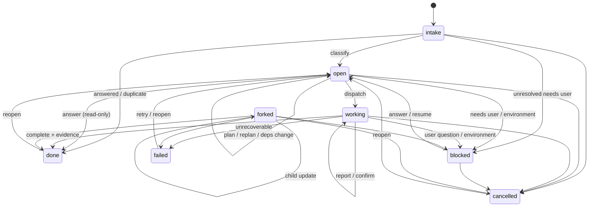

# Ticket 流转机制（草案）

> 目标设计，不替代根 DESIGN.md；DESIGN.md 的 5 条原则不变。本文只回答“一张 ticket 如何从请求走到终态”，不展开 Worker 契约、记忆和 Router 路由算法。

## 0. 结论

- **不新增状态。** 沿用现有 8 个状态：`intake` / `open` / `working` / `blocked` / `forked` / `done` / `failed` / `cancelled`。子阶段用 `waitingOn`、`lease`、`attempt` 表达，避免状态爆炸。
- **Router 是唯一写者。** Chat、Advisor、Worker、用户都只提交命令或意图；只有 Router 在事务里改状态、写事件、写 outbox。
- **一票一 executor，一票一活跃 lease。** 依赖是 DAG；派发幂等；同一就绪最多派发一次。
- **默认直管 worker。** 直管 worker 走结构化报告，Router 可自动推进；独立 worker 只投普通消息，Router 只观察，不自动替它收尾。
- **终态可重开，但不是自动重试。** `done` / `failed` / `cancelled` 是稳定终态；重开必须显式命令并记录原因。

## 1. 状态语义

| 状态 | 语义 | 典型 waitingOn | 是否可派发 | lease |
|---|---|---|---|---|
| `intake` | 请求已捕获，尚未定性 | `router` | 否 | 无 |
| `open` | 已受理，尚未执行 | `advisor` / `router` / `dependency` | 仅 Router 可派发 | 无 |
| `working` | 已有 executor，正在执行 | `worker` / `approval` | 否 | 有 |
| `blocked` | 无法推进，等外部条件 | `user` / `environment` | 否 | 无 |
| `forked` | 容器父票，等子票收敛 | `children` | 否 | 无 |
| `done` | 成功终态 | `none` | 否 | 无 |
| `failed` | 失败终态 | `none` | 否 | 无 |
| `cancelled` | 取消终态 | `none` | 否 | 无 |

`open` 不新增 `ready` 状态，用 `waitingOn` 区分三个子阶段：

- `open + waitingOn=advisor`：等 Advisor 澄清、拆解、定验收、产出 WorkOrder。
- `open + waitingOn=router`：已有合法 WorkOrder，进入待派发队列。
- `open + waitingOn=dependency`：依赖未完成，不能派发。

`working + waitingOn=approval` 是审批等待：审批是执行中的一次工具调用，不把票退回 `blocked`，避免打断 attempt 和 lease。`blocked + waitingOn=user` 才是“需要用户拍板”的停泊态。

## 2. 状态机



目标边（比现有实现更紧）：

```text
intake    -> open | blocked | done | cancelled
open      -> open | working | blocked | cancelled | forked | done
working   -> working | done | failed | blocked | cancelled
blocked   -> open | cancelled
forked    -> forked | done | failed | blocked | cancelled
done      -> open
failed    -> open
cancelled -> open
```

明确不允许：

- `intake -> working`。任何执行都必须先经过 `open` 和一次明确的 dispatch。
- `blocked -> working`。恢复统一走 `blocked -> open`，由 Router 重新派发；审批是例外，保持在 `working + waitingOn=approval`。
- 任何状态直接跳 `failed` / `done`，除非经过 `working`；例外是短问答票由 Advisor 只读核对后直接 `open -> done`（`ticket_answer`），以及 `intake -> done` 只允许“已回答/重复请求”这类非工作结论。
- 终态之间互跳。终态只能 `reopen` 回 `open`，再按正常流程走。

## 3. 命令与权限

所有命令都带 `commandId` 和 `expectedRevision`；重复命令返回第一次结果，不重复执行。

| 命令 | 提交者 | 状态变化 | 关键守卫 |
|---|---|---|---|
| `ticket.create` | Router（消费 Request） | 创建 `intake` | Request 未处理过；幂等键 `requestId` |
| `ticket.classify` | Router | `intake -> open` / `blocked` / `done` / `cancelled` | 归属可为 unassigned；工作票必须先 open |
| `ticket.plan` | Advisor | `open` 内更新 WorkOrder | 只有 `waitingOn=advisor` 可写；不得直接派发 |
| `ticket.answer` | Advisor | `open -> done` | 仅限短问答：只读、一次答复（`resolution.kind=answered`），不写 WorkOrder、不派 Worker；长调查必须走 WorkOrder |
| `ticket.dispatch` | Router | `open -> working` | 归属已落定、WorkOrder 合法、依赖完成、lease 可用、executor 健康 |
| `ticket.confirm` | Worker / Router | `working` 内确认 | attempt 匹配；60 秒内未确认转 blocked(environment) |
| `ticket.report` | Worker | `working` 内进度/心跳 | attempt 匹配；不能直接改终态 |
| `ticket.block` | Worker / Advisor / Router | `working/open -> blocked` | waitingOn + reason 必填；释放 lease |
| `ticket.resume` | Router | `blocked -> open` | 条件已满足；决定回 advisor 还是 router |
| `ticket.complete` | Worker 提议 / Router 落定 | `working -> done` | 证据、checklist、验收项；缺证据拒绝 |
| `ticket.fail` | Worker / Router | `working -> failed` | failure.code + message；可重试的走 retry |
| `ticket.cancel` | 用户 / Chat / Router | 任意非终态 -> `cancelled` | reason；释放 lease；尽力停止 worker |
| `ticket.retry` | Router | `failed -> open` | 未超过 maxAttempts；保留历史 attempt |
| `ticket.reassign` | Router | `working/blocked -> open` | 释放 lease；旧 worker 停止；新 executor 重新派发 |
| `ticket.reopen` | 用户 / Router | 终态 -> `open` | reason；revision+1；不自动重派 |
| `ticket.merge` | Router | source -> `done(merged)` | 依赖边迁移；merged done 不算依赖满足 |
| `ticket.comment` | 任意角色 | 不改状态 | 只写事件和附件 |

权限原则：

- Chat 只能提交 `create`、`cancel`，以及把用户回答作为 `ticket.resume` 的输入；不能直接改状态。
- Advisor 只能 `plan` 和请求 `block`，不能 dispatch，不能写 `done`。
- Worker 只能 `confirm` / `report` / 提议 `complete` / `fail` / `block`；不能改归属、预算、依赖。
- 用户保留取消、重开和叫停；直管 worker 的日常方向调整通过 Ria，不直接下指令。

## 4. 主流程

### 4.1 请求进入

1. Chat 先持久化 Request，再回执。
2. Router 消费 Request，创建 `intake` ticket；`waitingOn=router`。
3. 重复 Request、纯聊天、明显无关消息：`intake -> done`（resolution.kind=answered/duplicate）或 `cancelled`，不创建执行。

### 4.2 定性

Router 做确定性分类：

- 项目明确：`scope=project`，绑定 `projectId` / `workspaceId`，交 Project Advisor。
- 跨项目或全局：`scope=global`，交 Global Advisor。
- 归属不明：`scope=unassigned`，先交 Global Advisor 澄清；`unassigned` 可以 `open`，但永远不能 `dispatch`。
- 需要用户先决定：`blocked + waitingOn=user`，附 `attention`。

归属落定后写 `advisorId`；之后改归属视为重新规划，WorkOrder 作废，回到 `open + waitingOn=advisor`。

### 4.3 计划

**WorkOrder 是 plan of record，不是可选的建议。** 每张工单都必须经 Advisor 产出 WorkOrder 才能派发；Router 只接受挂在这张票上的 WorkOrder。**没有 Advisor 的 WorkOrder，工单不得进入 working**；Worker 按 WorkOrder 执行，不自行改方案，要改方案就回到 Advisor 重新规划。

Advisor 产出 WorkOrder，至少包含：

```text
goal            要达成什么
acceptance      可检查的验收项
constraints     不能做什么、权限边界、时间/预算
workspaceRef    Project 的 Workspace 根，或 Global 的 worker 根
deliverableDir  ria-runs/<workerId>/ 或 runs/<workerId>/
dependsOn       前置 ticket
risk            风险级别
budget          预算/次数上限
workerKind      建议 managed / independent
```

Router 只做结构校验：字段齐全、依赖无环、Workspace 存在、预算可用、归属已落定。Router 不判断方案好坏。

- 合法：`open + waitingOn=router`，进入待派发。
- 不合法：`open + waitingOn=advisor`，写 `planError` 事件，打回 Advisor。
- 需要用户：`blocked + waitingOn=user + attention`。

### 4.4 派发

Router 在**一个事务**里完成：

1. 校验 `status=open`、`waitingOn=router`、`revision`、依赖全部 `done`、归属不是 `unassigned`。
2. 选择 executor；默认 managed，独立 worker 只在显式指定时使用。
3. 获取 lease，创建 attempt，写 `ticket.dispatched` 事件和 outbox。
4. `open -> working`，`waitingOn=worker`。

事务提交后才发送。发送失败由 outbox 重试，不把状态回滚成 open；重复发送由 `ticketId:attemptSeq` 去重。

worker 在 60 秒内没有确认开始：`working -> blocked + waitingOn=environment`，通知用户/检查会话；不自动换 worker。

### 4.5 执行

- 直管 worker：按固定契约开工复述、里程碑报告；新指令会在步骤边界自动注入，无需轮询，问题走 `block` 或审批。直管 worker 默认 PTC，一个 `run_code` 是一个执行段；长任务必须拆段并报告，不能用一个长程序跨多个里程碑。
- 独立 worker：Router 只投普通消息，不注入契约；worker 不调用协作工具；Router 观察 session 活动和 idle 事件，**不因为 idle 自动 close**。
- 审批：`working + waitingOn=approval`，lease 保留；用户/Ria 决定后恢复 `waitingOn=worker`。审批超时按拒绝处理。

### 4.6 收口

- `complete`：worker 提交 done 报告 + 证据 + checklist；Router 校验后 `working -> done`。证据缺失、checklist 未完成且无 waiver，拒绝收口。
- `answer`：短问答票由 Advisor 只读核对后一次答复；`open -> done`，写 `resolution.kind=answered`（summary、answer、evidence、by），不产生 WorkOrder 与 Worker。需要长调查的需求不得走这条路径。
- `fail`：不可恢复错误、重试耗尽、预算耗尽、超时；`working -> failed`。
- `cancel`：用户叫停、需求撤销、重复/错误派发；任意非终态 -> `cancelled`；释放 lease，尽力停止 worker，不自动重试。
- `reopen`：验收不通过、结果被推翻、用户改需求；终态 -> `open`，revision+1，写原因，重新规划。

## 5. 派发、lease 与 attempt

### 5.1 attempt

每次 dispatch 创建一个 attempt：

```text
attemptId, seq, executor, executorKind, requestId, leaseId
dispatchedAt, confirmedAt, heartbeatAt, endedAt
outcome: running | done | failed | blocked | cancelled | replaced
```

- `attempt` 是当前 attempt，`attempts[]` 是历史。
- 换 executor、block 后重派、retry、reassign 都创建新 attempt；旧 attempt 只归档，不覆盖。
- 同一 attempt 的重复 report 按 `attemptId + reportId` 幂等丢弃。

### 5.2 lease

```text
leaseId, ticketId, attemptId, sessionId
state: active | released
acquiredAt, heartbeatAt, expiresAt
```

- 一票同时最多一个活跃 lease；一个 worker 同时最多一张 `working` 票。
- TTL 默认 15 分钟，可配置；worker 通过结构化 report 提供里程碑心跳，不靠轮询消费指令。
- lease 过期：`working -> blocked + waitingOn=environment`，释放 lease，通知 Ria；**不自动重派**，避免同一工作被执行两次。
- 长命令按里程碑拆段并 report；新指令在步骤边界自动注入，没有心跳的长任务不能靠 lease 猜活。

### 5.3 选择 executor

顺序：

1. 显式指定且健康、空闲、cwd 匹配的 worker。
2. 同 Workspace / 同 worker 根目录下，最近处理过该 Topic 的 idle managed worker。
3. 新建 managed worker（默认）。
4. 无可用 executor：`open + waitingOn=router` 排队，或 `blocked + waitingOn=environment`，向用户说明；不静默改派 independent。

## 6. 阻塞与恢复

`blocked` 必须同时有 `waitingOn` 和 `blockedReason`；需要用户决定时附 `attention {kind, question, options?}`。

| waitingOn | 含义 | 恢复路径 |
|---|---|---|
| `user` | 等用户回答/拍板 | 用户经 Chat 回答 -> `resume -> open`；需重规划则 `waitingOn=advisor`，否则 `waitingOn=router` |
| `environment` | 会话丢失、lease 过期、派发未确认、依赖数据损坏 | Ria/用户检查后 `resume -> open`；不自动重派 |

`dependency` 和 `approval` 不走 `blocked`：前者是 `open + waitingOn=dependency`，上游 done 后自动转 router；后者是 `working + waitingOn=approval`，审批结束恢复 worker。

依赖失败/取消：

- 默认 `open + waitingOn=dependency -> blocked + waitingOn=user`，发“依赖异常”通知，由用户决定取消、改依赖或重开上游。
- 不自动跳过依赖，不自动改写需求。

## 7. 完成、失败与重试

### done 的条件

- worker 报告 `done`，且 `attempt` 匹配；或研究类票由 Advisor 调 `ticket_answer` 直接答复（`resolution.kind=answered`，没有 attempt）。
- 有 `resolution`：worker 票含 summary、evidence、artifacts、completedAt；研究类票含 summary、answer、evidence、by。
- checklist 没有未完成项；若有，必须带 `waiver` 说明（研究类票没有 checklist）。
- Router 只校验结构和证据引用；质量判断由 Advisor/用户在看板或 reopen 时做。

### failed 的条件

- worker 报不可恢复错误。
- retry 次数达到 `maxAttempts`（默认 2，可配置）。
- 预算/时间硬上限。
- 依赖失败且用户选择终止。

### retry

- 只从 `failed` 或 `blocked(environment)` 触发，由 Router 执行。
- 新建 attempt，保留旧 attempt 和证据；`open + waitingOn=router`。
- 不重试 `cancelled`；不重试仍在运行的 worker；不重试没有新信息的同一失败。

## 8. 归属、Advisor 与依赖

- `scope` 三态：`unassigned` / `project` / `global`。
- `unassigned` 可以 `open` 让 Global Advisor 澄清，但不能 `dispatch`；派发前必须落定为 project 或 global。
- `project` 必须有 `projectId`；`global` 的 `projectId` 为空；不能靠空 projectId 猜归属。
- Project 票用 Project Advisor、项目预算、项目记忆；Global 票用 Global Advisor、全局预算、全局知识，不写项目记忆。
- 改归属只允许在 `intake/open`；进入 `working` 后改归属必须先 block/cancel，再 reopen。
- 依赖是 DAG，最多 8 个直接前置；拒绝自引用、环、`intake` 目标、重复边。
- 上游 `done` 才算满足；`merged done` 不算，依赖边应迁移到合并目标。
- 上游 `failed/cancelled` 默认阻断下游，交用户决定。

## 9. 两类 worker 在流转中的差异

| 环节 | 直管 worker | 独立 worker |
|---|---|---|
| 派发消息 | 固定 ticketBrief + 契约 | 普通用户消息，不注入契约 |
| 执行反馈 | `confirm/report/block/complete/fail` 结构化事件 | 无结构化工具；Router 观察 session 活动和 idle |
| 中途纠偏 | Ria 可 steer，worker 在下一步骤边界自动收到 | Ria 只读观察，建议给用户；用户直接指挥 |
| 完成判定 | worker 报 done + 证据，Router 校验 | Ria/用户确认后才 close；idle 不等于 done |
| 失败判定 | worker 报 fail 或 lease 过期 | Ria/用户判断；Router 不自动 fail |
| 默认 | 是 | 否，仅显式要求 |

独立 worker 的 ticket 仍然有状态和 lease，但 `lease` 只用于防重复派发和观察，不用于自动收口；idle 只产生观察事件，不产生终态。

## 10. 并发、幂等与恢复

- Router 单写者；每张票串行处理命令；`revision` 做乐观并发。
- 状态变更、事件、outbox 在同一事务；发送在提交后；outbox 至少一次、按幂等键去重。
- 同一就绪最多派发一次：`ticketId + attemptSeq + readyAt` 作为 dispatch 幂等键。
- 取消 vs 完成：先提交者赢；如果已完成，取消需要先 `reopen` 再 `cancel`，不能直接改终态。
- 重启恢复：
  - `working` 且 attempt 已确认：观察 worker，不重复派发。
  - `working` 且 attempt 未确认：`blocked + waitingOn=environment`。
  - `open/intake`：只报告，不自动 dispatch。
  - 自动恢复连续失败达到上限（现有 3 次）后 `blocked + waitingOn=user`。
- 旧数据兼容：旧 `waitingOn=ria` 读时映射到 `advisor/router`；旧 `blocked + waitingOn=approval` 读时映射到 `working + waitingOn=approval`；新写入不再产生这两种旧值。

## 11. 事件与持久化

事件类型：

```text
ticket.created        ticket.classified      ticket.planned
ticket.ready          ticket.dispatched      ticket.confirmed
ticket.reported       ticket.blocked         ticket.resumed
ticket.completed      ticket.failed          ticket.cancelled
ticket.retried        ticket.reassigned      ticket.reopened
ticket.merged         ticket.commented
```

事件字段：`eventId, ticketId, seq, type, actor, commandId, from, to, payload, at, revision`。事件只追加，状态快照同事务更新。

目标表：

```text
tickets          当前快照
ticket_events    追加事件
ticket_deps      依赖边
ticket_leases    活跃/历史 lease
ticket_attempts  每次派发
requests         入口请求
outbox           通知/派发/唤醒
```

索引：`(status, waitingOn)`、`projectId`、`executor`、`lease.expiresAt`、`dependsOn`。终态票归档到冷表/JSONL，热表只保留活跃和最近终态。

## 12. 看板映射

| 看板分组 | 过滤 |
|---|---|
| 需要你 | `blocked + waitingOn=user` 或 `working + waitingOn=approval` |
| 待派发 | `open + waitingOn=router` |
| 计划中 | `open + waitingOn=advisor` |
| 等依赖 | `open + waitingOn=dependency` |
| 进行中 | `working + waitingOn=worker` |
| 异常 | `blocked + waitingOn=environment`、`failed` |
| 最近完成 | `done` |

看板是只读投影；按钮只提交命令（cancel/reopen/retry/reassign），不直接改状态。直管卡没有输入框，独立卡可以打开会话。

## 13. 与现有实现的差异

现有 `lib/tickets.mjs` 已经有一套状态机，本文是目标态，不是现状描述。实现时需要收紧/调整：

1. 现有允许 `intake -> working`、`open -> open`、`blocked -> open` 等较宽边；目标增加 guard，并去掉 `intake -> working`。
2. 现有 `open` 默认 `waitingOn=ria`；目标拆成 `advisor/router/dependency`。
3. 现有审批用 `blocked + waitingOn=approval`；目标改为 `working + waitingOn=approval`，保留 attempt/lease。
4. 现有 `working` 的判断依赖 worker 是否有运行中的 turn；目标增加显式 lease/attempt，不把“session 在跑”当成唯一事实。
5. 现有 `executor=self` 仍保留兼容；新直管流程默认 executor 是 worker session，`self` 只用于旧数据和明确的 Ria 自处理。

## 14. 实施顺序

1. **纯状态机**：把上面的边、guard、invariant 写进 `tickets.mjs`，补单测；不接 worker。
2. **Router 命令层**：create/classify/plan/dispatch/resume/complete/cancel，事件 + outbox + revision。
3. **lease/attempt**：派发确认、心跳、过期、重启恢复；仍用现有 worker 通道。
4. **直管 worker 报告**：confirm/report/block/complete/fail 接入 ticket 状态。
5. **独立 worker 观察**：idle 只产生观察事件，不自动收口；看板投影。
6. **retry/reassign/reopen/merge**：补齐异常路径和审计。
7. **迁移**：旧 `ria` / `approval` 值读时映射；旧票不批量改写，按访问时惰性迁移。

---

本文只定义流转。Worker 契约、审批信封、Router 打分、知识写入规则分别见 `docs/design-v2.md` 和后续专题文档。根 `DESIGN.md` 未改。
