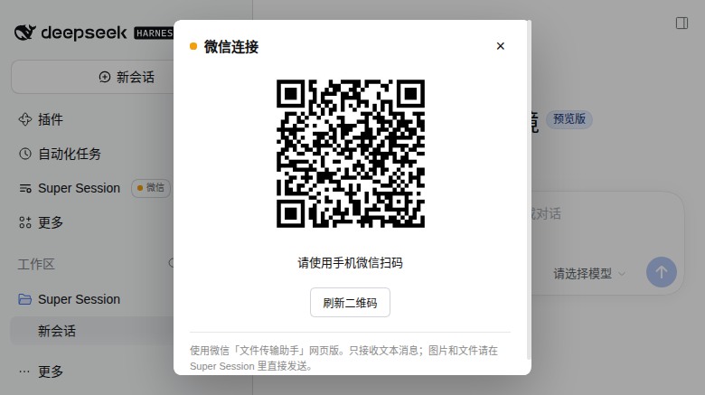

# 微信接入

Ria 入口标题右侧有一个“连接”chip。点开后默认打开上次使用的通道（首次为微信 tab），可以扫码登录微信「文件传输助手」网页版、查看连接状态和退出登录；同一个面板里还有微信 Claw 和 QQ 机器人两个通道，见 [channels.md](channels.md)。

- 微信客户端运行在 DSH 进程内，不启动 bridge 进程，不占端口。
- 扫码登录需要在弹层里完成一次，之后 DSH 重启会自动复用凭据。
- 凭据和去重/待发状态在 `DSH_HOME/state/ria/wechat/`，文件权限 0600。
- 微信发来的文本原样作为普通用户消息进入 Ria，不加前缀，也不直接进 worker。Ria 正在跑 turn 时，消息会以 `mode="steer"` 插入当前轮；Ria 空闲时才用 `mode="queue"` 起新 turn；steer 失败会自动用同一 requestId 回退一次 queue。这样手机上说的话能尽量并进当前处理，但也可能被 Ria 当成补充信息、回复时间取决于当前长任务。详见 [channels.md](channels.md#入站消息如何交给-ria)。
- Ria 的每条 assistant 文本回复都会同步回微信，统一以 🌊 前缀标记；暂停推送时除外。
- 带 note 的派发/转述成功后，note 也会作为一条普通微信文本推送（见 [派发 note 卡片与微信确认](operations.md#派发-note-卡片与微信确认)），发往当前活跃的微信侧通道（「文件传输助手」或微信 Claw），并受目标通道当时的暂停状态约束；一个通道暂停时会自动落到另一个可用通道。
- 入站支持文本、图片；微信 Claw 还支持文件。图片会下载原图、落盘并作为带附件（图片）的普通用户消息进入 Ria；Claw 文件会下载解密、落盘，并在消息里给出文件名、大小和绝对路径。原文字（如有）保留；下载/校验失败时仍投递文字并附失败原因。出站支持文本、本机图片；微信 Claw 和「文件传输助手」还支持用 `ria_send_file` 发送本机文件，「文件传输助手」的长回复还会自动转 .md。assistant 回复里的 Markdown 图片若指向本机存在的图片文件，会作为微信图片发出。详见下文“图片”“文件”两节。
- 出站长回复或复杂 Markdown 时，默认改发完整的 .md 文件；短消息和简单文本保持原样。
- DSH 重启后如有 creds 会自动重连；待发文本超过 10 条时只补发最后 10 条，并先提示跳过了多少条。
- chip 只在宽侧边栏显示；折叠侧边栏不插入。

## 暂停推送

暂停只关闭“Ria -> 微信”的出站推送：连接、登录态、长轮询和心跳保持，微信入站照常投递给 Ria。状态存在 `wechat/state.json`，DSH 重启后保持。

- 面板：已登录时 chip 弹层里有一张推送状态卡。正常显示“推送中”；暂停显示“已暂停推送”、来源（“手动”或“自动（触发暂停的通道消息）”）和暂停时间，旁边是“暂停推送 / 恢复推送”按钮。点击后立即用 POST 的返回值刷新，不等下一次轮询。
- 自动暂停开关：设置页的“自动暂停微信推送”（`wechatAutoPause`，默认开）控制是否在非微信通道消息到达时自动暂停；关闭后不自动暂停，也不改当前的 pausedBy/pauseReason。该开关只作用于微信「文件传输助手」通道；微信 Claw 与 QQ 通道仍按自己的“最后消息通道”规则暂停其他通道。来自微信 Claw 的消息也会暂停「文件传输助手」，但 `pauseReason` 记为“微信 Claw 通道消息”，不再笼统写成“非微信通道消息”。
- 自动暂停提示：弹层轮询或侧边栏轮询发现 paused 从 false 变为 true 且 pausedBy=channel 时，显示一条 8 秒自动消失的轻提示“已自动暂停微信推送：<pauseReason>”，不弹窗、不打断输入。chip 圆点同时变橙色。同时 Ria 通过副作用 outbox 往被暂停的通道自己发一条说明；「文件传输助手」被暂停时就发到文件传输助手自己，回一条微信消息即可恢复。
- 恢复时按真人消息锚点重放：恢复推送（手动或收到本通道消息自动恢复）时，Ria 读取 `ria.json` 里持久化的 `lastHumanMessageAt`——任意通道（网页、微信「文件传输助手」、微信 Claw、QQ）最后一条真人消息的时间。事件时间 `eventAt` 不晚于锚点的 outbox 通知直接标记 `delivered`，不发送，也不生成任何汇总横幅；晚于锚点的按 `eventAt` 升序重新排队，Ria 正文 `wechat_assistant_note` 与派发/审批卡片按原事件顺序交错补发，`dedupeKey` 继续去重。恢复时刻本身和单通道的 `lastInboundAt` 都不是锚点；旧版 `wechat_fold_notice` 一律静默标记送达，不再产生新的汇总。排队中的 `channel_file_send` 与内部 `dispatch_note` 不参与锚点静默/重排，仍按原重试逻辑补发。
- 手动：`POST /plugins/dsh-ria/api/wechat/pause`，body 为 `{"paused":true}` 或 `{"paused":false}`，可选 `reason`；`paused` 不是布尔值返回 400。三个通道统一的多通道接口见 [channels.md](channels.md#http-api)。
- 查询：`GET /wechat/status` 返回 `paused`、`pausedBy`、`pauseReason`、`pausedAt`、`resumedAt`、`resumedBy`、`wechatAutoPause`。`folded` 和 `lastFoldedAt` 仍作为旧字段返回，但当前恢复流程不再累加。
- 自动：Web/手机/QQ/其他非微信用户消息进入 Ria 时自动暂停（`pausedBy=channel`）；微信 Claw 入站也会暂停，但原因写“微信 Claw 通道消息”。微信「文件传输助手」入站自动恢复，包括恢复手动暂停；`wechatAutoPause=false` 时整个自动暂停分支跳过，Claw/QQ 自己的切换规则不受影响。
- 合成消息（`host_` 开头的启动恢复、启动失败、worker idle 唤醒）和官方 schedule 提醒不触发切换。
- 手动暂停优先：非微信消息的自动暂停不会覆盖 `pausedBy=manual`；手动恢复后，下一条非微信消息会再次暂停，这是预期行为。
- 正在发送的那一条会发完；还没开始发送的排队文本/文件丢弃。暂停期间不写微信内部 Outbound 队列（自动暂停提示是唯一例外：三个通道各自的暂停提示都允许在暂停态发出，且只发这一条），恢复后按重连积压策略补发。副作用 outbox 里的通知在恢复时按上面的“真人消息锚点”重放：锚点前的静默，锚点后的按事件时间补发，不再折叠成汇总。
- 自动暂停提示走副作用 outbox：仅在 channel 暂停真正转入时入队一次，dedupeKey 为 `channel:pausedAt`，重启不重复；允许在暂停态发出，但只限被暂停通道自己的一条提示，不放行后续推送；发送失败按 outbox 退避重试，最终失败只记日志；目标通道未连接、没有可回复的 peer 或手动暂停时不入队；投递时已恢复或 pausedAt 已变化则直接丢弃，deferred 不消耗 attempts。
- 丢弃会记 warn 日志：`dropped outbound while paused: {"at":...,"riaSessionId":...,"to":"filehelper","kind":"assistant|system|text|file","pausedBy":...,"reason":...}`，文本带 chars/preview，文件带 name/bytes。暂停和恢复各有一条 `pause:` / `resume:` info/warn 日志。

## 派发/审批 note 走哪个微信通道

`wechat_dispatch_note`、`wechat_approval_note` 只投给微信侧通道，不投 QQ；候选是「文件传输助手」和微信 Claw。旧版 `wechat_pause_notice` 仍按这个路由兼容老条目；新版 `channel_pause_notice` 不在这里路由，只发给被暂停的通道自己，包括 QQ。

1. 选择 `lastInboundAt` 最大的通道（最近一次收到该通道用户消息的时间）；时间相同时「文件传输助手」优先。这里的 `lastInboundAt` 只用于选择投递通道，不是恢复推送的锚点。
2. 首选通道暂停、未登录、或 Claw 还没有可回复的 `peer`/`context_token` 时返回 deferred，继续尝试下一个通道。
3. 两个通道都 deferred：outbox 条目保持 `pending`，`attempts` 和 `due` 都不变，由 30 秒 tick、startup 或后续 pump 再试；不丢条目，也不消耗 10s/1m/5m/15m/1h 的重试次数。
4. 某个通道真正发送报错：记一次失败；另一个通道成功则本条算送达，两个都失败才按退避重试。
5. 成功投递后标记 `delivered`，并记 info 日志 `WeChat <kind> note sent via wechat|wechat-claw`。

自动暂停提示不走同一路由：它只通过被暂停通道自己的 sendPauseNotice 发出。所以「文件传输助手」被 Claw 消息暂停时，这条提示发到文件传输助手自己，不会借道 Claw；QQ 也只在自己的 C2C 会话里收到。Claw 只能发文本 note，不会把 note 转成 .md，也不会附图片或文件。

## 长回复转 .md 文件

每条 assistant 文本回复都会先过规则；命中任意一项就发 .md 文件，否则直接发文本：

| 命中条件 | 默认值 |
|---|---|
| 字符数 | 超过 800 |
| 代码块 | 有围栏代码块（三个反引号或三个波浪线） |
| 表格 | 有 Markdown 表格 |
| 标题 | 4 个及以上 Markdown 标题 |
| 链接 | 6 个及以上 Markdown 链接 |

文件名形如 `ria-<会话短 id>-YYYYMMDD-HHmmss.md`，内容是完整回复，不截断。命中后先发一条短提示“（内容较长，已转为 Markdown 文件发送）”，再发文件，不重复正文；上传或发送文件失败时，回退为文本，并在正文前加“（原回复已转为 Markdown 文件，但文件发送失败，以下改为文本）”。

配置写在 profile 的 `cordis.yml` 里，覆盖插件行：

~~~yaml
- id: ria
  config:
    markdownFile:
      enabled: true
      charThreshold: 800
      codeBlock: true
      table: true
      headingCount: 4
      linkCount: 6
~~~

也可以直接写 `markdownFile: false` 关闭整套规则。环境变量优先级高于 profile 配置：`DSH_RIA_MD_FILE`、`DSH_RIA_MD_THRESHOLD`、`DSH_RIA_MD_CODE`、`DSH_RIA_MD_TABLE`、`DSH_RIA_MD_HEADINGS`、`DSH_RIA_MD_LINKS`。阈值会被限制在安全范围（80–100000 字符）。

## 图片

微信「文件传输助手」和微信 Claw 都支持图片双向收发。微信 Claw 固定开启；「文件传输助手」可以配置：

~~~yaml
- id: ria
  config:
    wechatImage:
      inbound: true
      outbound: true
~~~

- `wechatImage.inbound: false` 时，「文件传输助手」的图片消息只收到“目前只能接收文本消息”的提示，不下载、不落盘；文本消息不受影响。
- `wechatImage.outbound: false` 时，assistant 文本里的 Markdown 图片按原样当文本发送；文本、暂停、去重和 outbox 路径不受影响。
- 微信 Claw 的 `wechatClawImage.inbound` / `wechatClawImage.outbound` 只为兼容旧 profile 保留，始终按 true 处理；设置页没有 Claw 图片开关，PATCH 该字段也会被忽略。

下面先写「文件传输助手」，微信 Claw 的差异在最后一小节。

### 文件传输助手：出站

- 触发：Ria 的 assistant 文本里出现 ``，且 path 指向本机真实存在的图片文件时，该图片会作为微信图片发出；不扫描围栏代码块里的示例。
- 路径：绝对路径，或相对 Ria 状态目录（`DSH_HOME/state/ria`）与 dsh 进程当前目录；`file://` 等带 scheme 的地址不处理。
- 类型和大小：按文件头识别 PNG、JPEG、GIF、WebP，大小上限 20 MB；文件不存在、不是图片或超过上限时保留原 Markdown 文本，整条回复照常发送，不会失败。
- 顺序与失败：先发文本（图片语法从文本里去掉），再逐张发图片。某张图片发送失败只记 warn，不影响已经发出的文本和其他图片；暂停推送时按普通出站规则丢弃。
- 协议：与 .md 文件共用同一条串行限速队列；上传用 `mediatype=pic`、`MediaType=3`，发送用 `webwxsendmsgimg` 的 `Msg.Type=3`，返回的 MsgID 加入去重集合。`Outbound.enqueueImage()` 仍接受 `{ name, buffer, mime, ref }`，失败会 reject，调用方可重试。

### 文件传输助手：入站

- 触发：`InboundBridge` 用 `MsgType=3` 识别图片消息，进入 `deliverImageFromWechat`。图片消息的 `Content` 是 `` 元数据（`MsgId`、`mediaid`、`encryfilename` 等），不是正文；Ria 收到的文字来自这个字段里可读的原文字，没有文字时用“（用户发来一张图片）”占位。
- 下载：`WebWxClient.downloadImage` 复用当前登录的 Cookie、`skey`、`sid` 和 `pass_ticket`。先请求 `GET /cgi-bin/mmwebwx-bin/webwxgetmsgimg?MsgID=<MsgID>&skey=<skey>&mmweb_appid=<appid>`（不带 `type`，取原图）；失败后再试文件域名，并用 `` 里的 `mediaid`/`encryfilename` 走 `webwxgetmedia`（`sender`、`fromuser`、`pass_ticket`、`webwx_data_ticket`、`sid`）。任一请求返回 JSON/文本、HTTP 非 2xx、空响应或超过大小上限都会明确报错并进入降级。
- 校验：先按文件头识别 PNG、JPEG、GIF、WebP；空文件、超过上限（20 MB，且不超过宿主 `attachments.imageLimits.maxImageBytes`）、未知类型都拒绝。上限按两者的较小值执行。
- 落盘：成功保存到 `DSH_HOME/state/ria/wechat-inbound/`，文件名 `YYYYMMDD-HHMMSS-<MsgID>.<ext>`，同名冲突追加 `-2`、`-3`；目录 0700、文件 0600。文本里附一行绝对路径“（图片已保存：<path>）”，之后在 `ria_request` 的 `attachments` 里可以直接引用这个路径转给 worker。
- 投递：作为一条普通用户消息投给 Ria，内容是原文字（或占位）加 `{ type: 'image', mediaType, data }` 内容块；投递前用宿主的 attachment 校验（`validateImageBatch`/`validateImage`），保持与 `ria_request` 相同的限制。纯图片、带文字图片都保留用户原话。
- 清理：每次成功落盘后顺手清理该目录，删除超过 30 天的文件，并只保留最近 500 个（按 mtime，至少保留 1 个）；清理失败只记 warn，不影响本条消息。当前没有单独的保留天数/数量配置项。
- 失败降级：下载失败、空文件、超限、类型不支持、附件校验失败或携带图片投递失败时，都不会静默丢消息；Ria 仍会收到原文字（或占位）加一行 `[图片接收失败：<原因>]`，日志记 `[wx inbound] image <id> rejected (<code>): <reason>`。
- 协议备注：官方网页版对图片原图使用 `webwxgetmsgimg`，`type=slave` 才是缩略图；`webwxgetmedia` 用于文件/媒体，需要 `mediaid` 和加密文件名。入站图片不做 OCR、不转存微信 CDN URL，也不绕过宿主的附件大小限制。

### 微信 Claw

- 触发：`getupdates` 返回的 `item_list` 里 `type=2` 的 `image_item`；同一消息可以同时有文本和图片。入站开关关闭时纯图片仍回“目前只能接收文本消息。”。
- 下载与解密：优先 `media.full_url`，否则用 `encrypted_query_param` 拼 CDN 下载地址；`aeskey`（32 位 hex）优先于 `media.aes_key`，按 AES-128-ECB + PKCS#7 解密。CDN 下载不带 bot token，也不带额外 header。
- 落盘：`DSH_HOME/state/ria/wechat-claw-inbound/YYYYMMDD-HHMMSS-<msgid>.<ext>`，目录 0700、文件 0600，重名追加 `-2`；同样保留 30 天、最多 500 个。
- 投递：原文字（纯图用占位）加每张图的“（图片已保存：<path>）”和 `{ type: 'image', mediaType, data }`；投递前走宿主 `validateImageBatch`/`validateImage`。
- 失败：下载、解密、超限、格式或附件校验失败都保留文字并追加 `[图片接收失败：<原因>]`；日志是 `[claw inbound] image <id> rejected (<code>): <reason>`。
- 出站：`` 指向本机图片时，先 `getuploadurl`（`media_type=1`）拿上传地址，AES-128-ECB 加密后 POST 到 CDN，成功以响应头 `x-encrypted-param` 为准，再发 `type=2` 的 `image_item`；一条消息一张图，caption 作为单独文本先发。
- 出站密钥编码：`image_item.media.aes_key` 必须是 `base64(<32 位 hex 字符串>)`（44 字符），不是 `base64(<16 字节裸密钥>)`（24 字符）。后者能发出、返回 `ret=0`，但客户端解不开：缩略图是黑的，点开提示“图片已过期或被清理”。2026-11-14 真实账号实测，与 `Tencent/openclaw-weixin` 的 `src/messaging/send.ts` 一致；入站解码两种形式都接受。
- 出站失败：单张图失败只回退一条可见文本“图片 <name> 发送失败，请在 Ria 会话中查看原图”，不吞整条回复；围栏代码块不发送；暂停时图片和文本一样不发。
- 协议来源：腾讯公开的 `Tencent/openclaw-weixin` 客户端实现（`docs/protocol.md`、`src/api/types.ts`、`src/messaging/send.ts`、`src/cdn/upload.ts`、`src/media/media-download.ts`）。

## 文件

文件能力分入站和出站两部分。入站只有微信 Claw 实现；出站三个通道都可以通过 `ria_send_file` 发送本机文件。

### 入站（仅微信 Claw）

- `getupdates` 的 `item_list` 里出现 `type=4` 的 `file_item` 时，下载 `media` 指向的 CDN 文件，按 `aes_key` 做 AES-128-ECB + PKCS#7 解密，再按文件头/扩展名校验。
- 保存到 `DSH_HOME/state/ria/wechat-claw-inbound-files/`，文件名带时间戳、消息 id 和清洗后的原名；目录 0700、文件 0600，不覆盖已有文件，保留 30 天或最多 500 个。
- Ria 收到的是普通用户消息：原文字（纯文件用“（用户发来一个文件）”占位）加 `📎 文件：<name>（<size>）` 和 `路径：<absolute path>`。宿主目前没有可直接构造的 file part，所以用这三项文本引用，后续 `ria_request`、`ria_read` 或其它工具可以直接使用绝对路径。
- 上限默认 20 MB，可配置：

  ~~~yaml
  - id: ria
    config:
      channels:
        wechat-claw:
          files:
            enabled: true
            maxBytes: 20971520
  ~~~

  上限最高 100 MB；`enabled: false` 时纯文件只回“目前文件接收已关闭。”。
- 扩展名 allowlist：pdf、doc/docx、xls/xlsx、ppt/pptx、zip/gz/tar/7z/rar、txt、md、csv、json、html、xml、yml/yaml、log、png/jpg/jpeg/gif/webp、svg。其它类型回“不支持的文件类型：<ext>”，不落盘。
- 下载失败、解密失败、超限或类型不支持都不会丢整条消息：Ria 仍收到原文字并追加 `[文件接收失败：<原因>]`。
- 微信「文件传输助手」和 QQ 的入站文件尚未实现，收到文件只会回文本提示。

### 出站（三个通道）

在 Ria 会话里调用 `ria_send_file({ path, note? })`。`path` 必须是绝对路径，经 `realpath` 解析后必须是普通文件、非空、扩展名在 allowlist 内，且不超过该通道上限（默认 20 MB）。

- 通道选择：最近一次给 Ria 发过消息、且有可回复目标的通道，优先级按入站时间；没有目标返回 `no_target`。
- 暂停推送：不发送，把 `channel_file_send` 放进 outbox，返回 `queued=true`；恢复后自动重试。暂停、没有 peer 时 deferred 不消耗重试次数；超过 24 小时仍未连接会转 failed。
- 微信 Claw：`getuploadurl` 的 `media_type=3` 上传到 CDN，再发 `type=4` 的 `file_item`；AES 加密、字段和 `aes_key` 编码见 [channels.md](channels.md#文件)。
- 微信「文件传输助手」：走网页版 `sendFile`（appmsg 文件消息）。
- QQ 机器人：走官方 SDK 的 `sendFile`，仅在 C2C/群聊已有回复目标时发送。
- 失败不会静默：通道状态的 `lastFileSend` 记录 `delivered`、`name`、`bytes`、`path`，失败时还有 `code`/`error`，Claw 另带 `ret`/`errmsg`。`note` 会在文件送达后作为一条 `📎 <note>` 文本发送，失败只写 `noteError`，不影响文件已送达。
