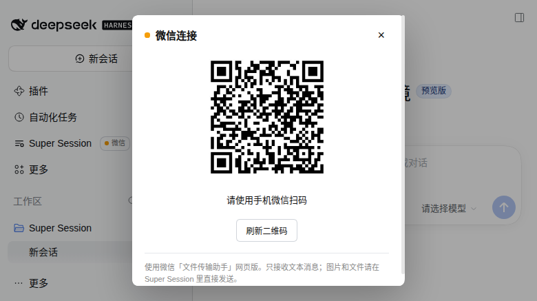

# 微信接入

Ria 入口标题右侧有一个“微信”chip。点开后可以扫码登录微信「文件传输助手」网页版、查看连接状态和退出登录。

- 微信客户端运行在 DSH 进程内，不启动 bridge 进程，不占端口。
- 扫码登录需要在弹层里完成一次，之后 DSH 重启会自动复用凭据。
- 凭据和去重/待发状态在 `DSH_HOME/state/ria/wechat/`，文件权限 0600。
- 微信发来的文本原样作为普通用户消息进入 Ria，不加前缀，也不直接进 worker。
- Ria 的每条 assistant 文本回复都会同步回微信，统一以 🌊 前缀标记；暂停推送时除外。
- 带 note 的派发/转述成功后，note 也会作为一条普通微信文本推送（见 [派发 note 卡片与微信确认](operations.md#派发-note-卡片与微信确认)），同样受暂停开关约束。
- 入站只投递文本（入站图片仍预留）；出站支持文本、.md 文件与本机图片：assistant 回复里的 Markdown 图片若指向本机存在的图片文件，会作为微信图片发出，见下文“图片”一节。
- 出站长回复或复杂 Markdown 时，默认改发完整的 .md 文件；短消息和简单文本保持原样。
- DSH 重启后如有 creds 会自动重连；待发文本超过 10 条时只补发最后 10 条，并先提示跳过了多少条。
- chip 只在宽侧边栏显示；折叠侧边栏不插入。

## 暂停推送

暂停只关闭“Ria -> 微信”的出站推送：连接、登录态、长轮询和心跳保持，微信入站照常投递给 Ria。状态存在 `wechat/state.json`，DSH 重启后保持。

- 面板：已登录时 chip 弹层里有一张推送状态卡。正常显示“推送中”；暂停显示“已暂停推送”、来源（“手动”或“自动（非微信通道消息）”）和暂停时间，旁边是“暂停推送 / 恢复推送”按钮。点击后立即用 POST 的返回值刷新，不等下一次轮询。
- 自动暂停提示：弹层轮询或侧边栏轮询发现 paused 从 false 变为 true 且 pausedBy=channel 时，显示一条 8 秒自动消失的轻提示“已自动暂停推送：检测到非微信通道消息”，不弹窗、不打断输入。chip 圆点同时变橙色。
- 手动：`POST /plugins/dsh-ria/api/wechat/pause`，body 为 `{"paused":true}` 或 `{"paused":false}`，可选 `reason`；`paused` 不是布尔值返回 400。
- 查询：`GET /wechat/status` 返回 `paused`、`pausedBy`、`pauseReason`、`pausedAt`、`resumedAt`、`resumedBy`。
- 自动：Web/手机等非微信用户消息进入 Ria 时自动暂停（`pausedBy=channel`）；微信入站自动恢复，包括恢复手动暂停。
- 合成消息（`host_` 开头的启动恢复、启动失败、worker idle 唤醒）和官方 schedule 提醒不触发切换。
- 手动暂停优先：非微信消息的自动暂停不会覆盖 `pausedBy=manual`；手动恢复后，下一条非微信消息会再次暂停，这是预期行为。
- 正在发送的那一条会发完；还没开始发送的排队文本/文件丢弃。暂停期间不写微信内部 Outbound 队列，恢复后按重连积压策略补发。
- 丢弃会记 warn 日志：`dropped outbound while paused: {"at":...,"riaSessionId":...,"to":"filehelper","kind":"assistant|system|text|file","pausedBy":...,"reason":...}`，文本带 chars/preview，文件带 name/bytes。暂停和恢复各有一条 `pause:` / `resume:` info/warn 日志。

## 长回复转 .md 文件

每条 assistant 文本回复都会先过规则；命中任意一项就发 .md 文件，否则直接发文本：

| 命中条件 | 默认值 |
|---|---|
| 字符数 | 超过 800 |
| 代码块 | 有围栏代码块（三个反引号或三个波浪线） |
| 表格 | 有 Markdown 表格 |
| 标题 | 4 个及以上 Markdown 标题 |
| 链接 | 6 个及以上 Markdown 链接 |

文件名形如 `ria-<会话短 id>-YYYYMMDD-HHmmss.md`，内容是完整回复，不截断。命中后先发一条短提示“（内容较长，已转为 Markdown 文件发送）”，再发文件，不重复正文；上传或发送文件失败时，回退为文本，并在正文前加“（原回复已转为 Markdown 文件，但文件发送失败，以下改为文本）”。

配置写在 profile 的 `cordis.yml` 里，覆盖插件行：

~~~yaml
- id: ria
  config:
    markdownFile:
      enabled: true
      charThreshold: 800
      codeBlock: true
      table: true
      headingCount: 4
      linkCount: 6
~~~

也可以直接写 `markdownFile: false` 关闭整套规则。环境变量优先级高于 profile 配置：`DSH_RIA_MD_FILE`、`DSH_RIA_MD_THRESHOLD`、`DSH_RIA_MD_CODE`、`DSH_RIA_MD_TABLE`、`DSH_RIA_MD_HEADINGS`、`DSH_RIA_MD_LINKS`。阈值会被限制在安全范围（80–100000 字符）。

## 图片（出站已实现，入站预留）

出站图片默认开启，入站图片仍默认关闭：

~~~yaml
- id: ria
  config:
    wechatImage:
      inbound: false
      outbound: true
~~~

- 触发：Ria 的 assistant 文本里出现 ``，且 path 指向本机真实存在的图片文件时，该图片会作为微信图片发出；不扫描围栏代码块里的示例。
- 路径：绝对路径，或相对 Ria 状态目录（`DSH_HOME/state/ria`）与 dsh 进程当前目录；`file://` 等带 scheme 的地址不处理。
- 类型和大小：按文件头识别 PNG、JPEG、GIF、WebP，大小上限 20 MB；文件不存在、不是图片或超过上限时保留原 Markdown 文本，整条回复照常发送，不会失败。
- 顺序与失败：先发文本（图片语法从文本里去掉），再逐张发图片。某张图片发送失败只记 warn，不影响已经发出的文本和其他图片；暂停推送时按普通出站规则丢弃。
- 协议：与 .md 文件共用同一条串行限速队列；上传用 `mediatype=pic`、`MediaType=3`，发送用 `webwxsendmsgimg` 的 `Msg.Type=3`，返回的 MsgID 加入去重集合。`Outbound.enqueueImage()` 仍接受 `{ name, buffer, mime, ref }`，失败会 reject，调用方可重试。
- 入站：`InboundBridge` 能识别 MsgType 3，但 `imagePartFromMessage` 仍是预留签名（解析 ``、下载原图、转 DSH 图片内容块）；当前明确报 “reserved but not implemented”，不会投递半成品。
- `outbound: false` 时保留原来的纯文本行为；文本、.md 文件、暂停、去重和 outbox 路径不受影响。
